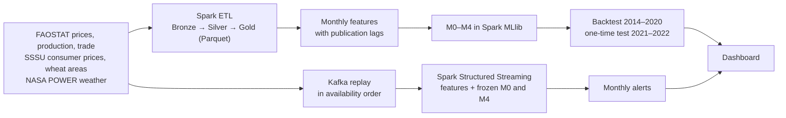

# FoodShield: early warning of wheat price stress

FoodShield tests whether combining price, weather, production and trade signals warns of wheat price stress earlier or better than watching prices alone. It is built on Apache Spark for batch processing, and on Apache Kafka with Spark Structured Streaming for a live alerting path. The pilot country is Ukraine.

Course project for DA 231o, Data Engineering at Scale (IISc).

## What it does

- **Question:** does adding weather, production and trade data improve early warnings of wheat price stress over a price-only baseline?
- **Stress:** a month is a stress month if the real (inflation-adjusted) farm-gate wheat price rises at least 10% within the next three months.
- **Models:** five logistic-regression models in Spark MLlib, each adding one group of signals:

  | Model | Inputs |
  |---|---|
  | M0 | Price only (change last month; price vs its 12-month normal) |
  | M1 | M0 + weather (rainfall and temperature vs normal for the month) |
  | M2 | M1 + production (production, yield, harvested area) |
  | M3 | M2 + trade (import and export volumes and values) |
  | M4 | M3 + a price × rainfall interaction |

- **Evaluation:** a rolling backtest over 2014–2020, then a one-time test on 2021–2022 with all settings fixed beforehand.
- **Streaming:** the same data replayed through Kafka in the order it would have become available; Spark Structured Streaming builds the features, scores each month and raises alerts.
- **Dashboard:** one offline HTML page to explore the results, change settings, and follow a replay live.



## Results at a glance

- **Backtest 2014–2020:** price-only M0 scored F1 0.57; the models with extra signals scored 0.42–0.44.
- **Test 2021–2022:** M4 scored F1 0.62 against M0's 0.43, with half the false alarms.
- **Reading:** the two disagree, and 11 stress episodes are too few to settle whether the extra signals help.
- **Engineering:** Spark processes the full FAOSTAT archives (22.7 million rows) and scales to 186 million rows in 43 s on 2 cores. The streaming path meets its targets (100 and 250 events/s, 95% of alerts within 2.9 s and 3.1 s on a 16-core Windows laptop), processes every unique record once, and gives exactly the batch answers.

Details: `docs/FINAL_TEST_RESULTS.md`, `docs/WEEK7_MODEL_EVALUATION.md`, `docs/WEEK7_SCALABILITY.md`.

## Quick start

1. **See the results:** open `docs/dashboard/index.html` in any browser. It works offline.
2. **Run the checks:** `python -m unittest discover -s tests -v` (about 1–2 minutes).
3. **Run the live demo (Windows):** double-click `RUN_DEMO_LIVE.bat`. It opens the dashboard on its Streaming tab and runs a 3-minute Kafka replay of 2022; each stress alert pops up as Spark raises it.

## Requirements

- Python 3.11 or later and Java 17 or later, then `pip install -r requirements.txt` (PySpark 4.3.0, kafka-python 3.0.13).
- **Windows:** Spark also needs the Hadoop 3.5.0 native files (`winutils.exe`, `hadoop.dll`) in the `bin` folder of the directory that `HADOOP_HOME` points to. See `docs/PREREQUISITES.md`.
- **Streaming:** Apache Kafka 4.4.0 and the Spark–Kafka connector files in a `Kafka/` folder. See `docs/WEEK6_STREAMING.md`.
- **One-click Windows setup:** `RUN_LAPTOP_STEPS.bat` checks Java, Hadoop and Python, installs the packages, runs the tests and the streaming runs, and rebuilds the results.

### Machine settings (Windows scripts)

The `.bat` and `.ps1` scripts name no folder on any particular machine. `scripts\foodshield_env.ps1` finds what they need, and each item can be set explicitly with an environment variable:

| Setting | Found automatically from | Set it explicitly with |
|---|---|---|
| Python 3.11+ | the project's `.venv`, then the `py` launcher, then `python` on `PATH` | `FOODSHIELD_PYTHON` (e.g. `py -3.12` or a path to `python.exe`) |
| Java 17+ | `JAVA_HOME`, then `java` on `PATH`, then JDKs under `%ProgramFiles%` | `JAVA_HOME` |
| Hadoop native files | `HADOOP_HOME` (this window, then user and machine settings) | `HADOOP_HOME` |
| Work folder for Kafka data and Spark checkpoints (short, no spaces) | `fs6` on the system drive | `FOODSHIELD_WORK_ROOT` |

## Running the pipeline

Run every command from the repository folder. Inputs that are not in Git can be downloaded again from the URLs, with the SHA-256 hashes, listed in `docs/DATA_SOURCE_REGISTER.md`. On Linux or macOS use `python3` and `/` in paths.

**1. Batch pipeline: ETL, features and models**

```powershell
python scripts\run_week2_etl.py                                # sources → Bronze/Silver/Gold Parquet
python scripts\run_week3_features.py --config configs\week3.real.local.json
python scripts\run_week4_rolling_origin.py                     # M0 rolling backtest
python scripts\run_week5_ablation.py                           # M0–M4 on identical months
python scripts\run_week5_ablation.py --annual-lag 3 --output data\processed\week5_ablation_lag3   # 3-year publication lag check
python scripts\run_final_test_once.py --dry-run                # the real test has been opened once and cannot be rerun
```

**2. Data at full size**

```powershell
python scripts\run_d9a_faostat_bulk.py                         # full FAOSTAT archives; needs them in data\raw\faostat_bulk
python scripts\run_d9b_grid_weather.py                         # 232-cell gridded weather; needs data\raw\nasa_power_grid\*.csv
```

**3. Streaming replay**

One command starts Kafka, creates the topics, runs the Spark consumer and the producer, checks the results and writes a report:

```powershell
python scripts\run_week6_replay.py --name demo --work-root <work folder> --replay-from 2016-01-01 --measure-from 2022-01-01 --rate 1000
```

- `--work-root` is a short folder without spaces for Kafka data and Spark checkpoints (the Windows scripts use `FOODSHIELD_WORK_ROOT`, by default `fs6` on the system drive).
- `--rate` sets events per second (`max` for full speed).
- `--measure-from` sets where the paced, measured part starts.
- The report is written to `data\processed\week6_streaming\<name>\week6_report.json`.
- Every run checks itself: duplicates removed, every unique record processed once, streamed alerts equal to an offline replay, and M0 equal to the one-time test.
- On Windows, `powershell -ExecutionPolicy Bypass -File scripts\week6_laptop.ps1` runs the full set of reported runs, and `python scripts\apply_laptop_results.py` summarises them.

**4. Evaluation and scalability**

```powershell
python scripts\run_week7_model_evaluation.py                   # lead times, threshold trade-off, probability quality
python scripts\run_week7_data_quality.py                       # data-quality and timing tests
python scripts\run_week7_batch_scaling.py --phase all          # batch scaling series (about 1 hour); plots in docs\figures
python scripts\run_week5_ablation.py --rise-pct 5 --horizon 3 --variants corrected --output data\processed\week7_label_sensitivity\rise5_h3   # other stress definitions
python scripts\run_week6_replay.py --name s7_rate_2000 --replay-from 2016-01-01 --measure-from 2022-01-01 --rate 2000   # one streaming series run
python scripts\plot_week7_streaming.py
```

**5. Dashboard**

```powershell
python scripts\export_week8_dashboard_features.py              # once: monthly model inputs for the "What if?" tab (needs Spark)
python scripts\build_week8_dashboard.py                        # rebuilds docs\dashboard\index.html from the saved results
python scripts\serve_dashboard.py --work-root <work folder>     # the same page plus the live view of a running replay
```

## Using the dashboard

| Tab | What you can do |
|---|---|
| Overview | Headline numbers, price history with stress months and alerts, M0–M4 results, each episode and its warning time |
| Explorer | Compare any two models; change the period, stress definition, publication lag and alert cutoff. Results are recalculated from the saved scores; the defaults show the reported results |
| What if? | Pick a month, move its inputs (price change, rainfall, production, imports) and see how the frozen models react |
| Streaming | Play back a recorded replay month by month, or follow a running one live with an on-screen pop-up for each alert |
| Scale | Batch runtime and throughput by workload size; CSV vs Parquet query times |

Live mode needs the page to be opened through `serve_dashboard.py` (or `RUN_DEMO_LIVE.bat`); opened as a file, the page shows the saved results only.

## Repository layout

| Path | Contents |
|---|---|
| `configs/` | One JSON config per run; `week5_frozen_protocol.json` fixes the settings of the one-time test |
| `src/foodshield/` | `etl/`, `features/`, `models/`, `evaluation/`, `streaming/` |
| `scripts/` | One entry point per step (see above) |
| `tests/` | `unittest` checks: fast unit tests plus slower integration tests on real inputs |
| `data/raw/`, `data/processed/` | Inputs and outputs. Only small, documented files are in Git; large downloads stay local |
| `docs/` | Design, data sources, method and results write-ups, figures, dashboard |

More detail on the design: `docs/PROJECT_BRIEF.md` (scope), `docs/ARCHITECTURE.md` (pipeline and evaluation design), `docs/WEEK6_STREAMING.md` (streaming design).

## Data and licences

| Data | Source | Terms |
|---|---|---|
| Wheat producer prices, production, trade | FAOSTAT (FAO) | CC BY 4.0 with attribution; FAO notes possible third-party exceptions |
| Consumer price index, regional wheat area | State Statistics Service of Ukraine (SSSU) | Free use and redistribution of official statistics, naming SSSU (Law 2524-IX, Art. 27) |
| Daily weather | NASA POWER Daily API | Public API; acknowledge NASA POWER as the source |
| Region centroids | geoBoundaries gbOpen (UKR ADM1) | Open boundary data; cite geoBoundaries |

Sources and hashes: `docs/DATA_SOURCE_REGISTER.md`. Synthetic data appears only in labelled demos and scaling benchmarks (`docs/SYNTHETIC_DATA.md`).

## Team

Bharath Kumar, Abhijith C R, Jyoti Prakash Das, Naman Singh Shekhawat.
