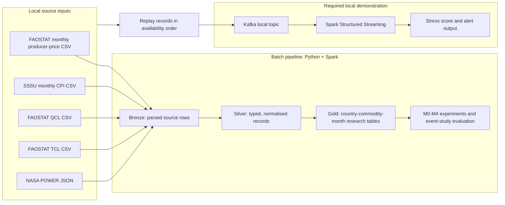
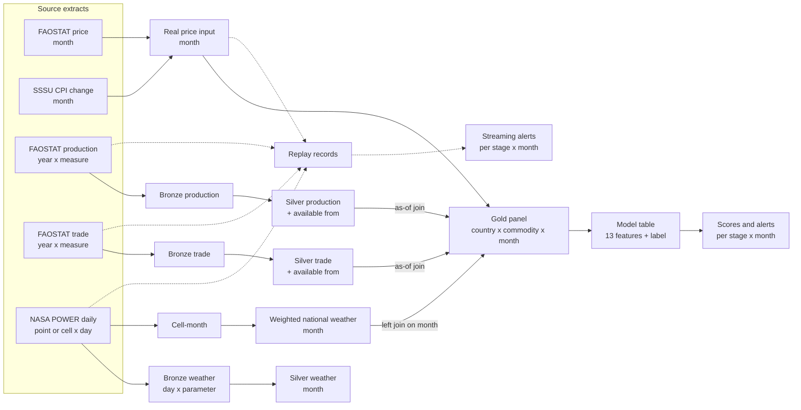

# 3. Architecture, pipeline and setup

How FoodShield is built: design principles, the batch and streaming architecture with its data contracts, the Week 2 ETL and Week 3 features, the streaming contract, the repository layout, software setup, and the data model (§3.9). Every processing step is walked through with code in [`8_PIPELINE_WALKTHROUGH.md`](8_PIPELINE_WALKTHROUGH.md). Data sources are in [`2_DATA.md`](2_DATA.md); models and results in [`4_MODELS_AND_RESULTS.md`](4_MODELS_AND_RESULTS.md); streaming runs in [`5_STREAMING.md`](5_STREAMING.md); decisions D1–D15 in [`7_DECISIONS.md`](7_DECISIONS.md).

**Scope:** the research experiment is wheat-only, with Ukraine as the pilot; the analysis grain is country–commodity–month, with the M0–M4 progression and the required local Kafka replay through Spark Structured Streaming. The implementation is configuration-driven, so a separately profiled country or commodity can reuse the pipeline without changing transformation or model code where source schemas and meanings are compatible. This reusable design does not claim data availability or expand the experiment beyond wheat.

## 3.1 Design principles

- Use Python and Apache Spark DataFrames/Spark SQL for repeatable batch transformations; store normalised layers as Parquet.
- Keep source files immutable in `data/raw/`; explicitly reviewed, attributed small snapshots may be versioned. Ignore other raw acquisitions and generated outputs under `data/processed/`, except outputs explicitly allowlisted with provenance for team reuse.
- Keep development-only synthetic inputs under `data/synthetic/` (only named fixtures are versioned), mark every row as synthetic, and exclude them from reported model and evaluation results (D7).
- Keep schemas, units, identifiers, grain, and temporal availability explicit. Retain source flags and notes. Do not turn missing values into zero.
- Keep the pipeline configurable by country, item code, source IDs and paths, while requiring a separate feasibility profile before changing from the Ukraine wheat pilot.
- Keep annual data availability separate from its reference year. The two-year lag (D6) is a declared proxy, not a verified publication vintage.
- Do not present a single weather point as representative weather, or proposal event examples as country-level binary labels.
- Keep raw FPMA/APK-Inform values local and do not redistribute or reproduce them in public outputs until reuse rights are confirmed.
- Design bounded local runs and tune parallelism and memory to the host. No cloud services or paid resources are in scope.

## 3.2 Architecture and data contracts



The batch path is the analytical foundation. Kafka replay is a separate demonstration that reads historical records; it is not a live-feed service and does not replace batch validation (§3.5). The local FPMA/APK-Inform series is an optional controlled comparator, not a shared input.

### Data layers

| Layer | Purpose | Contract |
|---|---|---|
| `data/raw/` | Original retrieved source responses and archives, and explicitly approved pinned snapshots. | Preserve unchanged. Keep unreviewed or restricted acquisitions local and ignored; allowlist only documented snapshots with reuse terms and attribution reviewed. Record canonical source, request and filter, retrieval, checksum and limitations in the download register ([`2_DATA.md`](2_DATA.md) §2.5). |
| Bronze | Source-specific rows flattened to tabular form. | Preserve source identifiers, units, flags, notes, original frequency, and a source-file key. No model assumptions here. |
| Silver | Typed, normalised signal rows ready for alignment. | Canonical country, commodity, unit, date/year and element fields; annual availability dates, weather location and method, and quality flags explicit. |
| Gold | Analysis-grain datasets and features. | Keyed by country–commodity–month; M0–M4 signals joinable, with missingness and coverage visible. Do not create target labels from the same signal being evaluated. |
| Artifacts | Profiles, evaluation summaries, charts and reports. | Separate from raw data and source code; targets kept distinct from measured results; reproducibility metadata included. |

### Data cleaning and normalisation rules

Cleaning rules are applied in Spark DataFrame/Spark SQL transformations, with source-specific rules recorded in the dataset contract:

- Preserve raw inputs. In derived tables, distinguish invalid keys from missing measurements; record rejected-row counts and reasons rather than silently dropping rows.
- Reject null or whitespace-only required identifiers and invalid dates. Trim identifiers and codes for matching, but retain original source fields when their exact spelling is useful for provenance.
- Keep missing measurements null. Convert sentinels only when the source defines them (NASA POWER `-999` is excluded from the silver weather table); never replace absent wheat values with zero.
- Define numeric validity checks by source, measure and unit. Do not apply generic bounds, clip outliers, or remove zero values without a documented source-based rule.
- Declare a unique grain for every output and use deterministic, source-justified duplicate handling. Fail or quarantine unresolved conflicts; do not select the maximum value as a generic deduplication rule.
- Make time zone, date parsing and period grain explicit. Use month-start dates for country–wheat–month records, and keep annual reference years separate from feature-availability dates.
- Preserve flags, notes, units, source identifiers and conversion factors through normalisation. Keep exact output column names and Spark types stable for each table contract.
- Use Spark expressions and aggregations; avoid collecting full datasets to Python driver memory or converting source tables to Pandas.

### Application components

| Package | Responsibility | State |
|---|---|---|
| `etl/` | Read source snapshots with explicit schemas; normalise identifiers, units, dates, missing values, flags, notes and annual availability into silver contracts. | Week 2 readers and transforms in `etl/week2.py`; full FAOSTAT bulk reader in `etl/bulk.py` (D9-A). A split into `ingestion/` (readers) and `transforms/` (normalisation) remains a planned refactor. |
| `features/` | Align signals to country–commodity–month; compute temporal lags and interactions; enforce availability before joins. | `week3.py`, `week4.py`, `week5.py` (the corrected D10 features). |
| `models/` | The price baseline and staged M1–M4 models behind a shared interface. | `m0.py`; `staged.py` (M0–M4 stage definitions and one estimator). |
| `evaluation/` | Target definitions, holdouts, metrics, episodes and lead time. | `evaluation/week4.py`; Week 7 evaluation and runtime measurements are run by `scripts/run_week7_*.py`. |
| `streaming/` | Replay history to local Kafka; consume with Spark Structured Streaming; emit traceable stress alerts. | Week 6 (D12): records, paced producer, Spark consumer, online monitor, local KRaft broker. Not a live ingestion service. |
| `scripts/` | Small bounded commands that load a config and call package functions. | Runners for Weeks 2–7, the one-time final test, the D9 scale jobs and the Week 8 dashboard. |

### Canonical analytical records

Silver data stays source-specific and long form. The gold feature table uses a unique `(country_code, commodity_code, month)` row key, with `month` as the first day of the calendar month. Measures and their availability metadata stay explicit:

- price nominal and real values, currency, unit and series identifier;
- weather measures, units, method, valid-day counts and region/location key;
- production and trade measures with reference year, `feature_available_from`, lag assumption, unit, quality flag and note;
- source snapshot/retrieval reference and per-signal missingness indicators.

Every table and column is listed in §3.9. Source units are preserved in silver. A unit conversion is written as a separately named feature with its conversion factor; nominal and real prices or different market/product definitions are never silently combined.

### Signal and target variables

The professor's report expectation includes the data model, methods, platforms, evaluation design, metrics, scalability goals, plots, analysis and summary. These variable groups make the data model concrete; the exact features used by each stage are listed in [`4_MODELS_AND_RESULTS.md`](4_MODELS_AND_RESULTS.md) and the target is D1.

| Variable group | Fields | Model role |
|---|---|---|
| Panel key and provenance | `country_code`, `commodity_code`, `month`, source/series ID, unit/currency, availability date, quality flags, weather spatial basis | Key and audit fields; metadata is not a predictor. |
| Price history | Real wheat price; lags; prior-window means and standard deviations; month-over-month change; past-only 12-month anomaly | M0 price-only baseline; nominal and real measures kept distinct. |
| Weather | Monthly corrected precipitation total; mean daily maximum and minimum temperature; valid-day counts; spatial method; past-only anomalies | M1. The 24-oblast wheat-area-weighted series (D5), compared with the same calendar month in the prior 10 years (D10). The 232-cell grid gives almost the same series (D9-B). |
| Production | Annual wheat production (t), yield (kg/ha), area harvested (ha), reference year, `feature_available_from`, flag/note | M2; only values available by the forecast origin. Bounded year-on-year change of the latest available year (D10); two-year lag with a three-year sensitivity run (D6). |
| Trade | Annual import/export quantity (t) and value (1000 USD), reference year, `feature_available_from`, flag/note | M3; quantity and value kept as separate measures, joined as-of. Same bounded change and lag as M2. |
| Temporal / cross-signal | Price × precipitation interaction | M4; calculated from past-only information. |
| Target and evaluation | Future price-stress label at the horizon; model score and alert flag; split ID; forecast origin; episode onset and warning lead time | Target and threshold are future-outcome definitions, not model inputs; neither is tuned on test data. |

### Evaluation contract

- Evaluate M0–M4 on identical eligible forecast origins, future target labels, horizon and chronological partitions. Change predictor groups by stage while holding the evaluation sample fixed.
- The primary ablation uses the intersection of months where all stages and the target are eligible. A longer-coverage M0-only result may be reported separately as supplementary, not as a direct ablation comparison.
- Fit learned preprocessing and model parameters on training only. Use validation to select settings and alert thresholds; leave the final test untouched. The protocol does not refit on validation after selection.
- Purge each partition boundary by the forecast horizon so a future label cannot reach across a split. Every predictor must be available by its forecast origin, including annual data with explicit availability dates.
- Keep benchmark-only synthetic workloads separate from real-data training, validation, test, labels and food-market conclusions.

For the Ukraine pilot the outcome (D1, D2) is a ≥10% increase in the CPI-adjusted producer price within three months. The split (D3) is train 2011–2017, validate 2018–2020, test 2021–2022 with horizon purge, plus a 2014–2020 rolling-origin backtest. The full protocol is frozen in `configs/week5_frozen_protocol.json`.

### Pilot source readiness (Ukraine)

| Signal | Profiled period | Status and limitation |
|---|---|---|
| FAOSTAT monthly wheat producer price | January 2010–January 2023 | Pilot price input and outcome; farm-gate Producer Price (LCU/tonne), 157 observations, all flagged official and complete through December 2022. CC BY 4.0 with attribution. |
| SSSU all-items CPI | August 1991–September 2026 | Official monthly CPI-change series with attribution; chained from December 2000 = 100. Broad inflation, not wheat-specific. |
| FPMA monthly wheat price | January 2001–October 2026 | Kept locally as a comparison source only; APK-Inform reuse terms unconfirmed and metadata has a Retail/Wholesale mismatch. Not used for M0 or the outcome. |
| NASA POWER weather | Daily January 2001–December 2022 | The 24-oblast wheat-area-weighted series is used by M1–M4 (D5); the single point is a sensitivity check; the full 232-cell grid is a check (D9-B). |
| FAOSTAT wheat production | Annual 1992–2024 | Ukraine extract and provenance sidecar tracked; production, yield and harvested area with flags. |
| FAOSTAT wheat trade | Annual 1992–2024 | Ukraine extract and provenance sidecar tracked; import/export quantity and value with units and flags. |

The original Week 3 feature build used the FPMA series and is not the shared panel (§3.4). The Week 4 Spark path builds features from the FAOSTAT/SSSU price and the shared QCL/TCL/NASA inputs; its observed counts matched the source-only profile (M0 145; M1 144; M2 132; M3/M4 121; 119 M4 origins with a three-month future window). With the corrected features (D10) the common origin set is 117 months. Country, commodity, input paths, source metadata, target and split are selected in config, but each new series still needs compatible verified inputs and its own profiling.

India is a possible comparator, not a full multi-year fallback: its FPMA price series spans January 2014–September 2026, but the local India weather extract covers 2022 only. No alternate country has a better verified M0–M4 common period; a country change needs a new coverage, rights and feature-completeness profile. A 31-country wheat panel is extension work (D13).

### Source and time grain

- **Price and outcome:** FAOSTAT Ukraine Wheat Producer Price (LCU/tonne), monthly element 5530, at farm-gate. Nominal and SSSU-CPI-deflated series are kept distinct, source flags retained, and the outcome measured only after each prediction cutoff. The deflator uses the SSSU all-items CPI chain with an explicit December 2000 = 100 anchor.
- **FPMA comparison:** source frequency, metadata and fields preserved locally. Raw values and value-revealing outputs are not redistributed without reuse permission; the wholesale series is not conflated with farm-gate prices.
- **FAOSTAT QCL production:** long form at country × commodity × element × data year; values carry unit, flag and note. Available from 1 January of `data_year + 2` (D6).
- **FAOSTAT TCL trade:** long form at reporter country × commodity × import/export element × data year; quantity and value distinct, with units, flags and notes. No partner dimension.
- **NASA POWER weather:** daily parameters, units, time standard, coordinates and spatial method preserved. One NASA cell per wheat oblast (24), weighted by SSSU oblast wheat harvested area (fixed 2015–2020 shares). D9-B repeats this on all 232 cells as a check.
- **Event evidence:** broad FAO-backed periods are retrospective global event-study contexts. The target is future Ukraine wheat farm-gate producer-price stress: at origin `t`, a positive label means the maximum CPI-adjusted FAOSTAT producer price in `t+1..t+3` is at least 10% above the real price at `t` (D1–D3). It is a future outcome from the same source as M0, not an independent-source label.

### Model progression

| Model | Signals |
|---|---|
| M0 | Price-only Spark MLlib binomial logistic regression over the past-only 12-month real-price anomaly and the month-over-month real-price change. Fit on labelled training data; alert cutoff selected on labelled validation data. The future-stress rule defines the training target; it is not a rule-based detector. D4: L2 0.1, standardisation, cutoff by best F1 on validation; the same estimator is used for M1–M4. |
| M1 | Price + weather |
| M2 | Price + weather + production |
| M3 | Price + weather + production + trade |
| M4 | All signals plus the price × precipitation interaction |

Models are compared by ablation under the evaluation contract above. The 2007–08, 2010/11 and 2022 windows are global contexts, not country-level binary labels: 2007–08 is outside the price series, 2010/11 lacks multi-year pre-event history, and 2022 falls in the test period. Validation scores are calibration evidence, not final performance. The test was opened once, after the protocol was frozen; any later model change is post-test exploration.

## 3.3 Week 2: Spark ETL (Bronze, Silver, Gold)

A bounded Spark batch ingestion slice for the Ukraine wheat pilot. Country, FAOSTAT M49/item codes, FPMA series UUID, paths, units, annual lag and output root are values in `configs/week2.local.json`; changing them requires a separately profiled compatible source extract.

`scripts/run_week2_etl.py` reads the configuration and runs `src/foodshield/etl/week2.py` in Spark local mode. It leaves `data/raw/` unchanged and writes Parquet under the ignored `data/processed/week2_ukraine/`:

- **Bronze:** source-specific flattened FPMA observations, FAOSTAT QCL/TCL rows, and NASA daily point observations, preserving source flags, notes and IDs.
- **Silver:** typed long-form prices, production and trade, plus daily and monthly NASA weather screening tables. Annual rows receive `feature_available_from = 1 January of (data_year + 2)`. The weather spatial basis is `single_point_screening`.
- **Gold:** `gold/m0_monthly_price`, one row per Ukraine/wheat/month from FPMA's calculated monthly records. It is not an event label and does not join the point weather into a country feature. *(Week 2 used the FPMA price, the candidate at the time; from Week 4 the price input is the FAOSTAT farm-gate price, [`2_DATA.md`](2_DATA.md) §2.1.)*
- `profile.json`: output counts, Spark schemas, config identity and material limitations.

**Run** (from the repository root in PowerShell; setup in §3.8):

```powershell
python -m venv .venv
.\.venv\Scripts\python -m pip install -r requirements.txt
$env:HADOOP_HOME = '<your Hadoop 3.5.0 Windows native home>'
.\.venv\Scripts\python scripts\run_week2_etl.py
```

The runner adds `$HADOOP_HOME\bin` to the child process `PATH`. It uses `local[2]`, a 1 GiB Spark driver, four SQL shuffle partitions and UTC session time. For the Windows JVM selector it reuses the ignored `data/processed/.spark-tmp/` directory, clearing prior files at the start of each run. Re-running replaces only the generated `data/processed/week2_ukraine/` tables and report. Use a copied config with a new `output_root` for parallel runs.

Grain, key and columns of every Bronze and Silver table are in §3.9.3; the step-by-step processing, with code and a worked example, is in [`8_PIPELINE_WALKTHROUGH.md`](8_PIPELINE_WALKTHROUGH.md) §5–7. The runner fails on empty datasets, null key values, or duplicate rows at each declared grain.

**Result:** Bronze prices 804, production 99, trade 132, weather point rows 24,105; Silver prices 804, production 99, trade 132, daily weather rows 24,105, monthly weather rows 264; Gold M0 monthly prices 310. These are local pilot counts, not nationwide coverage or model results.

## 3.4 Week 3: monthly features

The Week 3 feature job aligns an input panel at one row per country, wheat commodity code and calendar month. It creates predictor candidates only; it does not define the outcome, train models, or evaluate events. The starter configuration (`configs/week3.local.json`) uses the synthetic development panel ([`2_DATA.md`](2_DATA.md) §2.6), so its output is not observed data.

```powershell
python scripts\run_week3_features.py                                         # synthetic panel → data/processed/week3_ukraine_synthetic/
python scripts\run_week3_features.py --config configs\week3.real.local.json  # Week 2 Silver/Gold → data/processed/week3_ukraine_real/
```

Each run writes Parquet at `features/` and a `profile.json` with stage completeness counts, grain, feature list and caveats.

### Temporal rules

The month spine, lags, trailing windows, anomalies and as-of joins are explained step by step in [`8_PIPELINE_WALKTHROUGH.md`](8_PIPELINE_WALKTHROUGH.md) §7.4 and §10. In short: features use strictly earlier months, annual values are null before their availability date, missing months stay null, and synthetic, debug and label columns are never predictors. The profile reports, per stage, core-signal-complete and feature-complete rows plus per-feature missing counts.

### Week 3 results

- **Synthetic run:** 96 rows, all core-complete at every stage; feature-complete M0/M1 84 and M2/M3/M4 77. A hand-reviewed sample confirmed a null first-month lag, prior-month lag values, and anomaly availability only after 12 prior months. Plumbing evidence only.
- **Real-source run:** 310 unique price-month rows. M0 has 309 core-complete rows (one row lacks real-price values) and 297 with the lookback features. Point-weather coverage is 264/310 months; M1, M2 and M3 each have 264 core-complete rows. Feature-complete counts are M1 252, M2 231, M3 220 and M4 220. A hand-reviewed as-of sample selected production/trade data year 1999 for January 2001, 2013 for January 2015, and 2020 for January 2022, each available from that year's 1 January. A manual daily-to-monthly recomputation for January 2015 matched the Week 2 weather aggregate: mean daily maximum 0.451935 °C, mean daily minimum −5.371613 °C, precipitation sum 34.26 mm.

The real-source output was built from the FPMA price and stays local because APK-Inform reuse rights are unresolved. It is implementation evidence, not the shared pipeline. Week 4 added the FAOSTAT farm-gate price path with the SSSU CPI chain and the shared QCL/TCL/NASA inputs (`scripts/run_week4_m0.py --config configs/week4.local.json`), and Week 5 the corrected features (D10); see [`4_MODELS_AND_RESULTS.md`](4_MODELS_AND_RESULTS.md).

## 3.5 Streaming event and alert contract (Week 6, D12)

**Change from the plan.** The plan was to replay one processed country–commodity–month row per month. D12 instead replays the inputs at their own grain:

- daily grid-cell weather (1,864,120 records);
- the monthly real price (156);
- annual production and trade values (210).

The monthly features are then built inside the stream, so the replay is large enough to exercise Kafka and Spark.

**Input envelope** (`src/foodshield/streaming/records.py`). Each record is flat JSON with these fields:

- **Identity and timing:** `schema_version`, a deterministic `record_id`, `record_type`, `country_code`, `commodity_code`, `source`, `series_id`, `observation_date`, `available_at` (UTC) and `feature_set_version`.
- **Typed values** (null when absent): `prectotcorr_mm`, `t2m_max_c`, `t2m_min_c`, `price_real_lcu_per_tonne`, `annual_field`, `data_year`, `value` and `unit`.

**When each record becomes available:**

| Record | Available at |
|---|---|
| Daily weather | 00:00 UTC the next day |
| Monthly price | The first day of the next month |
| Annual value for year Y | 1 January of Y + 2 (D6) |

Replay order is `available_at`, with `record_id` as the tie-breaker.

**Kafka keys:** the grid cell for weather; `UKR:wheat` for price and annual records, so each series keeps its order within one partition. Topics are `foodshield.observations` (3 partitions) and `foodshield.alerts` (1 partition).

**Alert output.** One alert per month and model stage (M0, M4), written to a per-batch JSON-lines file and to the alert topic. Each alert has:

- `schema_version` and `record_id` (`alert:<stage>:<month>`);
- country, commodity and month;
- model stage and version (the frozen test model), score, cutoff and alert flag;
- the top three feature contributions as reason codes, and the features used;
- the Kafka timestamp at which the month's inputs were complete, the emission time and the latency.

**Delivery and restart.** Delivery is at-least-once:

- Spark checkpoints the Kafka offsets and the de-duplication state;
- records are de-duplicated by `record_id` within a 45-day event-time watermark;
- monitor state is saved with the micro-batch id, so a re-delivered batch is skipped;
- an alert can be re-sent after a crash, and readers de-duplicate it by `record_id`.

No exactly-once claim is made. Configuration is in `configs/week6_streaming.local.json`; runs, checks and results are in [`5_STREAMING.md`](5_STREAMING.md).

## 3.6 Scalability and execution approach

- Use Spark local mode with bounded parallelism, shuffle partitions, driver memory and source slices matched to each host. The Week 2 configuration (`local[2]`, 1 GiB driver memory, four SQL shuffle partitions) is the reference profile, not a required setting for every machine.
- Keep schemas explicit and transforms narrow; select needed columns before joins and aggregates. Avoid collecting full datasets to the driver, Python UDFs for ordinary SQL operations, and copies of the raw archives.
- Do not partition small pilot outputs by month. For larger sources, measure output size and query patterns first; consider country/year partitions and avoid high-cardinality or tiny-file layouts.
- Measure actual batch throughput, runtime, join/shuffle cost and memory. The full-size reference runs (22.7 million FAOSTAT rows; 1.86 million daily weather rows) and the repeated scaling series (up to 186 million rows; cores, shuffle partitions and memory varied one at a time) are in [`6_SCALABILITY.md`](6_SCALABILITY.md). Targets remain targets until measured.
- Configurable country, item and source values do not expand the study beyond wheat. Any alternate geography needs profiled identifiers and mappings.

## 3.7 Repository layout

```text
configs/
  week2.local.json ... week6_streaming.local.json   # Per-week local run settings
  week4_weather_oblasts.json  # 24 oblast centroids and wheat-area weights
  week5_frozen_protocol.json  # Frozen M0-M4 test protocol (D8)
  d9b_grid_cells.json         # 232 NASA grid cells for D9-B
docs/
  1_PROJECT.md                # Objective, scope, eight-week plan, course requirements, team
  2_DATA.md                   # Sources, Week 1 feasibility, events, download register, synthetic data, data quality
  3_ARCHITECTURE.md           # This document: design, ETL, features, streaming contract, layout, setup, data model
  4_MODELS_AND_RESULTS.md     # Evaluation protocol, M0-M4, one-time test, model evaluation
  5_STREAMING.md              # Kafka replay: design, checks, runs, laptop results, live demo
  5_STREAMING_LAPTOP_RESULTS.md  # Generated by scripts/apply_laptop_results.py
  6_SCALABILITY.md            # Experiment design, batch and streaming scaling, data at full size (D9)
  7_DECISIONS.md              # Requirements, decisions D1-D15, assumptions, open questions
  8_PIPELINE_WALKTHROUGH.md   # Every processing step with code and a worked example
  PROJECT_SUBMISSION.md       # Report source text (until the final report)
  figures/                    # Plots used in the docs, report and slides
  dashboard/index.html        # Self-contained results dashboard (scripts/build_week8_dashboard.py)
scripts/
  run_week2_etl.py ... run_week7_*.py   # Bounded local Spark entry points
  run_final_test_once.py      # Guarded one-time test
  run_d9a_faostat_bulk.py, run_d9b_grid_weather.py, fetch_*.py
  build_week8_dashboard.py, serve_dashboard.py   # Dashboard and its live view
src/foodshield/
  etl/week2.py, etl/bulk.py   # Week 2 ETL slice; full FAOSTAT bulk archives (D9-A)
  features/                   # Week 3/4/5 temporal features (incl. corrected D10 features)
  models/                     # m0.py; staged.py (M0-M4 stages, one estimator)
  evaluation/                 # Labels, metrics, episodes, lead time
  streaming/                  # Week 6 replay records, producer, Spark consumer, monitor, local Kafka
data/
  raw/                        # Local inputs; only documented shareable snapshots are versioned
  processed/                  # Outputs; only allowlisted reports/profiles are versioned
  synthetic/                  # Labelled synthetic fixtures (D7)
proposal/                     # Local proposal and presentation materials (not in Git); preserve in place
tests/                        # unittest: fast unit tests + slower integration tests on real inputs
```

## 3.8 Software prerequisites and setup

This is the team setup reference. It does not authorise or perform installations.

### Core tools

| Software | Required baseline | Notes and trusted source |
|---|---|---|
| Git | A maintained Git version | Needed to clone, branch, commit and pull. [Official Git install page](https://git-scm.com/install/). The project is on the `main` branch. |
| Python | Python 3.11 or later | Required by the pinned Spark 4.3.0. Keep driver and worker Python versions aligned. [Python for Windows](https://www.python.org/downloads/windows/). |
| Java JDK | Java 17 or later | Required by PySpark 4.x and Kafka 4.x. Set `JAVA_HOME` if Java is not on `PATH`. [Eclipse Temurin JDK 17 downloads](https://adoptium.net/temurin/releases/?version=17). |
| PySpark | 4.3.0 | Pinned in `requirements.txt`; install inside a project virtual environment. No separate Spark download is needed. [Spark 4.3.0 installation guide](https://spark.apache.org/docs/latest/api/python/getting_started/install.html). |
| PowerShell or terminal | PowerShell on Windows; a shell on other systems | Run repository commands and set per-session environment variables. |

`requirements.txt` is the project's Python dependency contract; do not add packages without recording the reason and updating it.

### Windows-only Hadoop support

On Windows, Spark needs Hadoop native files matching PySpark's bundled Hadoop 3.5.0 client: set `HADOOP_HOME` to a folder whose `bin` contains both `winutils.exe` (Windows filesystem operations) and `hadoop.dll` (Hadoop `NativeIO`). Use a path that suits your computer; the Windows scripts read it from `HADOOP_HOME` (README, "Machine settings"). Apache's [Windows guidance](https://cwiki.apache.org/confluence/display/HADOOP2/WindowsProblems) explains that official Hadoop releases do not include Windows binaries and documents building from source.

The maintainer built both files from the official [Hadoop 3.5.0 source archive](https://downloads.apache.org/hadoop/common/hadoop-3.5.0/hadoop-3.5.0-src.tar.gz), SHA-512 `90c4f187af0606443523249a40c9af487bd0bbee7af3ff777492f5b5198e599583d07e4d55f569e39842e3304a605e929babf6bbea7d7683c7fac0523147ab0b`. The source archive predates a Windows SDK 10.0.26100 name collision; the build applies Apache's merged [HADOOP-19977 fix](https://github.com/apache/hadoop/pull/8713.patch) and used Visual Studio 2022 Build Tools/MSVC, the Windows SDK and CMake. Those compiler tools are needed only for that build step. Teammates can use an already compatible Windows native build.

The Hadoop Windows files are not in Git and are not needed on Linux or macOS. The development runs used a 2-core Linux machine; Windows 11 is the documented laptop host, not a project-wide OS requirement.

### Additional tools for later milestones

| Milestone | Additional software | Status |
|---|---|---|
| Week 6 — streaming replay | **Pinned (D12):** Apache Kafka 4.4.0 (`kafka_2.13-4.4.0.tgz`, KRaft, one broker); Spark Kafka connector `spark-sql-kafka-0-10_2.13-4.3.0` with `spark-token-provider-kafka-0-10_2.13-4.3.0`, `kafka-clients-3.9.2` and `commons-pool2-2.13.1`; Python `kafka-python==3.0.13` (in `requirements.txt`). | Put the archive and the four jars in a `Kafka` folder in the repository (Git-ignored); `run_week6_replay.py` checks the archive's SHA-512 and unpacks it. On Windows, `HADOOP_HOME` is also required, because Spark writes streaming checkpoints. Commands: [`5_STREAMING.md`](5_STREAMING.md). Sources: [Kafka downloads](https://kafka.apache.org/community/downloads/), [Maven Central](https://repo1.maven.org/maven2/org/apache/spark/spark-sql-kafka-0-10_2.13/4.3.0/), [Spark's Kafka integration guide](https://spark.apache.org/docs/latest/structured-streaming-kafka-integration.html). |
| Week 8 — dashboard and demo | Static HTML dashboard (D15); live mode uses only the Python standard library | Nothing extra to install. Live demo: `RUN_DEMO_LIVE.bat` (needs the Week 6 laptop setup). |

Docker, cloud accounts, paid services, Maven, Scala, Jupyter and separate data-visualisation packages are not prerequisites (D12 chose native Kafka without Docker).

### Hardware, operating system and storage are per-machine

There is no agreed project-wide minimum RAM, processor, operating system or drive letter. The maintainer develops on Windows 11 with 8 GB RAM; the team laptop used for the reported streaming runs has 16 cores. These are machine details, not requirements. Keep acquired and processed data local except the small, allowlisted and attributed snapshots; record OS, CPU, RAM and runtime details for each scalability result.

### Get the code and prepare the Python environment

```powershell
git clone https://github.com/bharathkuma1/FoodShield.git
cd FoodShield
python -m venv .venv
.\.venv\Scripts\Activate.ps1
python -m pip install -r requirements.txt
git --version; python --version; java -version
```

On Linux or macOS, activate with `source .venv/bin/activate`. On Windows, `RUN_LAPTOP_STEPS.bat` checks Java, Hadoop and Python, installs the packages, runs the tests and the streaming runs, and rebuilds the results.

Run `python scripts\fetch_week2_inputs.py` to populate missing inputs from the URLs and filters in `configs/week2.local.json`; reviewed FAOSTAT, SSSU and NASA snapshots are already versioned, while the FPMA response is fetched locally. The script never overwrites existing source files and records retrieval hashes in `data/raw/retrieval_manifest.json`. Then run the pipeline commands in the README.

### Maintainer reference profile (Week 2 run)

- Windows 11, 8 GB RAM;
- Python 3.13.5, PySpark 4.3.0, Java 17;
- Hadoop 3.5.0 Windows native files in a local Hadoop folder;
- Spark local mode `local[2]`, 1 GiB driver memory, four SQL shuffle partitions.

### Official documentation

- [Apache Spark 4.3.0](https://spark.apache.org/docs/4.3.0/)
- [PySpark installation and supported runtime requirements](https://spark.apache.org/docs/latest/api/python/getting_started/install.html)
- [Apache Spark Structured Streaming + Kafka](https://spark.apache.org/docs/latest/structured-streaming-kafka-integration.html)
- [Apache Kafka](https://kafka.apache.org/documentation/)
- [Apache Hadoop](https://hadoop.apache.org/docs/current/)

## 3.9 Data model: tables, columns and joins

Every table in the pipeline, with its grain, key and columns; the lineage of each model input; and every join. Column names and Spark types below were printed from the pipeline's own schemas. How each table is produced, with a worked example, is in [`8_PIPELINE_WALKTHROUGH.md`](8_PIPELINE_WALKTHROUGH.md).

### 3.9.1 How the tables connect



Solid lines are the batch path; dotted lines are the streaming replay (record envelope in §3.5).

### 3.9.2 Source extracts

| File in `data/raw/` | Grain and key | Columns used | As read |
|---|---|---|---|
| `faostat_ukraine_monthly_wheat_producer_prices_2026-11.csv` | `Area Code (M49)`, `Item Code`, `Year`, `Months Code` | `Element Code` (5530), `Months`, `Unit` (LCU), `Value`, `Flag` | read by the deflator script as text; `Value` parsed as a decimal number |
| `ukrstat_ukraine_monthly_all_items_cpi_2026-11.csv` | `TIME_PERIOD` (`YYYY-Mmm`) | `OBS_VALUE` (index, previous month = 100), `UPDATED` | as above |
| `faostat_ukraine_wheat_production_2026-11.csv` | `Area Code (M49)`, `Item Code`, `Element`, `Year` | `Element Code`, `Unit`, `Value`, `Flag`, `Note` | Spark, every column `string` (`FAOSTAT_SCHEMA`), cast in Bronze |
| `faostat_ukraine_wheat_trade_all_measures_2026-11.csv` | as production | as production | as production |
| `nasa_power_ukraine_central_daily_2001_2022.json` | one point; map of `yyyyMMdd` → value per parameter | `PRECTOTCORR`, `T2M_MAX`, `T2M_MIN`, `geometry.coordinates`, `header.fill_value` (−999) | Spark nested schema (`NASA_SCHEMA`) |
| `nasa_power_grid/nasa_power_grid_daily_2001_2022.csv` | `cell_id`, `date` | `prectotcorr_mm`, `t2m_max_c`, `t2m_min_c` | Spark: `cell_id` and `date` string, values `double` |

### 3.9.3 Bronze and Silver tables (Spark)

**`bronze/production` and `bronze/trade`.** Grain: country × commodity × element × data year. Key: `country_code`, `commodity_code`, `element`, `data_year` (checked unique and non-null).

| Column | Type | Meaning |
|---|---|---|
| `country_code` | string, not null | `UKR` (from config) |
| `area_m49` | string | FAO country code without its apostrophe (`804`) |
| `country_name` | string | `Ukraine` |
| `commodity_code` | string | FAO item code (`15`, wheat) |
| `commodity_name` | string | `wheat` |
| `element_code` | int | FAO element code (5510 production, 5412 yield, 5312 area; 5610/5910 import/export quantity, 5622/5922 import/export value) |
| `element` | string | element name |
| `data_year` | int | the year the value describes |
| `unit` | string | `t`, `kg/ha`, `ha`, `1000 USD` |
| `value` | decimal(24,6) | the published value |
| `flag`, `note` | string | FAO quality flag and note, kept unchanged |
| `source_file_key` | string, not null | which input file (`qcl_csv`, `tcl_csv`) |

**`silver/production` and `silver/trade`** = the Bronze columns plus:

| Column | Type | Meaning |
|---|---|---|
| `feature_available_from` | date | 1 January of `data_year + lag` (D6: lag 2) |
| `availability_lag_years` | int, not null | the lag used (2; 3 in the sensitivity run) |

**`bronze/weather_daily_point`.** Grain: point × day × parameter. Key: `country_code`, `commodity_code`, `observation_date`, `parameter`, `latitude`, `longitude`.

| Column | Type | Meaning |
|---|---|---|
| `country_code`, `commodity_code` | string, not null | key |
| `longitude`, `latitude` | double | point location |
| `observation_date` | date, not null | the day measured |
| `parameter` | string, not null | `PRECTOTCORR`, `T2M_MAX`, `T2M_MIN` |
| `value` | double | the daily value (−999 = no value; removed in Silver) |
| `unit` | string, not null | `mm/day` or `C` |
| `spatial_basis` | string, not null | `single_point_screening` |
| `source_file_key` | string, not null | `nasa_power_json` |

**`silver/weather_daily_screening`** has the same columns, without −999 rows.

**`silver/weather_monthly_screening`.** Grain: point × month. Key: `country_code`, `commodity_code`, `month`, `latitude`, `longitude`.

| Column | Type | Meaning |
|---|---|---|
| `month` | date | first day of the month |
| `t2m_max_mean_c`, `t2m_min_mean_c` | double | mean of the daily values (°C) |
| `precipitation_sum_mm` | double | sum of the daily values (mm) |
| `precipitation_days_present` | bigint, not null | days with a precipitation value |

### 3.9.4 Derived inputs used by the models

**Real price input** (`data/processed/week4_ukraine_wheat_farmgate_realprice_candidate.csv`). Grain: month. Key: `year`, `month`. 157 rows, 2010-01 to 2023-01.

| Column | Type | Meaning |
|---|---|---|
| `year`, `month` | int, string (`01`–`12`) | the month |
| `nominal_price_lcu_per_tonne` | double | FAOSTAT producer price (UAH/t) |
| `cpi_change_previous_month_percent_index` | double | SSSU `OBS_VALUE` |
| `cpi_index_dec_2000_100` | double | chained index, December 2000 = 100 |
| `real_price_dec_2000_lcu_per_tonne` | double | nominal × 100 / index |
| `producer_price_flag` | string | FAOSTAT flag (`A` in all rows) |
| `cpi_updated` | string | SSSU release stamp |

**Wheat-weighted weather, 24 points** (`data/processed/week4_ukraine_weather_wheat_area_weighted_monthly.csv`). Grain: month. 264 rows, 2001-01 to 2022-12.

| Column | Type | Meaning |
|---|---|---|
| `month` | string `YYYY-MM` | the month |
| `precipitation_sum_mm` | double | weighted mean of the oblast monthly sums |
| `t2m_max_mean_c`, `t2m_min_mean_c` | double | weighted mean of the oblast monthly means |
| `precipitation_days_present` | double | weighted mean valid days |
| `weight_covered` | double | share of wheat-area weight with data (1.0 in every month) |
| `points_present` | int | oblast points with data (24) |

Weights are renormalised over the points that have a value.

**Grid weather (D9-B).** `cell-month` (61,248 rows, built in memory): `cell_id`, `month`, `precipitation_sum_mm`, `t2m_max_mean_c`, `t2m_min_mean_c`, `days`, `weight`. National output `data/processed/d9b_grid_weather/nasa_power_grid_wheat_weighted_monthly.csv` (264 rows): `month`, `precipitation_sum_mm`, `t2m_max_mean_c`, `t2m_min_mean_c`, `cells_present`. A check on the 24-point series, not a model input.

### 3.9.5 Gold panel

Grain: one row per `country_code` × `commodity_code` × `month`. 157 rows (2010-01 to 2023-01) × 135 columns. Built by `build_week4_selected_features` plus the Week 5 additions, in memory; the Week 4 version is also saved as Parquet in `data/processed/week4v2_ukraine_features_weighted_weather/features/`.

| Column group | Columns | Type | Notes |
|---|---|---|---|
| Key | `country_code`, `commodity_code`, `month` | string, string, date (not null) | `month` = first day of the month |
| Price | `price_nominal`, `price_real`, `currency`, `price_unit`, `price_source`, `price_element_code`, `price_source_flag`, `cpi_index_dec_2000_100`, `deflator_source`, `cpi_source_updated` | double / string | from the real price input |
| Weather (month) | `precipitation_sum_mm`, `t2m_max_mean_c`, `t2m_min_mean_c`, `precipitation_days_present`, `spatial_basis`, `latitude`, `longitude` | double / bigint / string | weighted series; latitude and longitude are null for a weighted series |
| Production as-of | `production_feature_year` (int), `production_available_from` (date), `production_t`, `yield_kg_ha`, `area_harvested_ha` (double), `production_source_metadata` | array of struct(element, unit, flag, note) | newest data year published by `month` |
| Trade as-of | `trade_feature_year`, `trade_available_from`, `import_quantity_t`, `export_quantity_t`, `import_value_1000_usd`, `export_value_1000_usd`, `trade_source_metadata` | as production | as production |
| Week 3 history (audit) | `<signal>_lag_{1,3,6,12}m`, `<signal>_prior_{3,6,12}m_mean`, `_sd`, `<signal>_anomaly_z_12m`, `<signal>_mom_change`, `m4_price_precipitation_anomaly_interaction` | double | computed for every price, weather and annual column; kept for traceability (D10) |
| Model inputs | the 13 corrected features and `month_sin`, `month_cos` | double | §3.9.6 |
| Provenance | `feature_month` (date), `is_synthetic` (boolean, false) | | |

### 3.9.6 Model table and the lineage of each input

The model table is the Gold panel restricted to the 13 corrected features (plus the two season columns for the control), joined to the label by month. Common origin set: 117 months (2011-01 to 2020-09) with every feature present; test window 2021-01 to 2022-10.

| Feature | Stage | Source column (table) | Grain conversion | Rule | Null when |
|---|---|---|---|---|---|
| `price_real_mom_change` | M0 | `real_price_dec_2000_lcu_per_tonne` (real price input) | monthly as is | price(t) / price(t−1) − 1 | no previous month (2010-01) |
| `price_real_anomaly_z_12m` | M0 | same | monthly as is | (price(t) − mean of t−12..t−1) / SD of t−12..t−1 | fewer than 12 earlier months, or SD 0 |
| `precipitation_sum_mm_clim_z` | M1 | `precipitation_sum_mm` (weighted weather) | daily sum → month; 24-point weighted mean | z against the same calendar month in the previous 10 years | fewer than 5 earlier years, or SD 0 |
| `t2m_max_mean_c_clim_z` | M1 | `t2m_max_mean_c` (weighted weather) | daily mean → month; weighted mean | as above | as above |
| `t2m_min_mean_c_clim_z` | M1 | `t2m_min_mean_c` (weighted weather) | as above | as above | as above |
| `production_t_yoy_sym_change` | M2 | `value` where `element = Production` (Silver production) | annual, carried as a step from `feature_available_from` | (v_Y − v_Y−1) / ((\|v_Y\| + \|v_Y−1\|) / 2), Y = `production_feature_year` | either year missing, or both 0 |
| `yield_kg_ha_yoy_sym_change` | M2 | `Yield` | as above | as above | as above |
| `area_harvested_ha_yoy_sym_change` | M2 | `Area harvested` | as above | as above | as above |
| `import_quantity_t_yoy_sym_change` | M3 | `Import quantity` (Silver trade) | as above, Y = `trade_feature_year` | as above | as above |
| `export_quantity_t_yoy_sym_change` | M3 | `Export quantity` | as above | as above | as above |
| `import_value_1000_usd_yoy_sym_change` | M3 | `Import value` | as above | as above | as above |
| `export_value_1000_usd_yoy_sym_change` | M3 | `Export value` | as above | as above | as above |
| `m4_price_precip_clim_interaction` | M4 | the two features named | — | `price_real_anomaly_z_12m` × `precipitation_sum_mm_clim_z` | either is null |
| `month_sin`, `month_cos` | season control | `month` | — | sin and cos of 2π (month − 1) / 12 | never |

**Label** (not a feature): `label` int, 1 if the maximum real price in t+1..t+3 is at least 10% above the real price at t (D1, D2); null when any of the three months is missing or falls in a later split. **Split**: origin month → train 2011–2017, validation 2018–2020, test 2021–2022, with 3-month purges (D3).

### 3.9.7 Outputs

**Backtest predictions** (`data/processed/week5_ablation_lag2/backtest_predictions.csv`). Grain: variant × stage × origin.

| Column | Meaning |
|---|---|
| `variant` | `corrected`, `corrected_plus_season`, `contract_anomaly` |
| `stage` | `M0`, `M0+season`, `M1`–`M4` |
| `origin`, `test_year` | the month scored and its backtest fold |
| `label` | 0 or 1 |
| `score`, `cutoff`, `alert` | probability of stress, fold cutoff, 1 if score ≥ cutoff |

**One-time test** (`data/processed/final_test/final_test_report.json`). One run per variant × annual lag; per stage: `coefficients`, `intercept`, `cutoff_from_validation`, confusion counts, `precision`, `recall`, `f1`, `false_positive_rate`, `auc`; `monthly` (`origin`, `label`, `score`, `alert`); `episodes` (`episode_start`, `episode_end`, `first_stress_month`, `detected`, `first_alert`, `lead_time_months`). The streaming monitor reads its model coefficients from here.

**Streaming alert** (JSON in `alerts/batch-*.jsonl` and on `foodshield.alerts`). Grain: stage × month; key `record_id` = `alert:<stage>:<month>`.

| Field | Meaning |
|---|---|
| `schema_version`, `record_id` | 1; the de-duplication key |
| `country_code`, `commodity_code`, `observation_month` | what was scored |
| `model_stage`, `model_version` | M0 or M4; the frozen test model |
| `score`, `cutoff`, `alert` | as above |
| `reason_codes` | the three largest contributions, `feature:±(coefficient × value)` |
| `features` | the input values used |
| `inputs_complete_kafka_ts`, `emitted_epoch`, `latency_s`, `batch_id` | timing and the micro-batch |

The shared summary `data/processed/week6_streaming/<run>/alerts.csv` keeps `observation_month`, `model_stage`, `score`, `cutoff`, `alert`, `latency_s`, `reason_codes`.

### 3.9.8 Keys and joins

| Join | Left | Right | Key and condition | Type | Why |
|---|---|---|---|---|---|
| Real price | FAOSTAT price | SSSU CPI | month | inner; a missing CPI month stops the script | every price month needs a deflator |
| Weather to panel | real price | weighted weather | `country_code`, `commodity_code`, `month` | left | keep every price month; missing weather stays null |
| Production as-of | panel | Silver production (wide by year) | same country and commodity, `production_available_from <= month`; then `row_number` over month, newest first, keep 1 | left, non-equi | only data already published by that month |
| Trade as-of | panel | Silver trade (wide by year) | as above with `trade_available_from` | left, non-equi | as above |
| Year before | annual wide table | itself shifted by one year | `data_year` = previous `data_year + 1` | left self-join | year-on-year change |
| Climatology | weighted weather | itself | window by calendar month, previous 10 rows | window, not a join | same-month normal |
| Grid weights | cell-month | cell weights | `cell_id` | inner, broadcast | 232 small weight rows |
| Label | model table | labels | origin month | in Python, by month key | the label is never a Spark column of the panel |
