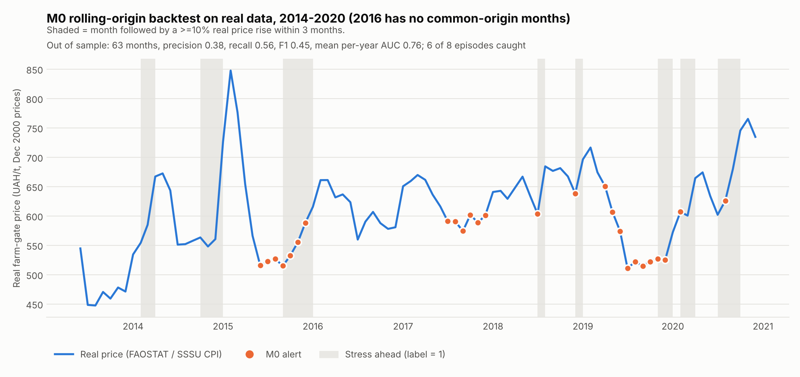
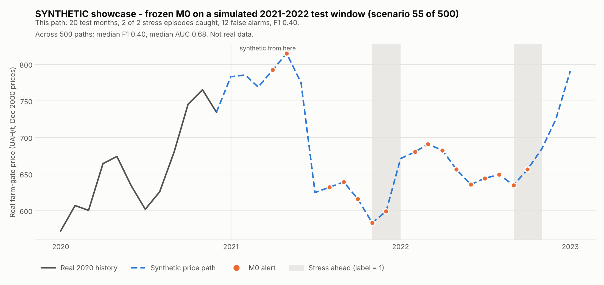
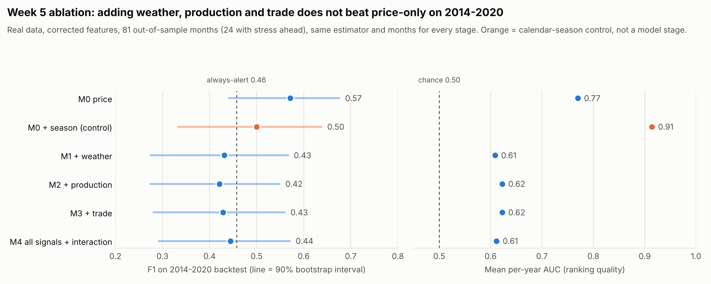
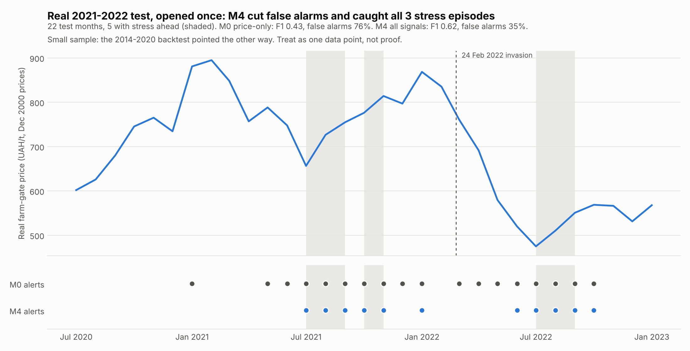
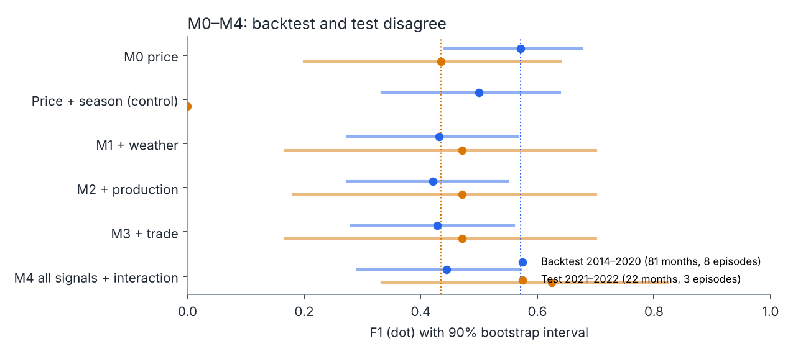
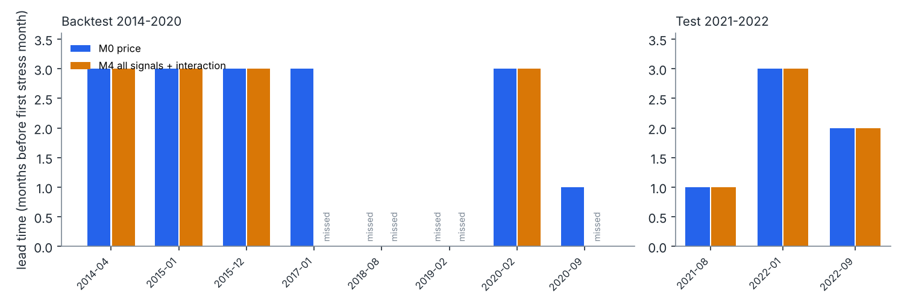
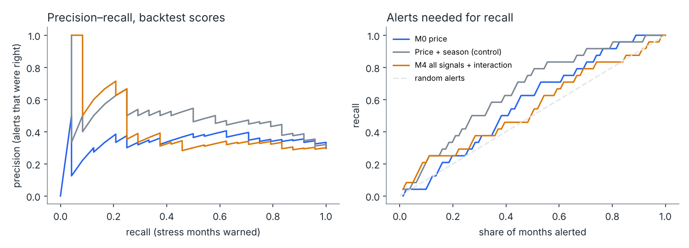
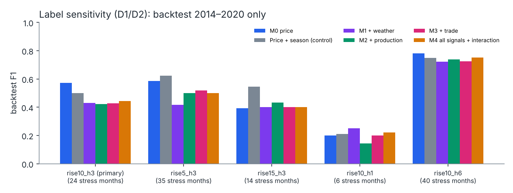

# 4. Models, evaluation and results

How the stress target and evaluation protocol were set (Week 4), how M0–M4 were built and compared (Week 5), what the one-time 2021–2022 test showed, and the Week 7 evaluation. Data are described in [`2_DATA.md`](2_DATA.md), the pipeline in [`3_ARCHITECTURE.md`](3_ARCHITECTURE.md), and decisions D1–D15 in [`7_DECISIONS.md`](7_DECISIONS.md).

**Results at a glance**

- **Backtest 2014–2020** (81 months, 8 episodes): price-only M0 F1 0.57; M1–M4 0.42–0.44, worse than M0 beyond noise (§4.4).
- **One-time test 2021–2022** (22 months, 3 episodes): M4 F1 0.62 against M0's 0.43, with about half the false alarms; M4 is the only stage that beats M0 beyond noise (§4.6).
- **Reading:** the two disagree, and 11 episodes are too few to settle whether the extra signals help. Multi-signal models did not *consistently* beat price-only monitoring for Ukraine (§4.7).

## 4.1 Evaluation protocol (Week 4)

*Week 4 record. The "review needed" choices below were confirmed unchanged as D1–D4 at the Week 4 review, with D5–D9 added (§4.3).*

### Timeframe available

| Input family | Ukraine coverage | Consequence |
|---|---|---|
| FAOSTAT monthly wheat producer price | January 2010–January 2023 | **Price input and future outcome.** Continuous monthly records through December 2022; farm-gate producer prices. |
| SSSU all-items CPI | August 1991–September 2026 | Official monthly CPI-change series, chained to an index with December 2000 = 100. Broad inflation deflator, not wheat-specific. |
| FPMA monthly wheat price | January 2001–October 2026 | Local comparator only; reuse terms and a Retail/Wholesale metadata mismatch unresolved. The earlier local FPMA label screen is not carried forward as evidence. |
| NASA POWER weather | January 2001–December 2022 | Caps the price/weather overlap at December 2022. |
| FAOSTAT wheat production and trade | Annual reference years 1992–2024 | Features, not monthly outcomes; shifted to when they could have been available. |

The all-signal input overlap is January 2010–December 2022 before lookback and missingness rules; January 2023 supplies one more outcome observation. The source-only profile (`scripts/profile_week4_m0_m4_eligibility.py` → `data/processed/week4_ukraine_m0_m4_eligibility.csv`) reports M0 145 feature-eligible origins (2011-01–2023-01), M1 144 (2011-01–2022-12), M2 132 (2011-02–2022-12), and M3/M4 121 (2011-02–2022-12). For a 3-month future window, 119 M4 origins have all future price observations through 2022-10. These are availability counts, not labels or model results.

### Outcome

| Candidate | What it would measure | Boundary |
|---|---|---|
| Future Ukraine farm-gate wheat producer-price stress | Whether information available through month `t` warns of a defined farm-gate price increase later. | **Selected.** FAOSTAT producer price as M0 history and future outcome, deflated by attributed SSSU CPI; time-separated but not independent by source. |
| Monthly wheat export-flow disruption | Changes in reported wheat exports. | Full monthly coverage not established; sparse samples cannot define missing months or labels. |
| Annual production or trade | Slow-moving supply context. | Unsuitable as monthly outcomes; kept as lagged features. |
| Proposal event contexts | Historical context for wheat-market disruptions. | A global event does not establish a country-month outcome. |

The real price is `nominal FAOSTAT producer price × 100 / chained SSSU CPI` (`scripts/profile_week4_price_deflator.py`; 157 months, January 2010–January 2023). It is not an IFPA score. Source terms and the CPI choice are in [`2_DATA.md`](2_DATA.md) §2.5.

### Label and horizon sensitivity

`scripts/profile_week4_stress_labels.py` creates candidate binary labels only on common M0–M4 feature-eligible origins in the training and validation periods; it emits no labels for origins on or after 2021-01. All candidates use common origins with 36 consecutive real-price observations through month `t`. The rise candidate compares the maximum price over `t+1..t+h` with the price at `t`; the level candidate compares months `t+1..t+h` with the trailing history. Boundaries are purged by each horizon.

For a three-month horizon:

| Candidate label | Training positives / eligible origins (episodes) | Validation positives / eligible origins (episodes) | Interpretation |
|---|---:|---:|---|
| Maximum future real price ≥5% above origin price | 15/42 (6) | 14/30 (6) | More frequent, less severe increase. |
| **Maximum future real price ≥10% above origin price** | **12/42 (4)** | **9/30 (5)** | **Chosen (D1):** a material real-price rise with several validation episodes. |
| Maximum future real price ≥15% above origin price | 9/42 (4) | 4/30 (2) | More severe, but validation support is sparse. |
| Future price above trailing 36-month 90th percentile | 12/42 (5) | 15/30 (2) | Measures an unusually high level, not a rise; labels cluster into few long episodes. |

The scan also covers 1- and 6-month horizons, 5/10/15% rises and 80th/90th/95th-percentile level cutoffs. With the 10% rule, the 1-month case has 3/44 training and 2/32 validation positives (3 and 2 episodes); 3 months has 12/42 and 9/30 (4 and 5); 6 months has 21/39 and 13/27 (4 and 4). Three months is a compromise between a short window with few labels and a long window with frequent positives, and gives similar positive rates in training (29%) and validation (30%). An episode is a contiguous run of positive eligible origins; a gap or purged month separates episodes. Counts and row-level labels: `data/processed/week4_stress_label_sensitivity.json` and `.csv`.

**Chosen (D1, D2):** a 3-month horizon; positive when the maximum CPI-adjusted farm-gate price over the next three months is at least 10% above the real price at `t`. 5% and 15% rises and 1- and 6-month horizons are sensitivity checks (§4.7). This rise threshold defines the outcome; it is separate from the model's alert cutoff, which is chosen on validation only.

### Chronological split (D3)

| Period | Role | Use |
|---|---|---|
| 2010 | Price-history warm-up | First complete source year; lets 12-month feature history accrue. |
| 2011–2017 | Training | Fit each model stage and learned preprocessing on these origins only. |
| 2018–2020 | Validation | Select alert thresholds; horizon-length purge before the test period. |
| 2021–2022 | Test | Evaluated once after all choices were fixed; with a 3-month outcome window the last origin is October 2022. Horizon-length purge at the boundary. |

Because the test has few events, a rolling-origin backtest on 2014–2020 is the standard second evaluation for every stage (§4.3).

**Warning lead time** is the interval between the first valid model warning and the later onset of price stress. **Processing/alert latency** is elapsed system runtime from input to output, a separate streaming measure ([`5_STREAMING.md`](5_STREAMING.md)).

## 4.2 M0 baseline in Spark (Week 4)

```powershell
python scripts\profile_week4_stress_labels.py
python scripts\run_week4_m0.py --config configs\week4.local.json
```

The Week 4 runner reads the monthly real-price input and attaches the configured NASA weather and FAOSTAT QCL/TCL inputs using the Spark readers; it does not read the local FPMA price file. Country, commodity and source paths come from `configs/week2.local.json` and `configs/week4.local.json`. The feature panel is `data/processed/week4_ukraine_faostat_features/`; the M0 profile and train/validation scores are under `data/processed/week4_ukraine_m0_candidate/`. The profile matched the source-only counts: 157 panel months; M0 145; M1 144; M2 132; M3/M4 121.

M0 uses only `price_real_anomaly_z_12m` and `price_real_mom_change`, with Spark MLlib binomial logistic regression (standardisation, L2 regularisation). It is fit on 42 training origins (12 positive, 30 negative) and applied to 30 validation origins (9 positive, 21 negative), where the alert cutoff is selected by F1. The ≥10%/3-month rule defines the supervised label; it is not the detector. The cutoff is 0.2377; validation has 8 true positives, 11 false positives and 1 false negative (precision 0.421, recall 0.889, F1 0.571). These figures come from the same months used to pick the cutoff, so they are calibration evidence, not an unbiased estimate (§4.3 shows the out-of-sample picture).

The project requirement is `pyspark[ml]==4.3.0`; the ML extra installs NumPy for the DataFrame-based Spark ML API. The same estimator family is used for M1–M4 so the ablation measures the added signal groups. See the [Spark 4.3 MLlib guide](https://spark.apache.org/docs/4.3.0/ml-guide.html).

**Reusing the framework for another country or commodity.** The runner takes the price file, the country/commodity source configuration, annual-signal lag, eligibility and label files, model settings, target ID and chronological split from configuration, along with price currency, unit, source, element code and deflator metadata. This makes the pipeline reusable for one country–commodity series at a time. Changing a code alone is not sufficient: a replacement needs matching, quality-profiled producer-price and CPI-adjusted monthly data, compatible weather, production and trade inputs, an eligibility table and labels, and a justified split. The approved scope stays Ukraine wheat.

## 4.3 Week 4 review (V2): backtest, weighted weather and annual timing

The `feature/workinprogress_v2` branch added the evidence for the Week 4 review. D1–D9 were confirmed with the recommended options at that review ([`7_DECISIONS.md`](7_DECISIONS.md)); the tables show the state at review time.

| Area | V1 state | V2 addition | Evidence file |
|---|---|---|---|
| Reproducibility | M0 run on the maintainer's Windows host | Labels and M0 re-run on a clean Linux/PySpark 4.3.0 environment: label file hash identical, M0 coefficients and validation counts identical | `data/processed/week4_ukraine_m0_candidate/m0_profile.json` |
| Weather (M1 input) | One NASA POWER point at 49°N 32°E, screening only | Wheat-area-weighted national series: 24 oblast points weighted by official SSSU wheat harvested area | `data/processed/week4_ukraine_weather_wheat_area_weighted_monthly.csv` |
| Regional wheat area | Not available | SSSU harvested wheat area by oblast, 2015–2021 (SDMX API) | `data/raw/sssu_ukraine_wheat_harvested_area_by_oblast_2026-11.csv` |
| Annual availability lag | 2-year proxy, no release-date evidence | FAO release dates for recent data years | Below |
| Small test sample | 9 M4 origins in 2022 | Rolling-origin backtest on real 2014–2020 data | `data/processed/week4_rolling_origin/` |
| Model showcase | None | Synthetic 2021–2022 test window (500 scenarios), scored by the frozen M0 model | `data/synthetic/week4_showcase/` |
| Code | — | `evaluation/week4.py`, weighted-weather reader in `features/week4.py`, four scripts, `configs/week4_v2.local.json` | Below |

**Findings at the review:**

1. **M0 ranks risk reasonably but alerts noisily.** On real, never-trained-on years (2014–2020), the price-only model ranks months well within a year (mean per-year AUC 0.76) and caught 6 of 8 stress episodes, 1–3 months ahead. As an alarm it is weak: precision 0.38 and a false alarm in 36% of calm months. On the M0–M4 common origins its F1 (0.45) barely beats "always alert" (0.44) or a momentum rule (0.44). This is the bar M1–M4 must clear.
2. **The Week 4 validation F1 of 0.57 was optimistic.** It came from the same 30 months used to choose the cutoff. The cutoff learned on each training window varies from 0.17 to 0.29, and with it the alert rate.
3. **Weighted weather changes rainfall, not temperature.** Correlation with the single point is 0.999 for temperatures but 0.88 for precipitation; the single point overstated rainfall variability (standard deviation 26.7 vs 21.2 mm/month). Feature coverage and the M0 result are unchanged.
4. **The 2-year annual lag matches recent FAO practice, but not every year** (below).



### Rolling-origin backtest (real data, pre-test only)

Expanding window. For each test year Y, M0 (same estimator and settings) is refit on every common-origin month whose 3-month outcome window ends by December of Y−1. The alert cutoff is picked by F1 on those training months, then year Y is scored once. No outcome after December 2020 is used (code guard). 2016 has no common-origin months under the Week 3 features because trade anomalies are undefined (fixed by D10, §4.4).

| Test year | Train months (stress) | Cutoff | Test months | Stress months | Alerts | Hits | False alarms | AUC |
|---|---:|---:|---:|---:|---:|---:|---:|---:|
| 2014 | 30 (4) | 0.174 | 11 | 5 | 0 | 0 | 0 | 0.80 |
| 2015 | 41 (9) | 0.227 | 11 | 4 | 7 | 4 | 3 | 0.75 |
| 2017 | 55 (16) | 0.287 | 11 | 0 | 6 | 0 | 6 | — |
| 2018 | 63 (16) | 0.247 | 11 | 2 | 2 | 2 | 0 | 1.00 |
| 2019 | 74 (17) | 0.227 | 11 | 2 | 9 | 2 | 7 | 0.33 |
| 2020 | 85 (18) | 0.204 | 8 | 5 | 2 | 2 | 0 | 0.93 |

| Pooled out of sample (63 months, 18 stress) | Precision | Recall | F1 | False-alarm rate |
|---|---:|---:|---:|---:|
| **M0** | 0.38 | 0.56 | 0.45 | 0.36 |
| Always alert | 0.29 | 1.00 | 0.44 | 1.00 |
| Momentum rule (alert if real price rose last month) | 0.34 | 0.61 | 0.44 | 0.47 |

Episodes: 8 in total. Missed: both in 2014, when the model had only 4 stress months to learn from. Caught: 2015-09 (lead 3 months), 2018-07 (1), 2018-12 (2), 2019-11 (3), 2020-02 (2), 2020-07 (1). Pooling raw scores across folds gives AUC 0.49, but that mixes six models' scales, so mean per-fold AUC is the correct summary. Supplementary, on M0-eligible origins (not the common set, so not an ablation comparison): 81 months, F1 0.57 vs always-alert 0.46, mean per-year AUC 0.77.

### Wheat-area-weighted weather (D5)

- **Points:** one per oblast (24, excluding Crimea and Kyiv city, which SSSU does not report). Each point is the polygon centroid from geoBoundaries ADM1; Odesa uses an interior point because its centroid falls outside the oblast.
- **Weights:** mean final-season SSSU wheat harvested area for 2015–2020, so no test-year information is used. The largest weights are Zaporizhzhia 9.6%, Odesa 9.0%, Kharkiv 7.9%, Dnipropetrovsk 7.8% and Kherson 7.1%. Oblast areas add up exactly to the national total in every year.
- **Aggregation:** identical to Week 2. The aggregation reproduced all 264 months of the committed single-point snapshot byte for byte. `scripts/fetch_week4_weighted_weather.py` regenerates everything.
- **Limits:** one grid cell per oblast; weights fixed at 2015–2020 shares (the SSSU API has no 2010–2014 regional data); pre-2022 SSSU areas exclude occupied territories. The full 232-cell grid later confirmed the series (D9-B, [`6_SCALABILITY.md`](6_SCALABILITY.md) §6.4).

### When annual FAOSTAT data actually became available (D6)

| Data year | Domain | Public evidence | Fits "available 1 Jan of data year + 2"? |
|---|---|---|---|
| 2023 | Production (QCL) | FAO release event, 19 Dec 2024 | Yes (released about 2 weeks before the rule's date) |
| 2022 | Production (QCL) | FAO highlight dated 27 Dec 2023 | Yes (released 5 days before the rule's date) |
| 2022 | Trade (TCL) | FAOSTAT Analytical Brief 80, December 2023 | Yes |
| 2020 | Production (QCL) | FAO highlight dated 01/04/2022 (FAO dd/mm format, so 1 April 2022) | **Possibly not.** If that was the release date, January–March 2022 forecasts would use 2020 data up to 3 months early. This affects only the test window. |
| 2020 | Trade (TCL) | FAOSTAT brief published 2022 (month not shown) | Unclear |
| ≤2016/17 | QCL / TCL | Internet Archive copy of the FAOSTAT bulk catalogue (28 Dec 2018): Production updated 20 Dec 2018, Trade updated 27 Jun 2018. Data years in those releases are not shown. | Unclear. A mid-year trade release would make the rule up to 6 months early for trade. |
| 2009–2015 | QCL / TCL | No release dates found | Unknown |

FAOSTAT keeps no historical vintages, and each further archive page needs a manual approval in the browser, so the search stopped here. Three ways forward were offered: (a) keep the 2-year rule and add a 3-year-lag sensitivity run; (b) collect FAOSTAT update dates for 2012–2019 from the Internet Archive; (c) ask FAO Statistics for historical release dates. Option (a) was chosen as D6. Source links are in [`2_DATA.md`](2_DATA.md) §2.5.

### Synthetic showcase (demonstration only, D7)

The showcase mirrors the real test window's structure: the same 20 eligible origins (2021-02 to 2022-10), features, ≥10%/3-month label, frozen M0 model and alert cutoff of 0.2377. Prices come from a block bootstrap of 2011–2020 real-price returns ([`2_DATA.md`](2_DATA.md) §2.6). Across 500 scenarios:

| Metric | p10 | Median | p90 |
|---|---:|---:|---:|
| F1 | 0.13 | 0.40 | 0.62 |
| AUC | 0.41 | 0.68 | 0.84 |
| Recall | 0.25 | 0.75 | 1.00 |
| Precision | 0.07 | 0.29 | 0.47 |
| False-alarm rate | 0.31 | 0.47 | 0.70 |
| Momentum-rule F1 | 0.14 | 0.32 | 0.50 |

Overall, 755 of 1,098 synthetic stress episodes (69%) were caught. The plotted scenario (55) is *typical, not best*: median stress count, F1 nearest the median; it catches both episodes 2–3 months ahead, with 12 false alarms. The bootstrap contains no war shock like 2022, so **these numbers are never FoodShield performance**.



### Reproduce the Week 4 review

From the repository root (Windows users set `HADOOP_HOME` first, [`3_ARCHITECTURE.md`](3_ARCHITECTURE.md) §3.8):

```powershell
python scripts\fetch_week4_weighted_weather.py                     # needs internet; rebuilds the weighted weather
python scripts\run_week4_m0.py --config configs\week4_v2.local.json  # features with weighted weather + M0
python scripts\run_week4_rolling_origin.py --config configs\week4_v2.local.json
python scripts\generate_week4_synthetic_showcase.py                 # synthetic, demo only
python scripts\plot_week4_review_figures.py
```

The Week 4 V1 commands (`configs/week4.local.json`) still work and give the same M0 result.

## 4.4 M0–M4 ablation (Week 5)

Decisions applied: D1–D9 (≥10%/3-month label; 2011–2017 / 2018–2020 / 2021–2022 split with purge; unchanged M0 estimator; weighted 24-oblast weather; 2-year annual lag with a 3-year sensitivity run). Owners: Jyoti (M1), Abhijith (M2 plus lag sensitivity), Naman (M3/M4 and ablation), Bharath (M0 reference and score interface).

### Stages and features (frozen in `configs/week5_frozen_protocol.json`)

| Stage | Adds | Features (cumulative count) |
|---|---|---|
| M0 | Price | `price_real_mom_change` (change since last month), `price_real_anomaly_z_12m` (price vs its trailing 12-month mean, in standard deviations) (2) |
| M1 | Weather | `precipitation_sum_mm_clim_z`, `t2m_max_mean_c_clim_z`, `t2m_min_mean_c_clim_z`: each month vs the same calendar month in the previous 10 years (at least 5) (5) |
| M2 | Production | Bounded year-on-year change of production, yield and harvested area for the latest available data year (8) |
| M3 | Trade | Bounded year-on-year change of import and export quantity and value (12) |
| M4 | Cross-signal | `m4_price_precip_clim_interaction` = `price_real_anomaly_z_12m` × `precipitation_sum_mm_clim_z` (13) |
| M0 + season (control) | Calendar | M0 plus `month_sin`, `month_cos` (4) |

Every stage uses the same Spark MLlib logistic regression (L2 0.1, standardisation, alert cutoff by best F1 on validation, D4).

### Two feature problems found and fixed (D10)

While building M1–M3, two Week 3 feature definitions turned out not to measure what their names say.

| Feature group | Problem (evidence) | Fix |
|---|---|---|
| Annual production and trade (M2, M3) | The "12-month anomaly" of an annual value repeated monthly keeps only the **sign** of the year-on-year change. Its size follows a fixed calendar pattern: 3.175 every February down to 0.289 every December, whatever the change was. Production +41% (2013) and +8% (2014) both score 3.175 in February. The feature is also undefined every January, and for trade in all of 2016, because import value was identical in 2013 and 2014. | Bounded year-on-year change of the latest available annual value: `(v_Y − v_Y−1) / ((\|v_Y\| + \|v_Y−1\|)/2)`, range −2 to 2. Same availability lag (D6). Code: `src/foodshield/features/week5.py`. |
| Weather (M1) | The "12-month anomaly" compares a month with the previous 12 months, so for temperature it mostly measures the **season**. Calendar month explains 96% of its variance for maximum temperature, 95% for minimum and 6% for precipitation. | Compare each month with the **same calendar month** in the previous 10 years (at least 5), past-only, from the 2001–2022 weighted series. |

Because the fixed features have no January or 2016 gaps, the common origin set grows from 96 to 117 months (backtest 63 → 81 months). M0's definition is unchanged; it is scored on the larger set. The fix was adopted because the old features are wrong, not because of the scores; both versions are reported.

### Main result (corrected features, 2-year lag)

Rolling-origin backtest on 2014–2020: 81 out-of-sample months, 24 with stress ahead, 8 episodes. Every stage uses the same estimator and the same months. "F1 − M0" is a 90% bootstrap interval; an interval entirely below 0 means the stage is worse than M0 beyond noise.

| Stage | Features | Precision | Recall | F1 (90% interval) | F1 − M0 | False-alarm rate | Mean per-year AUC | Episodes caught |
|---|---:|---:|---:|---|---|---:|---:|---:|
| **M0** price | 2 | 0.43 | 0.83 | **0.57** (0.44–0.68) | — | 0.46 | 0.77 | 6/8 |
| M0 + season (control) | 4 | 0.50 | 0.50 | 0.50 (0.33–0.64) | −0.22 to +0.07 | **0.21** | **0.91** | 6/8 |
| M1 + weather | 5 | 0.41 | 0.46 | 0.43 (0.28–0.57) | −0.27 to −0.02 | 0.28 | 0.61 | 5/8 |
| M2 + production | 8 | 0.36 | 0.50 | 0.42 (0.28–0.55) | −0.26 to −0.05 | 0.37 | 0.62 | 4/8 |
| M3 + trade | 12 | 0.38 | 0.50 | 0.43 (0.28–0.56) | −0.26 to −0.04 | 0.35 | 0.62 | 4/8 |
| M4 + interaction | 13 | 0.40 | 0.50 | 0.44 (0.29–0.57) | −0.25 to −0.02 | 0.32 | 0.61 | 4/8 |
| Always alert | — | 0.30 | 1.00 | 0.46 | | 1.00 | | |
| Momentum rule | — | | | 0.44 | | | | |



**In plain terms:**

1. **The extra signals do not help on 2014–2020.** M1–M4 are worse than price-only M0 on F1 beyond noise, and rank months less well (AUC about 0.61 vs 0.77).
2. **The calendar is the strongest single addition.** Price plus month-of-year ranks risky months best (AUC 0.91) and halves false alarms (21% vs 46%). Its F1 is not clearly different from M0, because it trades recall for precision.
3. **Weather's earlier apparent gain was the season.** With the Week 3 weather feature, M1 reached AUC 0.88; with a true weather anomaly it falls to 0.61.
4. **Too many features for the data.** Each stage adds 3–4 features against about 80 training months. Ranking does not improve, which is expected when signal is weak relative to sample size.

### Robustness checks

**Season in every stage (D11):** does anything beat price + season?

| Stage | F1 | F1 − (price + season) | False-alarm rate | AUC |
|---|---:|---|---:|---:|
| Price + season | 0.50 | — | 0.21 | 0.91 |
| + weather | 0.45 | −0.22 to +0.10 | 0.12 | 0.84 |
| + production | 0.57 | −0.06 to +0.20 | 0.19 | 0.84 |
| + trade | 0.49 | −0.14 to +0.11 | 0.18 | 0.82 |
| + interaction | 0.48 | −0.15 to +0.10 | 0.19 | 0.81 |

No stage beats price + season beyond noise, and ranking (AUC) drops as signals are added.

**3-year annual lag (D6 sensitivity).** M0, the season control and M1 are unchanged, since they use no annual data. With the stricter lag, M2–M4 get worse: corrected features M2 F1 0.38, M3 and M4 0.26; season version M2 0.48, M3 0.40, M4 0.36. Annual signals do not add warning value here.

**Week 3 features as built (for traceability):** on 63 months, M0 0.45, season control 0.36, M1 0.38, M2 0.47, M3 0.30, M4 0.41. Every F1 − M0 interval includes 0. The AUCs of 0.86–0.88 for M1–M4 are inflated by the seasonal weather feature.

Full numbers: `data/processed/week5_ablation_lag2/` and `week5_ablation_lag3/` (`ablation_table.csv`, `ablation_report.json` with per-fold results and intervals, `backtest_predictions.csv`).

### Limits

- **One country.** About 80 backtest months, 24 stress months and 8 episodes.
- **Small changes move F1 a lot.** One or two alerts shift it by about 0.05, hence the bootstrap intervals.
- **No tuning per stage.** The same L2 strength (0.1) is used for every stage, as D4 requires.
- **Same source for features and outcome.** The outcome uses the same FAOSTAT price series as the M0 inputs, strictly after each origin.
- **Approximate weather.** One NASA grid cell per oblast; area weights fixed at 2015–2020 shares. The full 232-cell grid gives almost the same national series (correlation ≥ 0.9986 after removing the season), so this is not material (D9-B).
- **Validation results are flat.** The single 2018–2020 validation split (33 months) gives F1 of 0.53–0.60 for every stage. It cannot separate the stages; the backtest is the more informative evidence.

### Reproduce

```powershell
python scripts\run_week5_ablation.py                                                          # 2-year lag (primary)
python scripts\run_week5_ablation.py --annual-lag 3 --output data\processed\week5_ablation_lag3  # D6 sensitivity
python scripts\plot_week4_review_figures.py                                                   # figures incl. week5_ablation.png
python scripts\run_final_test_once.py --dry-run                                               # pre-test check only
```

## 4.5 Frozen protocol and the one-time test (D8)

`configs/week5_frozen_protocol.json` (SHA-256 `c6fc95aa…0af58`) fixes:

- target, split, estimator, weather source, lags (2, plus 3 as sensitivity) and stages;
- the primary variant (`corrected`) and two robustness variants (`corrected_plus_season`, `contract_anomaly`);
- the exact feature list of every stage.

It was recorded together with decisions D10, D11 and the D8 go-ahead before the test was run. `scripts/run_final_test_once.py`:

- stops unless `--confirm-open-test` is given;
- stops if any feature list in the code differs from the frozen file;
- writes `data/processed/final_test/OPENED.json` before computing any test label, so it cannot be run twice.

Each stage is fit on 2011–2017, its alert cutoff is chosen on 2018–2020, and it then scores the real test window once: 2021-01 to 2022-10 (the last origin with a complete 3-month outcome). `--dry-run` runs the same code on pre-test stand-in windows and was checked before the test was opened; no 2021+ outcome was read.

The test was opened once, in Week 5 (time recorded in `OPENED.json`), with `--confirm-open-test`. Full output: `data/processed/final_test/final_test_report.json` (every month's score and alert, every stage, both lags, all three variants). Nothing was tuned after seeing the results; any later model change is post-test exploration, not test evidence. `tests/test_core.py` checks that the protocol hash is unchanged and that the test was opened after the protocol was frozen.

## 4.6 One-time test results, 2021–2022

22 test months, 5 with stress ahead, 3 episodes: July–August 2021, October 2021, July–August 2022.

| Stage | Alerts | Precision | Recall | F1 | False-alarm rate | AUC | Episodes caught (lead, months) | F1 − M0, 90% interval |
|---|---:|---:|---:|---:|---:|---:|---|---|
| **M0** price | 18 | 0.28 | 1.00 | 0.43 | 0.76 | 0.75 | 3/3 (1, 3, 2) | — |
| M0 + season (control) | 0 | — | 0.00 | 0.00 | 0.00 | 0.53 | 0/3 | −0.62 to −0.19 |
| M1 + weather | 12 | 0.33 | 0.80 | 0.47 | 0.47 | 0.84 | 3/3 (0, 3, 2) | −0.14 to +0.18 |
| M2 + production | 12 | 0.33 | 0.80 | 0.47 | 0.47 | 0.79 | 3/3 (0, 3, 2) | −0.14 to +0.19 |
| M3 + trade | 12 | 0.33 | 0.80 | 0.47 | 0.47 | 0.85 | 3/3 (0, 3, 2) | −0.12 to +0.18 |
| **M4** + interaction | 11 | 0.45 | 1.00 | **0.62** | **0.35** | **0.88** | 3/3 (1, 3, 2) | **+0.08 to +0.31** |
| Always alert | 22 | 0.23 | 1.00 | 0.37 | 1.00 | | | |
| Momentum rule | | | | 0.37 | | | | |

Intervals are a bootstrap over the 22 test months (2,000 resamples) with the same months for both models; an interval entirely above 0 means the stage beat M0 beyond noise. §4.7 gives the scripted, reproducible intervals, which differ by at most 0.023.



**In plain terms:**

1. **Every model caught all 3 episodes**, so the difference is in false alarms. Price-only M0 alerted in 18 of 22 months. M4 alerted in 11 and was right 5 times, with warnings 1–3 months ahead.
2. **M4 is the only stage that beats M0 beyond noise** (F1 0.62 vs 0.43). M1–M3 rank months better than M0 (AUC 0.79–0.85 vs 0.75), but their F1 gains are within noise.
3. **The calendar pattern broke.** The season control raised no alerts at all in 2021–2022. The harvest-season pattern learned from 2011–2017 did not hold through the war period.

### Robustness (pre-registered)

| Check | Result |
|---|---|
| 3-year annual lag (D6) | M0 and M1 unchanged. M2 F1 0.50, M3 0.62, M4 0.46 (AUC 0.84–0.87). Multi-signal stages still rank better than M0 (0.75), but which stage is best changes with the lag, so no single stage is robustly best. |
| Season in every stage (D11) | All stages weaker: price + season raised no alerts; M3/M4 F1 0.43, AUC 0.65. Adding the calendar hurt in 2021–2022. |
| Week 3 features as built (D10 check) | M1–M4 AUC 0.28–0.35, worse than chance; M3/M4 alerted in every month. This confirms that the old features were unreliable. |

### How the test fits with the 2014–2020 backtest

| Evidence | Months / stress months / episodes | Does adding weather, production and trade help? |
|---|---|---|
| 2014–2020 rolling-origin backtest | 81 / 24 / 8 | No. M1–M4 were worse than M0 beyond noise. |
| 2021–2022 real test (once) | 22 / 5 / 3 | Partly. M4 beat M0 beyond noise; M1–M3 ranked better. |

The backtest has about four times more data, so it should carry at least as much weight as the test. The reading for the report:

> On this one-country pilot, multi-signal models did not consistently beat price-only monitoring. They underperformed on 2014–2020 and outperformed on 2021–2022, a period of war-driven disruption when the usual seasonal price pattern broke down. The evidence is too thin (8 + 3 episodes) to decide between the two. More events, from more countries or more years, are needed.

FAOSTAT has at least 120 monthly wheat producer prices for 2010–2022 for 31 countries ([`6_SCALABILITY.md`](6_SCALABILITY.md) §6.4), so a multi-country panel is feasible on the price side; it is extension work after the core project (D13).

### Caveats to state in the report

- **Tiny test:** 5 stress months and 3 episodes. One alert more or less moves F1 by about 0.1.
- **What the 2022 "stress" was.** After the February 2022 invasion, Ukraine's real farm-gate price *fell* 43% (835 in February to 475 in July), as exports were blocked. The 2022 stress months (July–August) are a rebound from that low, not the invasion shock. The ≥10% rise rule counts rebounds as stress. That fits a farm-gate price-risk reading, but should be stated plainly.
- **Coverage:** occupied territories are excluded from SSSU-based weather weights from March 2022, and FAOSTAT 2021–2022 figures may be revised.
- **The annual lag is not fully verified.** For data year 2020, FAO's release may have come in about April 2022, so the 2-year rule could be up to 3 months early for January–March 2022 forecasts. The 3-year-lag run shows a similar overall picture.
- **Weather points are approximate:** one grid cell per oblast; the 232-cell grid check (D9-B) shows this does not affect the reading.
- **No re-runs.** Because the test is opened, any further model change is post-test exploration, not test evidence.

## 4.7 Model evaluation (Week 7)

**Script:** `scripts/run_week7_model_evaluation.py` → `data/processed/week7_model_evaluation/` and `docs/figures/week7_model_*.png`.

This brings together the Week 5 backtest and the one-time test, and adds analyses that use only pre-test data: lead times, the threshold trade-off, probability quality and label sensitivity. No test-period label was computed for it; the test numbers come from the one-time run.

### Headline

**Setup:** label ≥10% real price rise within 3 months; corrected features; 2-year annual lag; one Spark MLlib logistic regression for every stage.

| Window | Months | Months with stress ahead | Episodes |
|---|---:|---:|---:|
| Backtest 2014–2020 | 81 | 24 (30%) | 8 |
| Test 2021–2022 | 22 | 5 (23%) | 3 |

| Stage | Backtest F1 (90% interval) | F1 − M0, backtest | Backtest false alarms | Backtest episodes | Test F1 (90% interval) | F1 − M0, test | Test false alarms | Test episodes |
|---|---|---|---:|---:|---|---|---:|---:|
| **M0** price | **0.57** (0.44–0.68) | — | 0.46 | 6/8 | 0.43 (0.20–0.64) | — | 0.76 | 3/3 |
| Price + season (control) | 0.50 (0.33–0.64) | −0.22 to +0.07 | **0.21** | 6/8 | 0.00 | −0.64 to −0.20 | 0.00 | 0/3 |
| M1 + weather | 0.43 (0.28–0.57) | −0.27 to −0.02 | 0.28 | 5/8 | 0.47 | −0.14 to +0.18 | 0.47 | 3/3 |
| M2 + production | 0.42 (0.28–0.55) | −0.26 to −0.05 | 0.37 | 4/8 | 0.47 | −0.15 to +0.19 | 0.47 | 3/3 |
| M3 + trade | 0.43 (0.28–0.56) | −0.26 to −0.04 | 0.35 | 4/8 | 0.47 | −0.14 to +0.18 | 0.47 | 3/3 |
| **M4** + interaction | 0.44 (0.29–0.57) | −0.25 to −0.02 | 0.32 | 4/8 | **0.62** (0.33–0.82) | **+0.08 to +0.32** | **0.35** | 3/3 |
| Always alert | 0.46 | | 1.00 | | 0.37 | | 1.00 | |
| Momentum rule (price rose last month) | 0.43 | | | | 0.37 | | | |



**Note on the test intervals.** These are recomputed by the script with the published method (2,000 bootstrap resamples, seed 20261107). The earlier values in §4.6 were computed outside a script, with a different resampling order. The two differ by at most 0.023 and no conclusion changes; the scripted values are the reproducible ones.

**What it says:**

1. **The two evaluations point in opposite directions.** On 2014–2020, every added signal made F1 worse than price-only M0 beyond noise. On 2021–2022, M4 beat M0 beyond noise. With 11 episodes in total, neither result is strong enough to overrule the other. The defensible statement is that multi-signal models did not *consistently* beat price-only monitoring for Ukraine.
2. **Price-only M0 is only modestly better than trivial rules.** On the backtest, F1 0.57 against 0.46 for alerting every month and 0.43 for "the price rose last month".
3. **Calendar season is the strongest single signal on the backtest, and it broke in the test.** It halved false alarms on 2014–2020 but raised no alerts at all in 2021–2022.

### Episodes and lead time

| Episode (stress ahead) | First stress month | M0 | M4 |
|---|---|---|---|
| 2014-01 to 2014-03 | 2014-04 | 3 months ahead | 3 months ahead |
| 2014-10 to 2015-01 | 2015-01 | 3 | 3 |
| 2015-09 to 2015-12 | 2015-12 | 3 | 3 |
| 2016-10 to 2016-12 | 2017-01 | 3 | missed |
| 2018-07 | 2018-08 | missed | missed |
| 2018-12 | 2019-02 | missed | missed |
| 2019-11 to 2020-03 | 2020-02 | 3 | 3 |
| 2020-07 to 2020-09 | 2020-09 | 1 | missed |
| **Test** 2021-07 to 2021-08 | 2021-08 | 1 | 1 |
| **Test** 2021-10 | 2022-01 | 3 | 3 |
| **Test** 2022-07 to 2022-08 | 2022-09 | 2 | 2 |



- **Lead time.** When an episode is caught, the warning is usually 3 months ahead, the most a 3-month label allows. Lead time is capped by the horizon (D2), so the useful comparison is caught versus missed.
- **Missed by both models:** the two one-month episodes of 2018, which are short and isolated.
- **Missed by M4 but caught by M0:** two backtest episodes (2017-01 and 2020-09). That is why M4 catches fewer backtest episodes than M0.

### Threshold trade-off (backtest only)

Alert cutoffs are chosen by best F1 (D4). To see what other cutoffs would give, precision and recall were traced over every cutoff on the pooled out-of-sample backtest scores (2014–2020; no test data):

| Model | Best precision while catching ≥80% of stress months | Stress months caught when alerting in ≤30% of months | … in ≤50% of months |
|---|---:|---:|---:|
| M0 price | 0.35 | 33% | 62% |
| Price + season | 0.44 | 50% | 75% |
| M4 | 0.33 | 38% | 50% |



No cutoff gives both high recall and high precision. Catching 80% of stress months means about two false alarms for every correct alert. That is the practical cost of an early-warning rule built on this data.

### Probability quality (backtest)

The Brier score is the mean squared error of the predicted probability; lower is better. Always predicting the backtest base rate (30%) scores **0.209**.

| Stage | Brier |
|---|---:|
| M0 | 0.204 |
| Price + season | **0.183** |
| M1 | 0.210 |
| M2 | 0.205 |
| M3 | 0.209 |
| M4 | 0.210 |

The M0–M4 probabilities score about the same as the base rate on 2014–2020. Only price + season clearly improves on it. The models rank months a little (per-year AUC 0.61–0.77), but their probabilities should not be read as calibrated risks.

### Robustness (pre-registered)

| Check | Backtest | Test |
|---|---|---|
| 3-year annual lag (D6) | M2–M4 worse (M2 0.38, M3 and M4 0.26) | Best stage changes: M3 0.62, M4 0.46 |
| Season in every stage (D11) | No stage beats price + season beyond noise | All stages weaker; price + season raises no alerts |
| Week 3 features as built | Every F1 − M0 interval includes 0; AUC inflated by seasonal weather | On 20 months (these features have gaps): M0 0.47, M1–M4 0.20–0.42 |

Details in §4.4 and §4.6; numbers in `data/processed/week7_model_evaluation/robustness.csv`.

### Label sensitivity (D1, D2)

D1 and D2 kept 5% and 15% rises and 1- and 6-month horizons as sensitivity checks. Here they are run at model level on the 2014–2020 backtest only: the same estimator, folds and cutoff rule, with no test data. Command: `run_week5_ablation.py --rise-pct … --horizon … --variants corrected`; outputs in `data/processed/week7_label_sensitivity/`.

| Label | Stress months / episodes | M0 F1 | M1 | M2 | M3 | M4 | Price + season | Always alert |
|---|---|---:|---:|---:|---:|---:|---:|---:|
| **≥10% in 3 months (primary)** | 24 / 8 | **0.57** | 0.43* | 0.42* | 0.43* | 0.44* | 0.50 | 0.46 |
| ≥5% in 3 months | 35 / 11 | 0.58 | 0.42* | 0.50* | 0.52 | 0.50 | **0.62** | 0.60 |
| ≥15% in 3 months | 14 / 6 | 0.39 | 0.40 | 0.43 | 0.40 | 0.40 | **0.55** | 0.29 |
| ≥10% in 1 month | 6 / 5 | 0.20 | 0.25 | 0.14 | 0.20 | 0.22 | 0.21 | 0.13 |
| ≥10% in 6 months | 40 / 9 | **0.78** | 0.72 | 0.74 | 0.73 | 0.75 | 0.75 | 0.68 |

\* worse than M0 beyond noise (the 90% interval of F1 − M0 is entirely below 0). No stage is better than M0 beyond noise under any label.



- **The main backtest finding does not depend on the label choice.** Under every definition, adding weather, production or trade does not beat price-only monitoring on 2014–2020.
- **A 1-month horizon is too short to warn.** Every stage catches 1–2 of 5 episodes.
- **A 6-month horizon makes everything look better,** but only because stress becomes common (40 of 78 months): alerting every month already scores 0.68.
- **Season helps most at the rarer, larger 15% threshold.** Its interval, −0.002 to +0.305, just touches 0.

These checks support keeping D1 and D2 unchanged.

### Limits

- **One country and few events:** 8 backtest and 3 test episodes. One alert more or less moves F1 by up to 0.03 (backtest) or 0.1 (test).
- **Short histories:** the backtest's early folds train on 3–4 years.
- **Same source for features and outcome:** the outcome uses the same FAOSTAT price series as the M0 inputs, strictly after each origin.
- **2022 is unusual:** the stress months follow a 43% fall in the real price after the February 2022 invasion.
- **The planned extension:** a multi-country panel (D13) is the way to more events.
