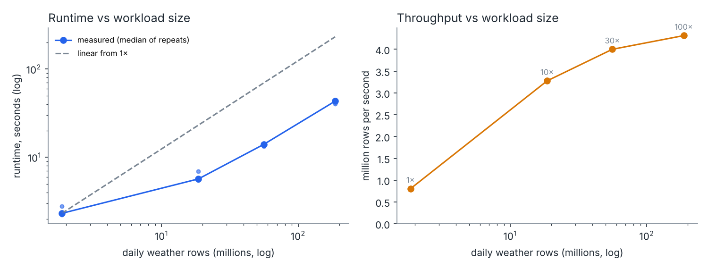
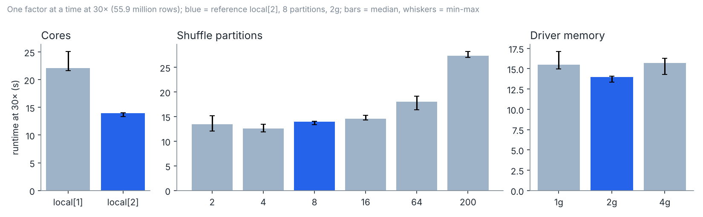
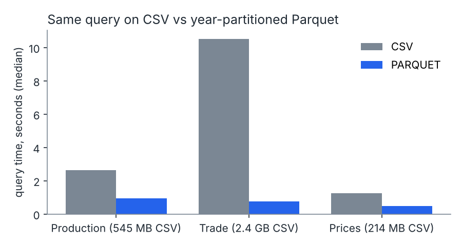
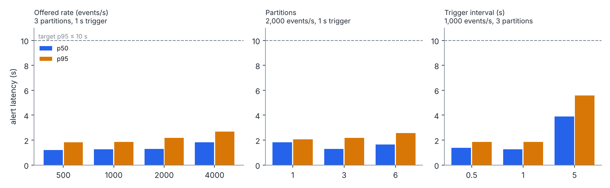

# 6. Scalability: experiment design, batch and streaming series, data at full size

How FoodShield's processing cost changes with input volume and Spark resources, and how the raw sources were handled at their real size (D9). Streaming design and the target runs are in [`5_STREAMING.md`](5_STREAMING.md); data sources in [`2_DATA.md`](2_DATA.md).

## 6.1 Experiment design

**Scope:** Spark batch processing and the TA-required local Kafka/Spark Structured Streaming replay. Wheat remains the only research commodity.

**Why it is part of the project.** The course rubric calls for scalability and performance goals and an evaluation with experimental design, metrics, plots and analysis. FoodShield's data integration and alerting workflow supplies a relevant workload, while controlled scale tests show how its processing cost changes as input volume and Spark resources change. The pilot's modest monthly coverage is not, by itself, evidence of scale.

**Separate analytical evidence from engineering benchmarks:**

- Run the analytical workflow on the profiled source inputs and report data-quality, feature-coverage and model results only from eligible real observations.
- Use a clearly labelled benchmark-only synthetic workload when the observed data are too small to expose scaling behaviour. Preserve the project schema, add an explicit benchmark-series identifier to keep keys unique, and never use these rows for model training, event validation, reported source coverage or food-market conclusions.
- Keep the source-data run and synthetic scale runs in separate output locations and profiles. Record the generation method and seed.
- Describe local Spark results as single-machine scaling unless a multi-node cluster is actually used and measured.

**Batch protocol:**

1. Fix a reproducible pipeline slice, input schema, transformations, output format and correctness checks.
2. Record a source-based reference run, then a sequence of workload sizes, increasing one dimension at a time with the transformation logic fixed.
3. Compare Spark resource configurations one factor at a time (local parallelism, shuffle partitions, driver memory), within the host's resources, recording the machine and runtime configuration.
4. Repeat runs consistently, with a warm-up policy and a stated measurement boundary.

Report elapsed time, throughput, speed-up relative to a declared reference, scaling efficiency where meaningful, and shuffle or spill indicators from Spark. Plot runtime and throughput against workload size and resource configuration. Keep failures and resource-limit effects in the analysis; do not extrapolate past measured conditions.

**Streaming protocol.** Use the documented replay schema and a fixed local Kafka/Spark configuration. Measure valid-record accounting, sustained and burst throughput, and end-to-end alert latency (p50 and p95) under stated pacing. The targets (≥100 events/s sustained, ≥250 events/s burst, alert p95 ≤10 s; D12c) are targets until observed. A replay benchmark demonstrates the local architecture; it is not a live-feed service or evidence of predictive performance.

**Reporting boundary.** The report may omit source extract row counts, but states the benchmark workload sizes, input and output sizes, machine and runtime settings, and observed metrics needed to reproduce the experiment. Synthetic inputs are labelled and kept out of the research conclusions.

## 6.2 Batch scaling series (Week 7)

**Script:** `scripts/run_week7_batch_scaling.py` → `data/processed/week7_batch_scaling/` (`runs.jsonl` holds every run, `summary.json`/`.csv` the medians).

| Item | Value |
|---|---|
| Hardware | Claude cloud workspace, Linux, 2 CPU cores, 8.4 GB RAM |
| Software | Python 3.13, Java 21, PySpark 4.3.0 in local mode |
| Spark settings | Adaptive query execution off, so the configured shuffle partition count is what runs |
| Mode | Single-machine scaling only; no cluster was used |

**Pipeline slice (fixed).** The D9-B weather aggregation, in two timed stages:

1. read daily cell weather from Parquet → aggregate to monthly per cell → write Parquet;
2. read the cell-months → join the wheat-area weights → national monthly → write Parquet.

**Workloads (D9-E).** Labelled, benchmark-only synthetic expansions of the real 1,864,120-row daily grid file: factor k makes k copies with a `benchmark_series` id; series 0 is the real data unchanged, so every run is checked against the D9-B batch output; the other copies add seeded noise (seed 20261107); they are never used for modelling or food-market conclusions.

| Factor | Rows | Parquet on disk | Generation |
|---:|---:|---:|---:|
| 1× | 1,864,120 | 12 MB | 4 s |
| 10× | 18,641,200 | 431 MB | 13 s |
| 30× | 55,923,600 | 1.29 GB | 26 s |
| 100× | 186,412,000 | 4.29 GB | 83 s |

**Method.** Each configuration runs in a fresh Spark process: one warm-up run, then 3 timed runs, reporting the median with min–max. Shuffle and spill bytes come from Spark's own metrics API.

**Checks, in all 12 configurations:** output row counts are exact (61,248 × k cell-months, 264 × k national months); series 0 matches the D9-B result to within its 4-decimal CSV rounding.

### Workload size (reference: `local[2]`, 8 shuffle partitions, 2 GB driver)

| Factor | Rows | Median runtime (min–max) | Throughput | Shuffle written | Spill |
|---:|---:|---|---:|---:|---:|
| 1× | 1.9 M | 2.32 s (2.23–2.79) | 0.80 M rows/s | 1.9 MB | 0 |
| 10× | 18.6 M | 5.69 s (5.51–6.97) | 3.28 M rows/s | 23 MB | 0 |
| 30× | 55.9 M | 13.98 s (13.34–14.06) | 4.00 M rows/s | 66 MB | 0 |
| 100× | 186.4 M | 43.21 s (40.45–44.37) | 4.31 M rows/s | 216 MB | 0 |



- **Small workloads are dominated by fixed cost.** At 1× most of the 2.3 s is job start-up and file handling, so 100 times the data takes only 19 times as long.
- **From 30× up, runtime grows almost in proportion to data.** 3.3× more data took 3.1× longer, and throughput levels off at about 4.3 million rows per second on 2 cores.
- **Warm-up matters.** The first run in each fresh process was 1.3–4× slower (for example 9.4 s vs 2.3 s at 1×) while the JVM warms up. That is why warm-up runs are excluded.
- **No configuration spilled to disk.** The aggregation shrinks the data early (186 million daily rows become 6.1 million cell-months).

### One factor at a time (30×, 55.9 million rows)

| Factor | Setting | Median runtime | vs reference |
|---|---|---:|---:|
| Cores | `local[1]` | 22.12 s | 0.63× |
| | **`local[2]` (reference)** | **13.98 s** | 1.00× |
| Shuffle partitions | 2 | 13.47 s | 1.04× |
| | 4 | **12.56 s** | **1.11×** |
| | **8 (reference)** | 13.98 s | 1.00× |
| | 16 | 14.59 s | 0.96× |
| | 64 | 18.03 s | 0.78× |
| | 200 (Spark default) | 27.35 s | 0.51× |
| Driver memory | 1 GB | 15.52 s | 0.90× |
| | **2 GB (reference)** | 13.98 s | 1.00× |
| | 4 GB | 15.71 s | 0.89× |



- **Cores.** Two cores are 1.58× faster than one: a parallel efficiency of 79%. The machine has only 2 cores, so this is the only core comparison possible here.
- **Shuffle partitions matter most.** Spark's default of 200 partitions is 2.2 times slower than the best setting (4). Each partition is a task with fixed overhead, and here only about 66 MB is shuffled. For this workload, partitions should be about 2–4 per core, or adaptive query execution should be left on so Spark merges small partitions itself.
- **Memory is not the constraint.** Nothing spilled at 1, 2 or 4 GB. Both 1 GB and 4 GB ran 11–12% slower than 2 GB, outside the 2 GB min–max range, so more memory did not help; the small difference is not caused by memory pressure.

### CSV vs Parquet on the real FAOSTAT archives (no synthetic data)

Same query as D9-A (all-country wheat rows, 2010–2022). The time includes opening the dataset each time. Median of 3 after a warm-up:

| Domain | CSV | Parquet (year-partitioned) | Speed-up |
|---|---:|---:|---:|
| Production (QCL, 4.2 M rows, 545 MB CSV) | 2.64 s | 0.95 s | 2.8× |
| Trade (TCL, 17.1 M rows, 2.4 GB CSV) | 10.51 s | 0.75 s | **14×** |
| Prices (PP, 1.3 M rows, 214 MB CSV) | 1.27 s | 0.49 s | 2.6× |



The single D9-A run (§6.4) reported 7–44× because it timed only the query on an already-opened dataset. Including the open, which costs about half a second for Parquet, is the fairer comparison. The gain grows with file size: Parquet reads only the needed year folders and columns.

## 6.3 Streaming scaling series (Week 7)

**Script:** `scripts/run_week6_replay.py` → `data/processed/week6_streaming/s7_*/`; summary table `data/processed/week6_streaming/week7_series_summary.csv`.

**Setup.** The Week 6 replay (Kafka 4.4.0, one KRaft broker; Spark Structured Streaming `local[2]`) on the same workspace machine:

- records from 2016-01 are sent fast to build the 5+ years of history the features need;
- all of 2022 (84,939 records, 13 alert months) is then sent at a fixed rate and measured;
- one factor is changed at a time; every run is a fresh broker and checkpoint;
- the run checks from Week 6 ([`5_STREAMING.md`](5_STREAMING.md) §5.2) are applied to every run.

| Varied | Setting | Achieved rate | Micro-batches | Alert latency p50 / p95 / max | Checks |
|---|---|---:|---:|---|---|
| Offered rate (3 partitions, 1 s trigger) | 500/s | 500.0/s | 227 | 1.20 / 1.81 / 1.99 s | all passed |
| | 1,000/s | 1,000.0/s | 141 | 1.26 / 1.87 / 2.26 s | all passed |
| | 2,000/s | 1,999.8/s | 98 | 1.30 / 2.19 / 2.51 s | all passed |
| | 4,000/s | 3,996.3/s | 79 | 1.83 / 2.68 / 2.92 s | all passed |
| Partitions (2,000/s, 1 s trigger) | 1 | 1,999.7/s | 85 | 1.82 / 2.07 / 2.14 s | all passed |
| | 3 | 1,999.8/s | 98 | 1.30 / 2.19 / 2.51 s | all passed |
| | 6 | 1,999.9/s | 104 | 1.65 / 2.56 / 3.14 s | all passed |
| Trigger (1,000/s, 3 partitions) | 0.5 s | 1,000.0/s | 161 | 1.40 / 1.86 / 1.86 s | all passed |
| | 1 s | 1,000.0/s | 141 | 1.26 / 1.87 / 2.26 s | all passed |
| | 5 s | 1,000.0/s | 39 | 3.89 / 5.59 / 5.68 s | all passed |



- **Targets met with a wide margin.** The targets were ≥100 events/s sustained, ≥250 burst and p95 ≤10 s. Spark kept up with every offered rate up to 4,000 events/s, 16 times the burst target, and the alert p95 stayed under 2.7 s.
- **The limit on this machine is the producer, not Spark.** The pure-Python Kafka producer peaks at about 5,000 events/s while sharing 2 cores with the broker and Spark; at full speed the consumer processed 4,914/s. Spark was not saturated at any tested rate. A faster client, or more cores, would be needed to find Spark's ceiling.
- **Latency is set by the trigger interval and one micro-batch.** With a 1 s trigger, a month's alert follows its last input by about 1.2–1.8 s (median). A 5 s trigger cuts micro-batches by 72% but raises latency to the trigger length. 0.5 s gives no gain, because each micro-batch already takes about 1 s to process.
- **M4 agreement depends on the replay start.** These runs replay from 2016, so the weather comparison has fewer earlier years than the frozen model's features: streamed M4 matches the frozen test on 20 of 22 months (largest score difference 0.064), against 21 of 22 for the Week 6 runs that replay from 2011. M0 matches exactly in every run.
- **Partitions make little difference on 2 cores.** More than about one partition per core adds tasks without adding parallelism. With 6 partitions, p95 was slightly higher.

The reported laptop runs (D12; Windows 11, 16 cores) met both targets with alert p95 of 2.9 s at 100/s and 3.1 s at 250/s, and sent 6,610 events/s at full speed ([`5_STREAMING.md`](5_STREAMING.md) §5.4).

## 6.4 Data at full size (D9)

**Decision:** D9 (confirmed at the Week 4 review). Options A, B, C and E are in scope; D (multi-country panel) is extension work after the core project (D13).
**Why:** the model table is small by design (monthly early warning for one country). The engineering work is handling the raw sources at their real size, and showing it in measured runtimes. A and B were run after the Week 5 test. Numbers come from `data/processed/d9a_faostat_bulk/bulk_profile.json` and `data/processed/d9b_grid_weather/grid_weather_profile.json`.

| Item | What | Code | Status |
|---|---|---|---|
| A | Full FAOSTAT bulk archives (all countries, all items) → Spark → year-partitioned Parquet, with Ukraine wheat reconciled to the Week 2 extracts | `src/foodshield/etl/bulk.py`, `scripts/run_d9a_faostat_bulk.py` | **Done.** 22.7 million rows from 3.2 GB of CSV in 2 min 40 s. Ukraine wheat matches the model inputs exactly. |
| B | NASA POWER weather for all 232 native grid cells inside the 24 wheat oblasts, 2001–2022 daily → Spark → wheat-weighted national series | `configs/d9b_grid_cells.json`, `scripts/fetch_d9b_gridded_weather.py`, `scripts/run_d9b_grid_weather.py` | **Done.** 1,864,120 daily rows aggregated in 11 s. Almost identical to the 24-point series used by the models. |
| C | Kafka replay at daily granularity into Spark Structured Streaming | `src/foodshield/streaming/`, `scripts/run_week6_replay.py` | **Done (Week 6, D12).** 1,864,486 records; every check passed ([`5_STREAMING.md`](5_STREAMING.md)). |
| E | Labelled synthetic scaling runs | `scripts/run_week7_batch_scaling.py` | **Done (Week 7).** 1×, 10×, 30× and 100× (§6.2). |
| D | Multi-country wheat panel | — | **Extension work** (D13). **31 countries** have enough monthly wheat producer prices (below), so D is feasible on price data. |
| TM | Detailed trade matrix (411 MB archive, optional) | Supported by the same code | Not downloaded; only needed for partner-level trade flows. |

Machine for the A and B timings: Claude cloud workspace, Linux, **2 CPU cores, 7 GB RAM**, Spark 4.3.0 `local[2]`, driver memory 3 GB (A) or 2 GB (B). They are single runs without a warm-up; the repeated measurements are in §6.2.

### A. Full FAOSTAT archives

Sizes (1 MB = 1,000,000 bytes):

| Domain | ZIP | CSV inside | Parquet | CSV ÷ Parquet | Rows | Years | Countries/areas | Items |
|---|---:|---:|---:|---:|---:|---|---:|---:|
| Production (QCL) | 33.9 MB | 545.0 MB | 37.6 MB | 14.5× | 4,209,110 | 1961–2024 | 244 | 301 |
| Trade (TCL) | 273.5 MB | 2,432.8 MB | 200.8 MB | 12.1× | 17,143,873 | 1961–2024 | 283 | 616 |
| Producer prices (PP) | 11.7 MB | 214.3 MB | 9.3 MB | 23.1× | 1,319,583 | 1991–2025 | 182 | 235 |
| **Total** | **319.1 MB** | **3,192.1 MB** | **247.6 MB** | **12.9×** | **22,672,566** | | | |

Timings (seconds):

| Domain | Unzip | Count rows (CSV) | Write Parquet | Count rows (Parquet) | Same query on CSV | Same query on Parquet | Query speed-up |
|---|---:|---:|---:|---:|---:|---:|---:|
| QCL | 0.8 | 3.8 | 22.3 | 0.5 | 3.79 | 0.34 | 11× |
| TCL | 6.0 | 4.0 | 72.1 | 0.2 | 14.61 | 0.33 | **44×** |
| PP | 0.3 | 0.5 | 6.8 | 0.2 | 1.56 | 0.23 | 7× |

The query is "all countries, wheat, 2010–2022" (6,087 / 11,549 / 10,854 rows). Parquet is faster because it is split by year folder and stored by column, so Spark reads only the years and columns it needs. The whole run, including Spark start-up, reconciliation and the coverage check, took 2 min 40 s.

**Ukraine reconciliation.** Ukraine wheat was filtered out of the global Parquet and compared value by value with the extracts the models use:

| Domain | Rows compared | Result |
|---|---:|---|
| QCL | 99 | Exact match |
| TCL | 132 | Exact match |
| PP | 157 monthly prices | Exact match. The bulk file also has 30 annual-average rows, which the monthly extract leaves out by design. |

So the at-scale path reproduces the model inputs.

**D9-D feasibility.** In PP, 31 countries have at least 120 of the 156 monthly wheat producer prices (local currency) for 2010–2022:

- **Complete (156):** Hungary, Lithuania, Poland, Canada, Finland, United Kingdom, Belarus, Slovakia, Ukraine, Romania, Czechia, Russian Federation.
- **150–155:** Austria 155, Spain 151, Netherlands 150.
- **140–149:** Serbia, South Africa, Peru, Rwanda, Armenia and United States 145; Türkiye, Palestine, Germany and Kazakhstan 144; Albania 140.
- **120–139:** Kyrgyzstan 134, Bulgaria 133, Croatia 132, Slovenia 122, Belgium 121.

A multi-country panel would multiply the number of stress episodes, which is the main limit of the one-country pilot. It would also need a CPI deflator per country; the FAOSTAT CP archive is the obvious candidate, but its per-country coverage and flags have not been checked.

### B. Gridded weather

- **Download:** 232 point requests to the NASA POWER Daily API (one per native 0.5° × 0.625° grid cell inside the 24 wheat oblasts). There were no errors or retries, giving 91.7 MB of raw JSON. The CSV has 1,864,120 daily rows (232 cells × 8,035 days, 2001–2022), is 68.4 MB, and has no missing values.
- **Spark:** read and count 2.8 s; daily → monthly per cell (61,248 cell-months) → wheat-weighted national series (264 months) 8.3 s.
- **Weights:** each cell gets its oblast's wheat-area share divided by the number of cells in that oblast, fixed at the 2015–2020 shares, as in Week 4.

**Comparison with the 24-point series the models use** (one cell per oblast centroid):

| Variable | Correlation | Correlation after removing each calendar month's average | Mean absolute difference | Mean, 24 points | Mean, full grid |
|---|---:|---:|---:|---:|---:|
| Precipitation (mm/month) | 0.9988 | 0.9986 | 0.82 mm | 46.8 | 47.2 |
| Max temperature (°C) | 1.0000 | 0.9998 | 0.16 °C | 14.24 | 14.08 |
| Min temperature (°C) | 1.0000 | 0.9998 | 0.14 °C | 4.52 | 4.66 |

The middle column matters most. The corrected M1 features compare each month with the same calendar month in earlier years, so the agreement has to hold after the season is removed, and it does.

**What this means:** the Week 5 limit "one NASA grid cell per oblast" is not a material approximation at national level. MERRA-2 cells are coarse and neighbouring cells move together, so 24 well-placed cells already give the national signal. A model re-run with gridded weather would get almost the same features, so weather's weak backtest result is not caused by the sampling of points. No re-run was done: the real test is already opened, so any re-run would be post-test exploration only.

### How the downloads were done

The Claude workspace cannot reach FAO or NASA directly, so both downloads went through the Claude desktop app's built-in browser on a project member's computer.

- **FAOSTAT archives:** downloaded from the official URLs in [`2_DATA.md`](2_DATA.md) §2.5 into the repository folder, copied into the workspace and checked with `zipfile.testzip`; the SHA-256 of each archive is in the profile.
- **NASA grid:** the same request URLs as `scripts/fetch_d9b_gridded_weather.py`, saved in four parts with a SHA-256 per part, all verified, then merged in cell order into `data/raw/nasa_power_grid/nasa_power_grid_daily_2001_2022.csv`. The manifest (request URL and raw SHA-256 per cell) is committed next to it; the CSV is not.

The large files stay out of Git (`data/raw/*`, `data/interim/` and root-level `*.zip` are ignored). Only profiles, the grid manifest and derived outputs are committed.

### Reproduce on a team member's computer

The FAOSTAT archives (about 319 MB; TM adds 411 MB if wanted). In PowerShell, from the repository folder:

```powershell
New-Item -ItemType Directory -Force data\raw\faostat_bulk | Out-Null
$base = "https://bulks-faostat.fao.org/production/"
foreach ($f in "Production_Crops_Livestock_E_All_Data_(Normalized).zip",
               "Trade_CropsLivestock_E_All_Data_(Normalized).zip",
               "Prices_E_All_Data_(Normalized).zip") {
    curl.exe -L --fail -o "data\raw\faostat_bulk\$f" "$base$f"
}
python scripts\run_d9a_faostat_bulk.py           # needs Spark set up as in 3_ARCHITECTURE.md §3.8; ~3.5 GB free disk
```

If the archives are already in the repository root (from a browser download), move them instead of downloading again:

```powershell
New-Item -ItemType Directory -Force data\raw\faostat_bulk | Out-Null
Move-Item -Path '.\*_E_All_Data_(Normalized).zip' -Destination data\raw\faostat_bulk\
```

Gridded weather. The fetch is resumable and takes a while (one request per cell). Then run the Spark step:

```powershell
python scripts\fetch_d9b_gridded_weather.py
python scripts\run_d9b_grid_weather.py
```

Archives can change after each FAO update. Compare the archive SHA-256 in `bulk_profile.json` before comparing results from different downloads.

## 6.5 Limits

- **One machine, 2 cores.** These results show single-machine scaling, not cluster scale-out.
- **Disk caching.** Repeated runs may read input from the operating system's file cache. This is likely for the smaller workloads; the 4.3 GB workload is half the RAM.
- **Synthetic copies.** The larger workloads are noisy copies of real data. They have the real schema and key structure, but they are not new information.
- **The laptop repeat.** Tried: 1×, 10× and 30× ran (median 3.5 s, 6.9 s and 14.6 s), then the 100× run stopped with a Java direct-memory error at the 2 GB setting. It needs a memory fix before it can be reported. `run_week7_batch_scaling.py --phase all --output-suffix _laptop` writes to `data/processed/week7_batch_scaling_laptop/` and `docs/figures/*_laptop.png`, so the workspace series is kept; `apply_laptop_results.py` then puts the two side by side.
