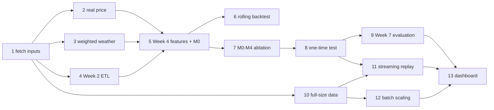

# 8. End-to-end pipeline, step by step

How FoodShield turns public source files into monthly stress alerts: acquisition, Spark processing through Bronze, Silver and Gold, features, models, evaluation, streaming, scale runs and the dashboard. Each step gives the code, the reason, and the same real month before and after. The column-level data model is in [`3_ARCHITECTURE.md`](3_ARCHITECTURE.md) §3.9; sources in [`2_DATA.md`](2_DATA.md); decisions D1–D15 in [`7_DECISIONS.md`](7_DECISIONS.md); results in [`4_MODELS_AND_RESULTS.md`](4_MODELS_AND_RESULTS.md), [`5_STREAMING.md`](5_STREAMING.md) and [`6_SCALABILITY.md`](6_SCALABILITY.md).

## 1. How to read this

Each processing step below names the Spark operation it uses, shows the code, and shows the same data before and after. This doc follows one month, **Ukraine wheat, January 2015**, from raw files to an alert, so each layer can be compared on the same data.

### Spark operations used, and where

| Spark operation | Used for | Section |
| --- | --- | --- |
| `filter`, `isNotNull`, `trim`, `regexp_replace` | clean codes, drop rows without keys | 5.2, 5.5 |
| `filter(value != -999)` | remove NASA "no value" sentinels | 6.1 |
| `groupBy` + `sum`, `avg`, `count` | daily → monthly weather; national weighted average | 6.3, 11.3 |
| `make_date`, `trunc`, `to_date` | month-start dates, availability dates | 6.2, 7.1 |
| `explode`, `map_entries`, `sequence` | flatten nested JSON; full month calendar | 5.4, 10.1 |
| non-equi join + `Window` + `row_number` | as-of join of annual data | 7.4 |
| `Window` + `lag`, `rowsBetween` | price change, 12-month anomaly, weather climatology | 10.3–10.5 |
| MLlib `Pipeline`, `VectorAssembler`, `LogisticRegression` | M0–M4 models | 12.3 |
| `readStream` (Kafka), `withWatermark`, `dropDuplicatesWithinWatermark`, `foreachBatch`, checkpoint | streaming replay | 14 |
| `repartition` + `partitionBy("year")` to Parquet | full FAOSTAT archives at scale | 15 |

### Three rules that shape every step

- **Three time grains.** FoodShield mixes daily weather, monthly prices and annual production/trade (section 8).
- **Time of knowledge.** Each value also has the date it *became known*, not only the date it describes. This is what stops the model from using the future.
- **Failing instead of fixing.** An unexpected duplicate or null key stops the pipeline, because there is no safe rule to pick one price.

### The running example: January 2015

- **Why this month:** it is a real stress month. The real price rose 16.8% within three months (725.78 → 847.49), and both M0 and M4 raised an alert.
- **Inputs that touch it:**
  - the January 2015 FAOSTAT producer price (2,705 UAH/tonne);
  - the SSSU consumer price index for January 2015 (+3.1% on December);
  - 31 days of weather in January 2015;
  - production and trade for **data year 2013**, the newest year published by 1 January 2015 under the two-year rule.

## 2. Run order: which script reads and writes what

**The pipeline runs as a fixed sequence of small scripts, each reading committed or earlier outputs and writing one folder.** Commands are in the README.



| # | Script | Reads | Writes |
|---|---|---|---|
| 1 | `fetch_week2_inputs.py` | URLs and filters in `configs/week2.local.json` | missing extracts in `data/raw/`, `retrieval_manifest.json` |
| 2 | `profile_week4_price_deflator.py` | FAOSTAT price, SSSU CPI | `data/processed/week4_ukraine_wheat_farmgate_realprice_candidate.csv` |
| 3 | `fetch_week4_weighted_weather.py` | NASA POWER API (24 points), SSSU wheat area, `configs/week4_weather_oblasts.json` | `data/processed/week4_ukraine_weather_wheat_area_weighted_monthly.csv` |
| 4 | `run_week2_etl.py` | the raw extracts | `data/processed/week2_ukraine/` Bronze, Silver, Gold Parquet and `profile.json` |
| 5 | `run_week4_m0.py --config configs/week4_v2.local.json` | outputs of 2 and 3; QCL and TCL extracts | feature panel Parquet, M0 profile |
| 6 | `run_week4_rolling_origin.py` | as 5 | `data/processed/week4_rolling_origin/` |
| 7 | `run_week5_ablation.py` (lag 2, lag 3) | as 5, plus the Week 5 features | `data/processed/week5_ablation_lag2/`, `_lag3/` |
| 8 | `run_final_test_once.py` | `configs/week5_frozen_protocol.json` | `data/processed/final_test/` (once) |
| 9 | `run_week7_model_evaluation.py`, `run_week7_data_quality.py` | outputs of 7 and 8 | `data/processed/week7_model_evaluation/`, `week7_data_quality/`, figures |
| 10 | `run_d9a_faostat_bulk.py`; `fetch_d9b_gridded_weather.py`, `run_d9b_grid_weather.py` | full FAOSTAT archives; NASA grid | `data/processed/d9a_faostat_bulk/`, `d9b_grid_weather/` |
| 11 | `run_week6_replay.py` | grid daily CSV, real price, QCL, TCL, final test report | `data/processed/week6_streaming/<run>/` |
| 12 | `run_week7_batch_scaling.py` | grid daily CSV | `data/processed/week7_batch_scaling/`, figures |
| 13 | `export_week8_dashboard_features.py`, `build_week8_dashboard.py`; `serve_dashboard.py` | saved results | `docs/dashboard/index.html`; live view |

## 3. Acquisition: getting the source files

**Every input is a public download with a recorded request and SHA-256 hash; nothing is typed in by hand.** The full list of URLs, filters and hashes is the download register, [`2_DATA.md`](2_DATA.md) §2.5.

### Step 3.1 — Fetch only what is missing

`scripts/fetch_week2_inputs.py`:

1. Reads the source list from `configs/week2.local.json`.
2. Skips any file that already exists; it never overwrites.
3. For FAOSTAT, streams the official bulk archive to a temporary file, keeps only the configured country, item and elements, and deletes the archive.
4. Writes `data/raw/retrieval_manifest.json` with retrieval times and hashes.

### Step 3.2 — A metadata sidecar next to every extract

Each shared extract has a `.metadata.json` file beside it with:

- the request URL or archive and the filter used;
- the row count and the output SHA-256;
- licence and attribution text.

So a later download can be compared with the one used: a different hash means a different release.

### Step 3.3 — Weather by API, one request per location

- **24 oblast points:** `fetch_week4_weighted_weather.py` sends one NASA POWER Daily API request per point (2001–2022), caches each raw response, and records each URL and hash in the output sidecar.
- **232 grid cells:** `fetch_d9b_gridded_weather.py` sends one request per cell and can resume after an interruption. The manifest of URLs and hashes is committed; the 68 MB CSV is not.

### Step 3.4 — Large archives through a browser

- The full FAOSTAT archives (319 MB) and the grid weather were fetched through a browser on a project member's computer, because the development machine could not reach FAO or NASA directly.
- Each file was copied to the development machine and checked (`zipfile.testzip` for archives, SHA-256 for every file).

### Step 3.5 — What is in Git and what is not

| In Git | Not in Git |
|---|---|
| Ukraine wheat extracts (FAOSTAT price, production, trade), SSSU CPI and wheat area, the single NASA point, all sidecars and manifests | FAOSTAT bulk archives, the grid daily CSV, FPMA prices (reuse terms unconfirmed), Kafka binaries |

## 4. The raw inputs

Five sources arrive in three different grains (monthly, daily, annual) and three formats (CSV, SDMX CSV, nested JSON). These are real rows from the files in `data/raw/`.

### 4.1 Wheat producer price (FAOSTAT PP) — monthly

```csv
Area Code,Area Code (M49),Area,Item Code,Element Code,Element,Year,Months Code,Months,Unit,Value,Flag
230,'804,Ukraine,15,5530,Producer Price (LCU/tonne),2015,7001,January,LCU,2705.000000,A
230,'804,Ukraine,15,5530,Producer Price (LCU/tonne),2015,7002,February,LCU,3326.000000,A
230,'804,Ukraine,15,5530,Producer Price (LCU/tonne),2015,7003,March,LCU,3376.000000,A
```

- **Grain:** one row per country × item × year × month.
- **Quirks:**
  - codes carry a leading apostrophe (`'804`), so they must be cleaned before matching;
  - the month is a word (`January`), not a date;
  - the price is nominal (not adjusted for inflation);
  - `Flag A` = official value (all 157 rows).

### 4.2 Consumer price index (SSSU) — monthly

```csv
FREQ,INDICATOR,BASE_PERIOD,REGION,TIME_PERIOD,OBS_VALUE
M,INDEX_CONSUMPRICE,PREV_MONTH,UA00000000000000000,2014-M12,103
M,INDEX_CONSUMPRICE,PREV_MONTH,UA00000000000000000,2015-M01,103.1
M,INDEX_CONSUMPRICE,PREV_MONTH,UA00000000000000000,2015-M02,105.3
```

- **Grain:** one row per month.
- **Quirks:**
  - the value is a *change on the previous month* (103.1 = prices up 3.1%), not an index level, so it has to be chained (section 8.2);
  - the period is written `2015-M01`.

### 4.3 Weather (NASA POWER) — daily

The single screening point (49°N, 32°E) is nested JSON: one map of date → value per parameter.

```json
{"geometry": {"coordinates": [32.0, 49.0, 166.71]},
 "properties": {"parameter": {
   "PRECTOTCORR": {"20150101": 0.52, "20150102": 0.86, "20150103": 1.0},
   "T2M_MAX":     {"20150101": -1.77, "20150102": 0.25, "20150103": 2.36},
   "T2M_MIN":     {"20150101": -13.65, "20150102": -3.25, "20150103": -1.03}}},
 "header": {"fill_value": -999.0}}
```

The 232-cell grid (D9-B) was saved as a flat CSV instead:

```csv
cell_id,date,prectotcorr_mm,t2m_max_c,t2m_min_c
r271_c334,2001-01-01,2.68,4.14,-2.02
r271_c334,2001-01-02,0.04,3.94,-1.75
```

- **Grain:** one row per location × day (× parameter in the JSON).
- **Units:** precipitation mm/day; temperatures °C.
- **Quirks:**
  - dates are `yyyyMMdd` strings used as JSON keys;
  - a missing value is written as `-999`, not null.

### 4.4 Production (FAOSTAT QCL) — annual

```csv
Area Code (M49),Item Code,Element Code,Element,Year,Unit,Value,Flag
'804,15,5510,Production,2012,t,15762600.000000,A
'804,15,5510,Production,2013,t,22279300.000000,A
'804,15,5412,Yield,2013,kg/ha,3393.100000,A
'804,15,5312,Area harvested,2013,ha,6566100.000000,A
```

- **Grain:** one row per country × item × element × year (long format: three measures in three rows).
- **Quirk:** `Year` is the year the harvest *describes*. FAO publishes it much later (section 8.3).

### 4.5 Trade (FAOSTAT TCL) — annual

```csv
Area Code (M49),Item Code,Element,Year,Unit,Value,Flag
'804,15,Import quantity,2013,t,1778.000000,A
'804,15,Export quantity,2013,t,7762279.000000,A
'804,15,Import value,2013,1000 USD,1932.000000,A
'804,15,Export value,2013,1000 USD,1891519.000000,A
```

- **Grain:** as QCL, four measures. Quantity (t) and value (1000 USD) are separate rows with different units.
- **Quirk:** Ukraine's wheat imports are tiny (1,778 t), so a plain percentage change can explode (section 8.4).

### Summary of grains

| Source | Grain | Rows used | Becomes known |
| --- | --- | --: | --- |
| FAOSTAT price | month | 157 | first day of the next month |
| SSSU CPI | month | 422 | first day of the next month |
| NASA weather (grid) | day × cell | 1,864,120 | next day, 00:00 UTC |
| FAOSTAT production | year × measure | 99 | 1 January, two years later |
| FAOSTAT trade | year × measure | 132 | 1 January, two years later |

## 5. Bronze: the source, flattened but not changed

**Bronze = every source row in a flat table, with its original codes, units, flags and notes kept.** No business rules and no model assumptions yet. Bronze is the record of what each source published. Code: `src/foodshield/etl/week2.py`.

### Step 5.1 — Read with an explicit schema (FAOSTAT CSV)

```python
raw = (spark.read.schema(FAOSTAT_SCHEMA)        # types written in the code, never inferred
       .option("header", "true")
       .option("mode", "FAILFAST")             # a malformed line stops the job
       .csv(source))
```

- **Why a fixed schema:** inference would read a sample and guess. A column that changes type in a new download would silently become a string. With a fixed schema it fails loudly.
- **Why FAILFAST:** Spark's default (`PERMISSIVE`) turns a broken line into nulls without raising an error.

### Step 5.2 — Clean the codes and keep only Ukraine wheat

```python
area_m49  = F.regexp_replace(F.trim(F.col("`Area Code (M49)`")), "^'", "")   # "'804" -> "804"
item_code = F.regexp_replace(F.trim(F.col("`Item Code`")), "^'", "")
raw.filter((area_m49 == "804") & (item_code == "15"))
```

- `trim` removes surrounding spaces; regexp_replace removes FAO's leading apostrophe.
- The country and item codes come from `configs/week2.local.json`, so another country is a config change.

### Step 5.3 — Rename and cast, keep provenance

```python
.select(F.lit("UKR").alias("country_code"),
        F.col("Element").alias("element"),
        F.col("Year").cast("int").alias("data_year"),
        F.col("Unit").alias("unit"),
        F.col("Value").cast("decimal(24,6)").alias("value"),   # exact decimal, no float rounding
        F.col("Flag").alias("flag"), F.col("Note").alias("note"),
        F.lit("qcl_csv").alias("source_file_key"))             # which file the row came from
```

**Production, before (raw CSV) → after (Bronze):**

|  | Area Code (M49) | Element | Year | Unit | Value | Flag |
| --- | --- | --- | --- | --- | --- | --- |
| raw | `'804` | Production | 2013 | t | 22279300.000000 | A |

| country_code | area_m49 | element | data_year | unit | value | flag | source_file_key |
| --- | --- | --- | --- | --- | --- | --- | --- |
| UKR | 804 | Production | 2013 | t | 22279300.000000 | A | qcl_csv |

### Step 5.4 — Flatten nested JSON (NASA weather)

The weather file is one JSON object holding a map `date → value` per parameter. Spark turns each map entry into a row:

```python
feature.select("geometry",
    F.explode(F.map_entries(F.col("properties.parameter.PRECTOTCORR"))).alias("entry")
).select(
    F.col("geometry.coordinates").getItem(0).alias("longitude"),
    F.col("geometry.coordinates").getItem(1).alias("latitude"),
    F.to_date(F.col("entry.key"), "yyyyMMdd").alias("observation_date"),
    F.lit("PRECTOTCORR").alias("parameter"),
    F.col("entry.value").cast("double").alias("value"),
    F.lit("mm/day").alias("unit"),
    F.lit("single_point_screening").alias("spatial_basis"))
# repeated for T2M_MAX and T2M_MIN (unit C), then unionByName of the three
```

- `map_entries` turns the map into an array of (key, value) pairs; `explode` makes one row per pair.
- **Nested JSON is unpacked inside Spark; no separate flattening script is needed**.

**Weather, after Bronze (long format, one row per day × parameter):**

| longitude | latitude | observation_date | parameter | value | unit |
| --- | --- | --- | --- | --- | --- |
| 32.0 | 49.0 | 2015-01-01 | PRECTOTCORR | 0.52 | mm/day |
| 32.0 | 49.0 | 2015-01-01 | T2M_MAX | −1.77 | C |
| 32.0 | 49.0 | 2015-01-01 | T2M_MIN | −13.65 | C |
| 32.0 | 49.0 | 2015-01-02 | PRECTOTCORR | 0.86 | mm/day |

### Step 5.5 — Quality gate on Bronze

```python
_assert_quality(qcl_bronze, "bronze.production",
                keys=["country_code", "commodity_code", "element", "data_year"],
                required_values=["value"])
```

The gate stops the run if:

- the table is empty;
- any key column is null;
- a required value is null;
- two rows share the same key.

Duplicates are not resolved by keeping the highest value: two different production figures for the same year would mean the extract is wrong, and there is no safe rule to choose one.

**Bronze counts (Week 2 run):** production 99 rows, trade 132, weather 24,105 daily point rows (8,035 days × 3 parameters).

### What Bronze deliberately does *not* do

- No unit conversion.
- No missing-value handling (`-999` is still there).
- No monthly alignment.
- No availability dates.

## 6. Silver: cleaned, typed and time-aware

**Silver = the same facts, cleaned and given time rules, ready to be lined up by month.** Missing values are made explicit, each annual value gets the date it became known, and daily weather becomes monthly.

### Step 6.1 — Remove the "no value" sentinel

```python
weather_daily = weather_bronze.filter(F.col("value") != F.lit(-999.0))
```

- NASA writes `-999` when it has no measurement (its `fill_value`).
- A value outside what the source can mean is not a reading.
- The row is removed, **not set to 0**. Zero rainfall is a real measurement; "no data" is not.
- In the 2001–2022 Ukraine files there were **no** `-999` values, but the rule stays for future downloads.

### Step 6.2 — Give each annual value its "known from" date

```python
def silver_annual(df, lag_years):
    return (df.withColumn("feature_available_from",
                          F.make_date(F.col("data_year") + F.lit(lag_years), F.lit(1), F.lit(1)))
              .withColumn("availability_lag_years", F.lit(lag_years)))
```

| element | data_year | value | feature_available_from |
| --- | --- | --- | --- |
| Production | 2012 | 15,762,600 t | 2014-01-01 |
| Production | 2013 | 22,279,300 t | **2015-01-01** |
| Production | 2014 | … | 2016-01-01 |

- So on 1 January 2015, the newest production figure the model may see is **2013**.
- **Two dates per value**: the year it describes and the date it became public. This is decision D6; section 8.3 explains why two years.

### Step 6.3 — Daily weather to monthly (groupBy)

```python
month = F.trunc(F.col("observation_date"), "month").cast("date")      # 2015-01-17 -> 2015-01-01
(daily.withColumn("month", month)
      .groupBy("country_code", "commodity_code", "month", "latitude", "longitude", "spatial_basis")
      .agg(F.avg(F.when(F.col("parameter") == "T2M_MAX", F.col("value"))).alias("t2m_max_mean_c"),
           F.avg(F.when(F.col("parameter") == "T2M_MIN", F.col("value"))).alias("t2m_min_mean_c"),
           F.sum(F.when(F.col("parameter") == "PRECTOTCORR", F.col("value"))).alias("precipitation_sum_mm"),
           F.countDistinct(F.when(F.col("parameter") == "PRECTOTCORR",
                                  F.col("observation_date"))).alias("precipitation_days_present")))
```

- **Pivot inside the aggregate:** `F.when(parameter == …, value)` gives null for the other parameters, and `avg`/`sum` skip nulls. One pass turns the long table into three monthly columns.
- **Rain is summed, temperature is averaged.** A month's rainfall is the total that fell; a month's temperature is the typical day.
- **Valid-day count is kept** (`precipitation_days_present`), so a month built from too few days can be spotted.

**January 2015, single point, 93 daily rows → one monthly row:**

| month | t2m_max_mean_c | t2m_min_mean_c | precipitation_sum_mm | precipitation_days_present |
| --- | --: | --: | --: | --: |
| 2015-01-01 | 0.451935 | −5.371613 | 34.26 | 31 |

This was checked by hand: recomputing January 2015 from the 31 daily values gives the same three numbers.

### Step 6.4 — Nominal price to real price (the CPI chain)

This step is plain Python (`scripts/profile_week4_price_deflator.py`), not Spark: it is 157 rows, and a running product is simplest as a loop.

1. Set the December 2000 index to 100.
2. For each later month: `index = previous index × OBS_VALUE / 100`.
3. Real price = nominal price × 100 / index.
4. A missing CPI month stops the script ("cannot chain safely"); it never skips a gap.

| month | nominal (UAH/t) | CPI change | chained index | real price |
| --- | --: | --: | --: | --: |
| 2014-12 | 2,026 | 103.0 | 361.49 | 560.45 |
| **2015-01** | **2,705** | **103.1** | **372.70** = 361.49 × 1.031 | **725.78** = 2,705 × 100 / 372.70 |
| 2015-02 | 3,326 | 105.3 | 392.45 | 847.49 |
| 2015-03 | 3,376 | 110.8 | 434.84 | 776.38 |

- **Why real price:** in early 2015 Ukraine had very high inflation (10.8% in March alone). A nominal rise of 25% in a month can be mostly inflation. The stress label must measure wheat getting dearer *relative to everything else*.
- Real prices are in "December 2000 hryvnias", so only their changes matter, not their level.

### Silver counts (Week 2 run)

| Table | Rows |
| --- | --: |
| production | 99 |
| trade | 132 |
| daily weather (point) | 24,105 |
| monthly weather (point) | 264 |
| real price (Week 4) | 157 |

## 7. Gold: one row per country – wheat – month

**Gold = the analysis table: exactly one row per (country_code, commodity_code, month), with every signal that was known by that month joined in.** Models read Gold only. Code: `assemble_selected_price_panel` in `src/foodshield/features/week4.py`.

*History note:* in Week 2 the Gold table was a price-only table built from FPMA. From Week 4 the price comes from FAOSTAT + SSSU, and Gold is the joined panel described here.

### Step 7.1 — The price is the driving table

```python
prices = (spark.read.schema(PRICE_SCHEMA).option("header", "true").option("mode", "FAILFAST")
          .csv(price_csv)
          .select(F.lit("UKR").alias("country_code"), F.lit("15").alias("commodity_code"),
                  F.make_date(F.col("year"), F.col("month").cast("int"), F.lit(1)).alias("month"),
                  F.col("nominal_price_lcu_per_tonne").alias("price_nominal"),
                  F.col("real_price_dec_2000_lcu_per_tonne").alias("price_real"), …))
```

- Every month is a **month-start date** (`2015-01-01`). All sources are joined on this one key, so they must all use the same convention.
- **Why price drives:** the model makes one prediction per month that has a price. A month with weather but no price has nothing to predict from.

### Step 7.2 — Check the grain before joining

```python
if prices.filter(F.col("month").isNull() | F.col("price_real").isNull()).limit(1).count(): raise ValueError(...)
if prices.groupBy(*KEY).count().filter(F.col("count") > 1).limit(1).count(): raise ValueError(...)
```

- A duplicate month **stops** the run instead of being resolved.
- `limit(1).count()` stops scanning as soon as one bad row is found.

### Step 7.3 — Join monthly weather (left join)

```python
panel = prices.join(weather, ["country_code", "commodity_code", "month"], "left")
```

- **Left join:** every price month stays, even without weather. Missing weather becomes null, not a dropped month.
- In practice every 2010–2022 month found its weather (weather covers 2001–2022).

### Step 7.4 — Join annual data "as of" each month (Window + row_number)

A plain join on year is wrong: a January 2015 forecast must not use 2015 or 2014 harvest figures, because they were not yet published. Instead, for each month we keep the **newest** annual year whose `feature_available_from` is on or before that month.

```python
condition = ((F.col("m.country_code") == F.col("a.country_code"))
             & (F.col("m.commodity_code") == F.col("a.commodity_code"))
             & (F.col("a.production_available_from") <= F.col("m.month")))      # only years already published
joined = m.join(a, condition, "left")                                          # each month x every earlier year
rank = Window.partitionBy("m.country_code", "m.commodity_code", "m.month").orderBy(
           F.col("a.production_available_from").desc_nulls_last(),
           F.col("a.production_feature_year").desc_nulls_last())
joined.withColumn("_annual_rank", F.row_number().over(rank)).filter(F.col("_annual_rank") == 1)
```

1. Before joining, the long table (3 rows per year) is made wide: `groupBy(data_year).agg(max(when(element == "Production", value)), …)`. The flags and notes are kept as a list of structs.
2. The join pairs January 2015 with every year published by then (1992–2013).
3. `row_number` ordered by "published" descending picks rank 1 = **2013**.
4. The same is done for trade.

- A non-equi join (`<=` instead of `=`) followed by a row_number ranking. This is the core leakage protection.

### The Gold row for January 2015

| Column | Value | Came from |
| --- | --- | --- |
| country_code, commodity_code, month | UKR, 15, 2015-01-01 | key |
| price_nominal | 2,705 UAH/t | FAOSTAT PP |
| price_real | 725.78 | Silver CPI chain |
| precipitation_sum_mm | 42.03 | weighted weather, 24 oblasts (section 11) |
| t2m_max_mean_c / t2m_min_mean_c | 0.23 / −5.49 | weighted weather |
| production_feature_year | **2013** | as-of join |
| production_available_from | 2015-01-01 | Silver rule |
| production_t / yield_kg_ha / area_harvested_ha | 22,279,300 / 3,393.1 / 6,566,100 | QCL 2013 |
| trade_feature_year | 2013 | as-of join |
| import_quantity_t / export_quantity_t | 1,778 / 7,762,279 | TCL 2013 |
| import / export value (1000 USD) | 1,932 / 1,891,519 | TCL 2013 |

### Layer comparison on the same fact (2013 production)

| Layer | What the 2013 harvest looks like |
| --- | --- |
| Raw | `'804,…,Production,2013,t,22279300.000000,A` in a CSV |
| Bronze | typed row: UKR, Production, 2013, t, 22279300, flag A, from `qcl_csv` |
| Silver | the same row + `feature_available_from = 2015-01-01` |
| Gold | a column on every month from 2015-01 to 2015-12: `production_t = 22,279,300`, `production_feature_year = 2013` |

## 8. Mixing daily, monthly and annual data

**Everything is brought to one grain: the calendar month, written as its first day.** Finer data (daily) is aggregated up; coarser data (annual) is carried down as a step, switched on only from the date it became public. Nothing is interpolated.

### 8.1 Daily → monthly (weather)

| Measure | Rule | Why |
| --- | --- | --- |
| Precipitation (mm/day) | **sum** of the days | rainfall in a month is the total that fell |
| Max / min temperature (°C) | **mean** of the days | the month's typical day |
| Valid days | **count** of days with a value | shows how complete the month is |

- A month is used only when it is complete:
  - in batch, the 2001–2022 files have every day;
  - in streaming, a month "closes" only when all 232 cells have every day of that month (section 14).
- **Time of knowledge:** a day's weather is known the next day at 00:00 UTC, so a month's weather is complete on the 1st of the next month.

### 8.2 Monthly → monthly (price and CPI)

The grain is already right; only the date format differs.

| Source | As written | Converted to |
| --- | --- | --- |
| FAOSTAT price | `Year=2015, Months=January` | `2015-01-01` |
| SSSU CPI | `2015-M01` | `2015-01-01` |
| Weighted weather CSV | `2015-01` | `F.to_date(concat_ws("-", month, "01"))` → `2015-01-01` |

- **CPI is a change, not a level:** chained into an index first (section 6.4).
- **Time of knowledge:** January's price is known on 1 February.

### 8.3 Annual → monthly (production and trade)

1. **No splitting into 12 parts.** A harvest of 22.3 million t is not 1.86 million t per month. The annual figure is a fact about the year.
2. **Carried as a step.** Each month gets the newest annual value already published (as-of join, section 7.4). The value stays the same for 12 months, then steps to the next year.
3. **Switched on by publication, not by the year it describes:** data year Y is usable from 1 January of Y + 2 (D6).
4. **No interpolation.** Drawing a line between 2013 and 2014 would need the 2014 value, which was not public yet: that is using the future.

**Which harvest year each 2015 month sees:**

| Forecast months | Production/trade year used | Why not newer |
| --- | --- | --- |
| 2015-01 to 2015-12 | 2013 | under the two-year rule, data year 2014 becomes usable only from 2016-01-01 |
| 2016-01 to 2016-12 | 2014 |  |

**Why two years (D6), with evidence:**

- FAO released 2022 production data on 27 Dec 2023, and 2023 data on 19 Dec 2024: about one year after the data year ends, just before the rule's date.
- 2020 production data may have come out only around 1 April 2022, so for January–March 2022 the rule could be up to 3 months early.
- FAOSTAT keeps no historical versions, so older release dates are unknown.
- **Safeguard:** every M2–M4 result was also run with a **3-year** lag. Results got worse, not better, so the conclusion does not depend on the lag being optimistic.

### 8.4 What went wrong first with annual data, and the fix (D10)

The Week 3 features treated the repeated annual value like a monthly series and took its "12-month anomaly". On a step series that number only shows the *sign* of the change and decays by month:

| Month | "Anomaly" for +41% production (2013) | for +8% (2014) |
| --- | --: | --: |
| February | 3.175 | 3.175 |
| December | 0.289 | 0.289 |

The fix (Week 5) compares the latest available year with the year before:

```latex
\text{change} = \frac{v_Y - v_{Y-1}}{(|v_Y| + |v_{Y-1}|)/2}
```

- Range −2 to +2, so tiny bases (Ukraine imports 1,411 t → 1,778 t) cannot explode.
- Null when both years are 0 or either is missing.
- **January 2015:** production 2013 vs 2012 = (22,279,300 − 15,762,600) / 19,020,950 = **+0.343**; import quantity +0.230; export quantity −0.112.

### 8.5 What January 2015 is allowed to know

| Signal | Newest value used | Known since |
| --- | --- | --- |
| Price | January 2015 (725.78 real) | 1 Feb 2015, when the forecast is made |
| Price history | Jan 2014 – Dec 2014 | earlier |
| Weather | January 2015, all 31 days | 1 Feb 2015 |
| Production / trade | data year 2013 | 1 Jan 2015 |
| **Outcome (label)** | max real price Feb–Apr 2015 | only afterwards; never a model input |

## 9. Missing data, duplicates and assumptions

**The general rule: a missing value stays null, is never set to zero, and is never filled from the future.** A row is dropped only when it cannot mean anything (no key, a sentinel). A feature that cannot be computed is null, and a month with any null model input is left out of model training and scoring.

### 9.1 Missing values: every case

| Case | What happens | Why |
| --- | --- | --- |
| NASA `-999` | row removed in Silver | the source says "no measurement" |
| A weather day absent | month not closed (streaming); valid-day count drops (batch) | a partial month would understate rainfall |
| One weather cell missing a value | the area weights are re-spread over the cells that have it (batch and streaming) | the national figure stays a weighted average, not a smaller sum |
| A calendar month with no price | an empty row is inserted (spine), so lags still count calendar months | `lag(1)` must mean last month, not "last row" |
| Price change for the first month (2010-01) | null | no earlier month |
| 12-month price anomaly for 2010 | null | needs 12 earlier months |
| Weather vs 10-year normal | null until at least 5 earlier years of that month exist | too few years make a noisy normal |
| Annual year-on-year change | null if either year is missing, or both are 0 | division would be meaningless |
| Any model input null in a month | that month is not scored | MLlib's `VectorAssembler(handleInvalid="error")` would stop on it |
| CPI month missing | the deflator script stops | a gap would break the chained index |
| Future price for the label not yet observed | label is null (month not used) | the outcome must be fully known |

### 9.2 Duplicates

| Where | Rule | Reason |
| --- | --- | --- |
| Batch, any source key repeated | run **stops** with an error | for a price or a harvest there is no safe value to pick |
| Streaming, the same record sent twice | removed by `record_id` (section 14) | expected: delivery is at-least-once |
| Streaming, the same weather day arriving twice | the day bitmask detects it and it is not counted again | protects the monthly sum |

### 9.3 Assumptions we state openly

1. **Annual data is public two years later** (data year + 2, 1 January). It is a rule of thumb, checked against recent FAO releases and tested with 3 years.
2. **Weather weights are fixed** at the 2015–2020 wheat-area shares: regional areas are not available before 2015.
3. **One NASA grid cell per oblast is enough.** Checked: the full 232-cell grid gives almost the same national series (correlation ≥ 0.9986 after removing the season).
4. **CPI is a fair deflator.** It measures general inflation, not wheat-specific costs.
5. **The outcome uses the same price series as the inputs,** strictly after the forecast month. Separated in time, not in source.
6. **Official statistics exclude occupied territories from March 2022.** Weather is not affected.
7. **Sources are revised in place.** The SHA-256 of each file records exactly which release was used.

### 9.4 Data actually observed

- Price: 157 months, 2010-01 to 2023-01, **0 missing**, every flag `A`.
- Weighted weather: 264 months, 2001–2022, **0 missing**, full weight every month.
- Grid weather: 1,864,120 daily rows, **0 missing**.
- Production 99 rows and trade 132 rows, 1992–2024, **0 missing**.
- So in practice the nulls in the model table come only from the rules above (start-up history), and every M0–M4 input is complete from 2011-01.

## 10. Features: Spark window functions, step by step

**Every feature looks only backwards from its month.** The windows end at the month before (`rowsBetween(-n, -1)`), or at the current month for values already known in it. Code: `build_week3_features` (`features/week3.py`) and `features/week5.py`.

### Step 10.1 — Build a full month calendar (the "spine")

```python
bounds = panel.groupBy("country_code", "commodity_code").agg(F.min("month").alias("_start"), F.max("month").alias("_end"))
spine  = bounds.select("country_code", "commodity_code",
             F.explode(F.sequence("_start", "_end", F.expr("interval 1 month"))).alias("month"))
df = spine.join(panel, KEY, "left")
```

- `sequence` makes the list 2010-01 … 2023-01; `explode` makes one row per month.
- A month missing from the source becomes a row of nulls, so every window below counts **calendar** months.
- Gaps are therefore explicit nulls, not skipped rows.

### Step 10.2 — The window

```python
order = Window.partitionBy("country_code", "commodity_code").orderBy("month")
```

- `partitionBy` = one series per country–commodity.
- `orderBy("month")` = time order inside it.

### Step 10.3 — Month-on-month price change (M0 feature 1)

```python
df.withColumn("price_real_mom_change", F.col("price_real") / F.lag("price_real", 1).over(order) - 1.0)
```

**January 2015:** 725.78 / 560.45 − 1 = **+0.295** (real price up 29.5% on December).

### Step 10.4 — Price vs its last 12 months (M0 feature 2)

```python
prior_year = order.rowsBetween(-12, -1)                      # the 12 months BEFORE, not including this one
n    = F.count("price_real").over(prior_year)
mean = F.avg("price_real").over(prior_year)
sd   = F.stddev_samp("price_real").over(prior_year)
df.withColumn("price_real_anomaly_z_12m", F.when((n >= 12) & (sd > 0), (F.col("price_real") - mean) / sd))
```

**January 2015:** the mean of Jan–Dec 2014 is 582.36 and the SD is 49.21, so z = (725.78 − 582.36) / 49.21 = **+2.91**. The price is almost three standard deviations above its recent normal.

- **Why `-1` and not `0` at the end of the frame:** including the current month in its own normal would shrink the anomaly and mix today into the baseline.
- **Why require 12 values:** a 3-month "normal" would be noise. 2010 is therefore all null.
- The same pattern also makes lags (1, 3, 6, 12 months) and 3/6/12-month means and SDs, kept for audit; M0 uses only the two features above.

### Step 10.5 — Weather vs the same month in earlier years (M1)

```python
by_month = Window.partitionBy(F.month("month")).orderBy("month").rowsBetween(-10, -1)
n, mean, sd = F.count(c).over(by_month), F.avg(c).over(by_month), F.stddev_samp(c).over(by_month)
F.when((n >= 5) & (sd > 0), (F.col(c) - mean) / sd)          # for rain, max and min temperature
```

- **The trick:** `partitionBy(month number)` puts all Januaries in one partition. `rowsBetween(-10, -1)` then means "the previous 10 Januaries".
- **January 2015 rain:** 42.03 mm against the Januaries of 2005–2014 (48.7, 24.1, 56.8, 28.4, 35.7, 64.9, 37.6, 52.3, 59.2, 39.4 mm) gives z = **−0.20**: a normal January.
- **Why not the last 12 months:** for temperature that mostly measures the season (calendar month explains 96% of the old feature's variance). Every January would look "cold".

### Step 10.6 — Annual year-on-year change (M2, M3)

```python
previous = wide.select((F.col("data_year") + 1).alias("data_year"), F.col("production_t").alias("production_t__prev"))
changes  = wide.join(previous, "data_year", "left")         # each year next to the year before (self-join, no window)
```

Then the bounded change from section 8.4. January 2015 (data year 2013): production **+0.343**, yield +0.192, area +0.154 (each 2013 vs 2012).

### Step 10.7 — The M4 interaction and the season control

```python
.withColumn("m4_price_precip_clim_interaction", F.col("price_real_anomaly_z_12m") * F.col("precipitation_sum_mm_clim_z"))
angle = 2 * pi * (F.month("month") - 1) / 12
.withColumn("month_sin", F.sin(angle)).withColumn("month_cos", F.cos(angle))
```

- **January 2015 interaction:** 2.91 × (−0.20) = **−0.57**. Large when an unusual price meets unusual rain.
- **Season:** sine and cosine put December next to January (12 and 1 are far apart as numbers, close as seasons). Used only in the "price + season" control.

### January 2015 feature vector (all 13 used by M4)

| Stage | Feature | Value |
| --- | --- | --: |
| M0 | price_real_mom_change | +0.295 |
| M0 | price_real_anomaly_z_12m | +2.91 |
| M1 | precipitation_sum_mm_clim_z | −0.20 |
| M1 | t2m_max / t2m_min climatology z | +0.67 / +0.81 |
| M2 | production / yield / area yoy change | +0.343 / +0.192 / +0.154 |
| M3 | import qty / export qty yoy change | +0.230 / −0.112 |
| M3 | import / export value yoy change | +0.365 / −0.219 |
| M4 | price × rain interaction | −0.57 |

### Proof that no feature looks ahead

- All 1,864,486 records were replayed in the order they became known.
- For each of 156 months, the features at the moment the month closed were compared with the features recomputed after everything had arrived.
- They are **identical** in every month and every feature (`tests/test_integration.py`).

## 11. One national weather series from many points

**Ukraine's weather is a wheat-weighted average: each place counts by how much wheat it grows.** Rain in Zaporizhzhia (9.6% of wheat area) matters more than rain in a region that grows little wheat. Decision D5; the 232-cell check is D9-B.

### Step 11.1 — Choose the points

- **24 points:** one NASA cell at the centre of each wheat oblast, from geoBoundaries outlines. Odesa uses an interior point, because its centre falls outside the region.
- **232 cells (check):** every native NASA grid cell (0.5° × 0.625°) whose centre lies inside one of the 24 oblasts.

### Step 11.2 — Weights from wheat area

1. SSSU harvested wheat area per oblast, 2015–2020 (the regional numbers add up exactly to the national total).
2. Each oblast's weight = its mean share of the national area. Largest: Zaporizhzhia 9.6%, Odesa 9.0%, Kharkiv 7.9%, Dnipropetrovsk 7.8%, Kherson 7.1%.
3. For the grid, an oblast's weight is split equally across its cells.
4. Weights are **fixed**: no test-year area is used, and regional areas before 2015 are not available.

### Step 11.3 — Daily → cell-month → national month (Spark, D9-B)

1. `groupBy(cell_id, month)` → rain summed, temperatures averaged (as section 6.3).
2. Join each cell-month to its weight.
3. `groupBy(month)` → weighted average: `sum(weight × value) / sum(weight)`.

- Row counts: 1,864,120 daily rows → 61,248 cell-months → 264 national months.
- Runtime on 2 cores: read 2.8 s, aggregation 8.3 s.

### January 2015, three ways

| Method | Rain (mm) | Max temp (°C) | Min temp (°C) |
| --- | --: | --: | --: |
| 1 central point (Week 2 screening) | 34.26 | 0.45 | −5.37 |
| **24 weighted points (used by the models)** | **42.03** | **0.23** | **−5.49** |
| 232 weighted cells (check) | 42.87 | 0.21 | −5.39 |

- One point under-reads this January's national rain by about 8 mm: a single location is not the country.
- 24 points and 232 cells agree closely. Over all 264 months, correlation after removing the season is 0.9986 for rain and 0.9998 for temperature.
- **Result:** the weather input is a fair national signal, so weather's weak result is not caused by how the points were chosen.

## 12. Label, split and the M0–M4 models

**The model learns: "given what was known at month t, will the real price rise at least 10% in the next three months?"** The label and metrics are plain Python (`evaluation/week4.py`); the model fitting and scoring are Spark MLlib (`models/staged.py`).

### Step 12.1 — The label (D1, D2)

```python
# 1 if max real price in t+1..t+3 is at least 10% above the price at t
future = [prices[t + 1], prices[t + 2], prices[t + 3]]       # None if any month is missing
label  = 1 if max(future) >= 1.10 * prices[t] else 0
```

| Origin t | Real price at t | Max of next 3 months | Rise | Label |
| --- | --: | --: | --: | --: |
| **2015-01** | 725.78 | 847.49 (Feb) | +16.8% | **1** |
| 2015-02 | 847.49 | 776.38 (Mar) | −8.4% | 0 |
| 2015-03 | 776.38 | 654.00 (Apr) | −15.8% | 0 |

- The label is never a model input. It is the answer the model is trained and judged against.
- A guard (`last_allowed`) returns no label when the 3-month window reaches into the test period, so test prices cannot leak into training.

### Step 12.2 — The split (D3)

| Period | Role |
| --- | --- |
| 2010 | warm-up for the 12-month history |
| 2011–2017 | training |
| 2018–2020 | validation: chooses the alert cutoff |
| 2021–2022 | test, opened once |

- **Purge:** the last 3 months before each boundary are dropped, because their label looks into the next period.
- **Rolling backtest (2014–2020):** for each year Y, train on every month whose outcome ends by December of Y−1, then score year Y once. January 2015 is scored by a model trained only on months up to September 2014.

### Step 12.3 — Fit in Spark MLlib (same estimator for every stage)

```python
fitted = Pipeline(stages=[
    VectorAssembler(inputCols=features, outputCol="x", handleInvalid="error"),
    LogisticRegression(featuresCol="x", labelCol="label", family="binomial",
                       regParam=0.1, elasticNetParam=0.0,         # L2 only
                       maxIter=100, standardization=True),
]).fit(train_df)
scores = fitted.transform(score_df).select("origin", vector_to_array("probability")[1].alias("p"))
```

- **VectorAssembler:** packs the 2 (M0) to 13 (M4) feature columns into one vector column. `handleInvalid="error"` stops on a null instead of guessing.
- **LogisticRegression:**
  - minimises log-loss plus an L2 penalty (0.1), which shrinks weights to limit overfitting on about 80 months;
  - standardises features internally, so rain in mm and price z-scores are on the same footing;
  - returns coefficients on the original scale.
- **`probability[1]`:** the probability of stress.
- **Same settings for M0–M4:** the only thing that changes between stages is the feature list, so differences come from the added signals.

### Step 12.4 — The alert cutoff

```python
candidates = sorted({0.0, 1.0, *scores})
cutoff = max(c for c in candidates if f1(c) == best_f1)       # ties go to the higher cutoff
```

- The cutoff is **not 0.5**: stress months are only about 30% of months, so 0.5 would miss most of them.
- For the one-time test it is chosen on 2018–2020; in the backtest, on each fold's training months. Never on the months being judged.

### Step 12.5 — January 2015 scored (backtest year 2015)

| Stage | Score | Cutoff | Alert | Actual |
| --- | --: | --: | --- | --- |
| M0 (price only) | 0.493 | 0.292 | yes | stress |
| M4 (all signals) | 0.452 | 0.379 | yes | stress |

Both alerted in this month. January 2015 belongs to the stress episode of October 2014 – January 2015, which both models caught 3 months ahead.

The score is the logistic function of the weighted features:

```latex
p = \frac{1}{1 + e^{-(b + w_1 x_1 + \dots + w_k x_k)}}
```

The streaming job computes exactly this formula from the saved test coefficients (section 14).

The way these scores are judged is section 13.

## 13. Evaluation and the one-time test

**Every stage is judged on the same months, by data it was not fitted on, and the 2021–2022 test could be opened only once.** Results are in [`4_MODELS_AND_RESULTS.md`](4_MODELS_AND_RESULTS.md).

### Step 13.1 — Rolling backtest loop (2014–2020)

```text
for each test year Y in 2014 ... 2020:
    train = months whose 3-month outcome ends by December of Y-1
    fit the stage on train; choose the cutoff by best F1 on train
    score the months of Y once; keep score, cutoff, alert
```

- The same loop, folds and months are used for M0–M4, so differences come from the features.
- Output: one row per variant × stage × month in `backtest_predictions.csv` ([`3_ARCHITECTURE.md`](3_ARCHITECTURE.md) §3.9.7).

### Step 13.2 — Freeze the protocol, then open the test once

1. `configs/week5_frozen_protocol.json` fixes the target, split, estimator, lags, variants and the exact feature list of every stage. Its SHA-256 is checked by the tests.
2. `run_final_test_once.py` stops unless `--confirm-open-test` is given.
3. It stops if any feature list in the code differs from the frozen file.
4. It writes `final_test/OPENED.json` before computing any test label, and refuses to run if that file exists.
5. Each stage is fitted on 2011–2017, its cutoff chosen on 2018–2020, and 2021-01 to 2022-10 scored once.
6. `--dry-run` runs the same code on earlier stand-in windows, without reading any 2021+ outcome.

### Step 13.3 — Metrics

- **Per month:** confusion matrix → precision, recall, F1, false-alarm rate; AUC for ranking (threshold-free).
- **Per episode:** a run of consecutive stress months; caught if an alert came at or before its first stress month; lead time = months in between.
- **Baselines:** "always alert" and "alert if the real price rose last month".
- **Probabilities:** Brier score against always predicting the base rate.

### Step 13.4 — Uncertainty

- The backtest months are resampled with replacement 2,000 times (seed 20261107).
- The same resampled months are used for every stage, so each stage's F1 minus M0's F1 gets a 90% interval.
- An interval that contains 0 means the difference is within noise.

### Step 13.5 — Pre-registered robustness runs

| Variant | What changes |
|---|---|
| 3-year annual lag | annual data usable one year later (D6) |
| Season in every stage | `month_sin`, `month_cos` added to every stage (D11) |
| Week 3 features as built | the original anomaly features, kept for traceability (D10) |
| Other stress definitions | 5% / 15% rise, 1- / 6-month horizon; backtest only |

## 14. Streaming: the same steps inside Kafka and Spark

**The streaming path rebuilds the same monthly features from raw records as they "arrive", and scores the frozen M0 and M4.** It implements the TA's requirement for a local replay. Code: `src/foodshield/streaming/`.

### Step 14.1 — Turn every input into a timed record

Each record is flat JSON with the moment it would have become known (`available_at`):

```json
{"schema_version": 1, "record_id": "wx:r271_c334:2015-01-17", "record_type": "weather_daily",
 "series_id": "r271_c334", "observation_date": "2015-01-17", "available_at": "2015-01-18T00:00:00Z",
 "prectotcorr_mm": …, "t2m_max_c": …, "t2m_min_c": …}
```

| Record type | record_id example | Available at | Count (all years) |
| --- | --- | --- | --: |
| Daily weather | `wx:r271_c334:2015-01-17` | next day 00:00 UTC | 1,864,120 |
| Monthly price | `px:UKR:wheat:2015-01` | 2015-02-01 | 156 |
| Annual value | `an:QCL:production_t:2013` | 2015-01-01 | 210 |

- **For January 2015:** 232 cells × 31 days = 7,192 weather records, one price record, and the 2013 annual records (already sent on 1 January).
- The `record_id` is built from the content, so a re-sent record has the same ID. That is what makes de-duplication possible.

### Step 14.2 — Kafka: one broker, two topics

- **Kafka 4.4.0, KRaft mode** (no ZooKeeper): one process is both broker and controller, on 127.0.0.1:9092.
- A fresh, empty data folder for every run; retention unlimited; topics never auto-created.
- **Topics:** `foodshield.observations` (3 partitions) for input, `foodshield.alerts` (1 partition) for output.
- **Keys decide order:** weather keyed by cell (`r271_c334`), price and annual records by `UKR:wheat`. Kafka keeps order within a partition, and one key always goes to the same partition.

### Step 14.3 — The producer sends in time order

```python
KafkaProducer(acks="all", retries=5, max_in_flight_requests_per_connection=1,
              linger_ms=5, batch_size=256 * 1024)
```

1. Sort all records by `(available_at, record_id)`.
2. Before `--measure-from`: send as fast as possible, to build history.
3. After it: send record n at `start + n / rate`. This gives exactly 100, 250 or 1,000 events/s.
4. Optionally re-send 1% of records on purpose (`--duplicate-fraction 0.01`) to test de-duplication.

- `acks="all"` waits for the broker to confirm; `max_in_flight=1` stops a retry from overtaking the next message.

### Step 14.4 — Spark reads Kafka as a stream

```python
raw = (spark.readStream.format("kafka")
       .option("subscribe", "foodshield.observations")
       .option("startingOffsets", "earliest")
       .option("maxOffsetsPerTrigger", 200000)          # cap per micro-batch
       .option("failOnDataLoss", "true").load())
```

- Spark treats the topic as an endless table and processes it in **micro-batches**, one every second (trigger).
- Each Kafka row has `key`, `value` (bytes), `topic`, `partition`, `offset`, `timestamp`.

### Step 14.5 — Parse and validate (like Bronze + a quality gate)

```python
parsed = (raw.select(F.from_json(F.col("value").cast("string"), RECORD_SCHEMA).alias("r"),
                     F.col("timestamp").alias("kafka_ts"))
             .select("r.*", "kafka_ts")
             .withColumn("available_ts", F.to_timestamp("available_at"))
             .filter(F.col("record_id").isNotNull() & (F.col("schema_version") == 1)
                     & F.col("record_type").isin("weather_daily", "price_monthly", "annual")
                     & F.col("available_ts").isNotNull()))
```

- A fixed schema again; malformed or unknown messages are dropped and counted.

### Step 14.6 — De-duplicate with a watermark (Spark state)

```python
deduped = parsed.withWatermark("available_ts", "45 days").dropDuplicatesWithinWatermark(["record_id"])
```

- Spark keeps the IDs it has seen in a **state store** and drops any repeat.
- The **watermark** lets Spark forget IDs older than 45 days of event time, so the state does not grow forever.
- Result: 18,582 of 18,582 injected duplicates removed.
- This keeps one row per record_id on a stream that never ends.

### Step 14.7 — Aggregate inside each micro-batch (`foreachBatch`)

```python
weather = (batch.filter(F.col("record_type") == "weather_daily")
   .groupBy("series_id", F.substring("observation_date", 1, 7).alias("month"))
   .agg(F.sum("prectotcorr_mm"), F.sum("t2m_max_c"), F.sum("t2m_min_c"),
        F.count("prectotcorr_mm"), F.count("t2m_max_c"), F.count("t2m_min_c"), F.count(F.lit(1)),
        F.expr("bit_or(shiftleft(1L, dayofmonth(to_date(observation_date))))"),   # which days were seen
        F.max(F.unix_micros("kafka_ts")) / 1e6))                                # when the last one arrived
```

- Sums and counts, not averages: a month's days arrive across many batches, and sums can be added up later while averages cannot.
- **The day bitmask:** day 17 sets bit 17. OR-ing gives the set of days seen; a day already in the mask is a duplicate. A month is complete when every day's bit is set for all 232 cells.
- Thousands of daily rows become a few hundred cell-month rows before reaching the driver.

### Step 14.8 — Close the month and score it (online monitor)

1. Merge the partial sums into each cell-month.
2. When all 232 cells are complete **and** the month's price has arrived, the month closes.
3. Build the wheat-weighted national weather (section 11).
4. Compute the 13 features with the batch definitions (section 10).
5. Score M0 and M4 with the saved coefficients: `p = 1 / (1 + e^-(b + w·x))`. No retraining.

**January 2015 as streamed on the laptop:**

| Stage | Score | Cutoff | Alert | Latency | Main reasons (weight × value) |
| --- | --: | --: | --- | --: | --- |
| M0 | 0.497 | 0.193 | yes | 2.96 s | price change +2.10; price anomaly −1.24 |
| M4 | 0.417 | 0.254 | yes | 2.96 s | price change +2.05; price anomaly −1.29; area change −0.23 |

- These scores differ from section 12.5 because streaming uses the **one-time test models** (trained 2011–2017), not the 2015 backtest fold.
- **Latency** = the alert's write time minus the Kafka timestamp of the month's last input.

### Step 14.9 — Write alerts

- To the `foodshield.alerts` topic, keyed by `alert:M4:2015-01`.
- To `alerts/batch-NNNNNN.jsonl`, written atomically (temp file, then rename), so a re-run batch overwrites cleanly.
- The dashboard's live view reads these files every second and pops up each stress alert.

### Step 14.10 — Checkpoint and restart

```python
deduped.writeStream.foreachBatch(process).option("checkpointLocation", run_dir / "checkpoint") \
       .trigger(processingTime="1.0 seconds").start()
```

- Spark saves the Kafka offsets and the de-duplication state in the checkpoint folder.
- The monitor saves its own state with the last batch ID.
- After a crash, Spark re-runs the unfinished batch; the monitor sees `batch_id <= last_batch_id` and skips it, so nothing is counted twice.
- **Tested:** the consumer was killed mid-run; the new one cleared a 239,011-record backlog with nothing lost.
- Delivery is **at-least-once with de-duplication**, not exactly-once.

### Step 14.11 — Where Hadoop fits

- Spark writes Parquet and checkpoints through Hadoop's FileSystem library.
- On Windows that library needs `winutils.exe` and `hadoop.dll`; they were built from the Hadoop 3.5.0 source.
- No HDFS, YARN or MapReduce: storage is the local disk.

### Step 14.12 — Every run checks itself

After each run, `run_week6_replay.py` replays the same records straight into the monitor, with no Kafka or Spark, and compares: every unique record processed once, duplicates removed, streamed weather equal to the Spark batch series, streamed alerts equal to that offline replay, and streamed M0 equal to the one-time test. The check list and the results of every run are in [`5_STREAMING.md`](5_STREAMING.md) §5.2–5.5.

## 15. Scale runs

**The same Spark code is run on the sources at full size and on labelled synthetic expansions, to measure how cost grows with volume.** Timings and analysis are in [`6_SCALABILITY.md`](6_SCALABILITY.md).

### Step 15.1 — Full FAOSTAT archives (D9-A)

```python
schema = StructType([StructField(name, StringType(), True) for name in header])   # from the file header
raw = spark.read.schema(schema).option("header", "true").option("mode", "FAILFAST").csv(csv_path)
df.repartition("year").write.mode("overwrite").partitionBy("year").parquet(target)
```

1. Unzip the main CSV of each archive (production, trade, prices).
2. Read every column as a string, with the schema taken from the header and FAILFAST.
3. Write Parquet, one folder per year (`partitionBy("year")`), after `repartition("year")` so each folder gets few files.
4. Filter Ukraine wheat out of the global Parquet and compare it value by value with the extracts the models use.
5. Time the same query (all countries, wheat, 2010–2022) on CSV and on Parquet. Parquet reads only the needed year folders and columns.

### Step 15.2 — Gridded weather (D9-B)

Section 11.3: daily → cell-month → national month in Spark, then compared with the 24-point series.

### Step 15.3 — Batch scaling series

1. **Workloads:** the real 1,864,120-row grid file copied k times (1×, 10×, 30×, 100×) with a `benchmark_series` id. Series 0 is the real data unchanged; the others get seeded noise. They are never used for modelling.
2. **Pipeline:** the D9-B aggregation in two timed stages (daily → cell-month → national), written to Parquet.
3. **Method:** each configuration in a fresh Spark process; one warm-up run, then 3 timed runs; the median reported. Shuffle and spill bytes come from Spark's stage metrics.
4. **One factor at a time:** cores (`local[1]`, `local[2]`), shuffle partitions (2 to 200), driver memory (1, 2, 4 GB).
5. **Check:** exact output row counts, and series 0 equal to the D9-B result.

### Step 15.4 — Streaming series

`run_week6_replay.py` with one setting changed per run: offered rate, number of partitions, trigger interval ([`6_SCALABILITY.md`](6_SCALABILITY.md) §6.3).

## 16. Outputs: dashboard and live alerts

**All results end in one offline HTML page; during a replay the same page shows alerts as Spark raises them.**

### Step 16.1 — Build the static dashboard

`scripts/build_week8_dashboard.py`:

1. Reads the saved result files: backtest predictions, the one-time test report, Week 7 evaluation, scaling and streaming reports, the real price series.
2. Embeds them as one JSON object in `scripts/dashboard_template.html`, writing `docs/dashboard/index.html`. No internet or libraries are needed to open it.
3. The page recomputes F1, episodes and lead times in the browser from the saved month-by-month scores when a setting is changed. Nothing is retrained.
4. The "What if?" tab applies the frozen test coefficients to edited inputs of one month. Its inputs come from `export_week8_dashboard_features.py`, which also checks that they reproduce the test scores.

### Step 16.2 — Live view during a replay

`scripts/serve_dashboard.py`:

1. Serves the page on 127.0.0.1 only, read-only, using the Python standard library.
2. Answers `/live` with the newest run in the work folder: its status file and every alert written so far.
3. The page polls `/live` once a second, draws each month as it is scored, and pops up each new stress alert, with optional sound.

`RUN_DEMO_LIVE.bat` starts the server and a replay together. The demo steps are in [`5_STREAMING.md`](5_STREAMING.md) §5.7.

## 17. Scope beyond batch analytics, and design choices

### 17.1 Techniques beyond basic DataFrame aggregation

| Topic | What FoodShield does |
| --- | --- |
| Input formats | CSV, SDMX CSV and nested JSON (`explode`, `map_entries`) |
| Time grains | daily + monthly + annual, aligned to month (section 8) |
| Time of knowledge | every value carries when it became public; as-of join with `<=` (section 7.4) |
| Missing periods | month spine with `sequence` + `explode` (step 10.1) |
| Windows | trailing frames `rowsBetween(-12, -1)`; same-month climatology `partitionBy(month(...))` |
| Weighting | area-weighted national weather from 24 / 232 locations (section 11) |
| Bad data | the run stops; explicit quality gates |
| Storage at scale | full FAOSTAT archives to year-partitioned Parquet; labelled scaling series (section 15) |
| Machine learning | Spark MLlib Pipeline, logistic regression, frozen protocol, one-time test |
| Streaming | Kafka + Structured Streaming, watermark de-duplication, checkpoint restart, self-checks |

### 17.2 Design choices and their reasons

**Three layers instead of one step**

- Each layer can be checked on its own: Bronze against the source, Silver against the rules, Gold against the grain.
- If a rule changes (for example the lag), only Silver and Gold are rebuilt; Bronze stays as FAO published it.

**Combining daily, monthly and yearly data**

- Daily is aggregated up to month (sum for rain, mean for temperature).
- Monthly is used as it is, after the date format is unified.
- Yearly is carried down as a step to every month, but only from the date it was published.

**Missing values are not filled with 0 or an average**

- Zero is a real reading (no rain). An average from the whole series would use future months.
- Missing stays null, and a month with a null model input is not scored.

**Protection against data leakage**

- Windows end at the previous month, annual data waits two years, and labels stop before the test.
- Replaying everything in arrival order gives identical features in all 156 months.

**Real (CPI-adjusted) prices**

- Inflation reached 10.8% in one month in 2015. Without adjusting, general inflation would look like wheat stress.

**Duplicates stop the run**

- For one country–month there should be exactly one official price. Two values mean a broken extract, so the run stops.

**Logistic regression as the model**

- About 80 training months with 23 stress months. A larger model would overfit; L2 regularisation keeps the weights small.

**An alert cutoff other than 0.5**

- Stress is about 30% of months, so 0.5 misses most of it. The cutoff is chosen by best F1 on validation years only.

**Where Spark is needed, and where it is not**

- At pilot size, Python would work. Spark matters for the full FAOSTAT archives (22.7 M rows), the 186 M-row scaling series and the streaming path.
- The CPI chain (157 rows) is deliberately plain Python.

**Recovery after a consumer crash**

- Spark resumes from its checkpoint, the monitor skips batches it already applied, and duplicates are removed by `record_id`. Tested with a hard kill.

**Delivery guarantee**

- No: at-least-once delivery with de-duplication. An alert message can repeat after a crash; readers remove it by its `record_id`.

**Role of Hadoop**

- Only its file-system library, which Spark uses for Parquet and checkpoints. No HDFS or YARN; everything runs on one machine.

**Results**

- Model results and their interpretation are in [`4_MODELS_AND_RESULTS.md`](4_MODELS_AND_RESULTS.md); streaming and scaling measurements in [`5_STREAMING.md`](5_STREAMING.md) and [`6_SCALABILITY.md`](6_SCALABILITY.md).
