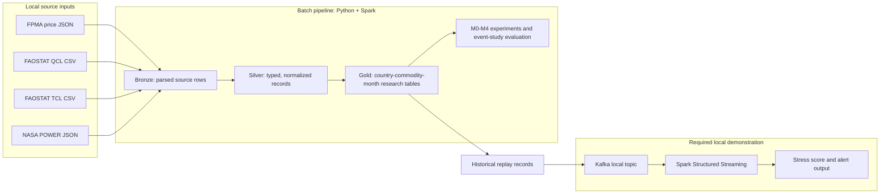

# FoodShield architecture baseline

**Status:** Project architecture baseline; current implementation and planned work are distinguished below.
**Scope:** Wheat-only research pilot, country–commodity–month analysis, M0–M4 progression, and the required local Kafka replay through Spark Structured Streaming. Other commodities remain future extensions and must not expand the current analysis scope.

## Design principles

- Use Python and Apache Spark DataFrames/Spark SQL for repeatable batch transformations; store normalized layers as Parquet.
- Keep source files immutable in `data/raw/`; explicitly reviewed, attributed small snapshots may be versioned. Ignore other raw acquisitions and all generated outputs under `data/processed/` and `artifacts/`.
- Keep development-only mock inputs under ignored `data/synthetic/`, mark every row as synthetic, and exclude them from reported model/evaluation results.
- Keep schemas, units, identifiers, grain, and temporal availability explicit. Retain source flags/notes. Do not turn missing values into zero.
- Keep the pipeline configurable by country, item code, source IDs, and paths, while requiring a separate feasibility profile before changing from the Ukraine wheat pilot.
- Keep annual data availability separate from its reference year. The current two-year lag is a declared proxy, not a verified publication vintage.
- Do not present the exploratory NASA point as representative weather or proposal event examples as country-level binary labels; select final evaluation instances after coverage and outcome checks.
- Keep raw FPMA/APK-Inform values local and do not redistribute or reproduce them in public outputs until reuse rights are confirmed.
- Design bounded local runs and tune parallelism/memory to the host. The current maintainer's Windows 11 / 8 GB machine is one reference environment, not a requirement for teammates. No cloud services or paid resources are currently in scope.

## Batch and streaming architecture



The batch path is the analytical foundation. Kafka replay is a separate demonstration that reads historical or processed records; it is not a live-feed service and does not replace batch validation.

## Data layers and contracts

| Layer | Purpose | Contract |
|---|---|---|
| `data/raw/` | Original retrieved source responses/archives and explicitly approved pinned snapshots. | Preserve unchanged. Keep unreviewed/restricted acquisitions local and ignored; allowlist only documented snapshots with reuse terms/attribution reviewed. Record canonical source, request/filter, retrieval date, checksum, and limitations in `DATA_SOURCE_REGISTER.md`. |
| Bronze | Source-specific rows flattened to tabular form. | Preserve source identifiers, units, flags, notes, original frequency, and a source-file key. Do not apply model assumptions here. |
| Silver | Typed, normalized signal rows ready for alignment. | Use canonical country, commodity, unit, date/year, and element fields; keep annual availability dates, weather location/method, and quality flags explicit. |
| Gold | Analysis-grain datasets and features. | Keyed by country–commodity–month for this wheat project; M0–M4 signals must be joinable and their missingness/coverage visible. Do not create target labels from the same signal being evaluated. |
| Artifacts | Profiles, evaluation summaries, charts, and reports. | Keep separate from raw data and source code; state targets versus measured results and include reproducibility metadata. |

### Data cleaning and normalization rules

Apply cleaning rules in Spark DataFrame/Spark SQL transformations, with source-specific rules recorded in the dataset contract:

- Preserve raw inputs. In derived tables, distinguish invalid keys from missing measurements; record rejected-row counts and reasons rather than silently dropping rows.
- Reject null or whitespace-only required identifiers and invalid dates. Trim identifiers and codes for matching, but retain original source fields when their exact spelling or formatting is useful for provenance.
- Keep missing measurements null. Convert sentinels only when the source defines them (NASA POWER `-999` is excluded from the current silver weather table); never replace absent wheat values with zero by default.
- Define numeric validity checks by source, measure, and unit. Do not apply generic bounds, clip outliers, or remove zero values without a documented source-based rule.
- Declare a unique grain for every output and use deterministic, source-justified duplicate handling. Fail or quarantine unresolved conflicts; do not select the maximum value as a generic deduplication rule. The AQI assignment's highest-reading rule is domain-specific and does not transfer to wheat prices or volumes.
- Make time zone, date parsing, and period grain explicit. Use month-start dates for country–wheat–month records, and keep annual reference years separate from feature-availability dates.
- Preserve flags, notes, units, source identifiers, and conversion factors through normalization. Keep exact output column names and Spark types stable for each published table contract.
- Use Spark expressions and aggregations for processing; avoid collecting full datasets to Python driver memory or converting source tables to Pandas.

These rules carry the course's Spark DataFrame discipline into the wheat domain while keeping each validity and conflict rule tied to its actual source semantics.

### Application component boundaries

| Package | Project-level responsibility | State |
|---|---|---|
| `ingestion/` | Read source snapshots using explicit schemas; record retrieval/version metadata; keep feature logic out of source adapters. | Planned; Week 2 readers currently live in `etl/week2.py`. |
| `transforms/` | Normalize source identifiers, units, dates, missing values, flags, notes, and annual availability into silver contracts. | Initial source transforms are in `etl/week2.py`; split into modules as sources are added. |
| `features/` | Align signals to country–commodity–month; compute temporal lags/interactions; enforce availability before joins. | Planned for Week 3. |
| `models/` | Implement the price baseline and staged M1–M4 detectors/scorers behind a shared interface. | Planned for Weeks 4–5. |
| `evaluation/` | Store event-study contexts/target definitions, holdouts, metrics, ablations, and runtime measurements. | Planned for Weeks 4–7; no binary target is approved yet. |
| `streaming/` | Replay processed history to local Kafka; consume with Spark Structured Streaming; emit traceable stress alerts. | Planned for Week 6; not a live ingestion service. |
| `scripts/` | Provide small bounded commands that load config and call package functions. | Week 2 runner implemented. |

### Canonical analytical records

Silver data stays source-specific and long form. The planned gold feature table uses a unique `(country_code, commodity_code, month)` row key, with `month` as the first day of the calendar month. Keep measures and their availability metadata explicit:

- price nominal/real/USD values, currency, unit, and series UUID;
- weather measures, units, method, valid-day counts, and region/location key;
- production/trade measures with reference year, `feature_available_from`, lag assumption, unit, quality flag, and note;
- source snapshot/retrieval reference and per-signal missingness indicators.

Preserve source units in silver. If unit conversion is needed, write a separately named feature and record the conversion factor; do not silently combine nominal and real prices or different market/product definitions.

### Source and time grain

- **FPMA price:** preserve source observation frequency; use the provider's calculated monthly values as the M0 month-level input rather than averaging weekly rows without a separately approved rule. Store nominal, real, and USD fields as separate measures with currency/unit metadata.
- **FAOSTAT QCL production:** long form at country × commodity × element × data year; values carry unit, flag, and note. Current provisional availability date is January 1 of `data_year + 2`.
- **FAOSTAT TCL trade:** long form at reporter country × commodity × import/export element × data year; quantity and value remain distinct and keep units/flags/notes. The selected bulk extract has no partner dimension.
- **NASA POWER weather:** preserve daily parameters, units, time standard, coordinates, and spatial method. Current Ukraine data is a single-point screening sample. Planned national/crop-exposure features require verified region selection and wheat-area weights.
- **Event evidence:** broad FAO-backed periods are retrospective global event-study contexts. An independent, observable stress target is a separate contract needed before classification metrics are meaningful.

## Model progression and event validation

| Model | Signals |
|---|---|
| M0 | Price |
| M1 | Price + weather |
| M2 | Price + weather + production |
| M3 | Price + weather + production + trade |
| M4 | All feasible signals plus temporal lags and cross-signal interactions |

Compare models by ablation on common supported holdout periods. Report unavailable signals and coverage changes. The 2007–08, 2010/11, and 2022 windows are context for event-study timing; do not claim precision, recall, or predictive skill until the independent target and negative periods are operationally defined. Prevent threshold tuning on the holdout cases.

## Repository layout

```text
configs/
  week2.local.json            # Local pilot identity, input paths, lag, output path
docs/
  ARCHITECTURE.md             # This baseline
  DATA_SOURCE_REGISTER.md    # Re-download URLs, requests, filters, provenance gaps
  DECISIONS.md                # Confirmed requirements and working decisions
  PLAN.md                     # Eight-week roadmap
  WEEK1_*.md                  # Feasibility evidence and handoff
  WEEK2_ETL.md                # Current local pipeline instructions/contracts
scripts/
  run_week2_etl.py            # Bounded local Spark entry point
src/foodshield/
  ingestion/                  # Source-specific readers and snapshot metadata (planned)
  transforms/                 # Bronze/silver contracts and normalization (planned)
  features/                   # Country-commodity-month alignment and lags (planned)
  models/                     # M0-M4 detector/scoring interfaces (planned)
  evaluation/                 # Event studies, targets, metrics, ablations (planned)
  streaming/                  # Historical replay, stream consumer, alert writer (planned)
  etl/week2.py                # Current FPMA/FAOSTAT/NASA ETL slice
data/
  raw/                        # Local inputs; only documented shareable snapshots are versioned
  processed/                  # Bronze/Silver/Gold Parquet, ignored by Git
proposal/                     # Submitted proposal materials; preserve in place
artifacts/                    # Generated reports/figures, ignored by Git
tests/                        # Planned for targeted contract checks; not added yet
```

`configs/week2.local.json`, `scripts/run_week2_etl.py`, and `src/foodshield/etl/week2.py` are the current Week 2 implementation. The other `src/foodshield/` packages, tests, and artifacts are planned, not yet implemented. Proposal source files and archive contents stay in their existing locations.

## Current implementation slice and boundaries

`scripts/run_week2_etl.py` reads the JSON configuration and runs `src/foodshield/etl/week2.py` in Spark local mode. It writes source-specific bronze Parquet, typed silver Parquet, monthly point-weather screening data, the M0 monthly-price gold table, and a profile with schemas and counts. It fails for empty datasets, null grain keys, or duplicate grain keys. It does not yet build a joined M1–M4 feature table, event labels, model scores, or streaming records.

The current maintainer's machine has PySpark 4.3.0, Java 17, and Apache-built Hadoop 3.5.0 Windows native files (`winutils.exe` and `hadoop.dll`) under `D:\Bharath\Installations`. This path and Windows native setup are host-specific, not shared team prerequisites; see `PREREQUISITES.md` for teammate setup. The Week 2 ETL has written its Bronze, Silver, and Gold Parquet outputs and profile; pilot counts and source limitations are documented in `WEEK2_ETL.md`.

## Streaming event and alert contract (planned)

The replay input is a processed country–commodity–month observation, not a raw source row. Use a stable JSON envelope with `schema_version`, deterministic `record_id`, `country_code`, `commodity_code`, `observation_month` (month start), `available_at` (UTC timestamp), `feature_set_version`, `model_stage`, `signals_present`, and typed `features`. Preserve units and valid availability dates; absent values remain null and are marked absent. Order replay by `available_at` with `record_id` as a deterministic tie-breaker.

Alert output should include `schema_version`, `record_id`, country/commodity/month, model stage/version, score or status, threshold/config identifier, reason codes, and emitted UTC timestamp. Topic names, replay pacing, checkpoint location, and output mode must be explicit in local configuration. Reconcile input and output counts and document restart behavior; do not promise exactly-once semantics without evidence. The final serialization and delivery details remain a Week 6 design gate.

## Scalability and execution approach

- Use Spark local mode with bounded parallelism, shuffle partitions, driver memory, and source slices matched to each host. The current Week 2 configuration (`local[2]`, 1 GiB driver memory, four SQL shuffle partitions) is the maintainer's reference profile, not a required setting for every machine.
- Keep schemas explicit and transforms narrow; select needed columns before joins and aggregates. Avoid collecting full datasets to the driver, Python UDFs for ordinary SQL operations, and copies of the raw archives.
- Do not partition small pilot outputs by month. For larger sources, measure output size and query patterns first; consider country/year partitions and avoid high-cardinality or tiny-file layouts.
- Measure actual batch throughput, runtime, join/shuffle cost, and memory in later weeks. Targets remain targets until measured. Streaming latency/throughput requires a separately documented replay workload and runtime configuration.
- Configurable country/item/source values do not expand the study beyond wheat. Any alternate geography requires profiled identifiers and mappings; another commodity is outside this proposal's analysis scope.

## Decision references

- Project objective, scope, M0–M4 and TA streaming requirement: `PROJECT_BRIEF.md`.
- Working source and temporal choices, plus unresolved release gates: `DECISIONS.md`.
- Re-download paths and source provenance: `DATA_SOURCE_REGISTER.md`.
- Week 1 country/event feasibility and per-owner status: `WEEK1_PROPOSAL_SOURCE_FEASIBILITY.md`, `WEEK1_EVENT_CASES.md`, and `WEEK1_TASK_ASSIGNMENTS.md`.
- Current ETL fields, grains, run instructions, and outputs: `WEEK2_ETL.md`.
