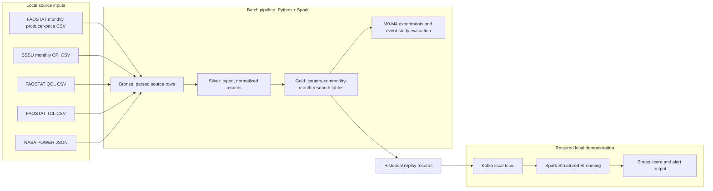

# FoodShield architecture baseline

**Status:** Project architecture baseline; current implementation and planned work are distinguished below.
**Scope:** The current research experiment remains wheat-only, with Ukraine as the selected pilot; the analysis grain is country–commodity–month, with M0–M4 progression and the required local Kafka replay through Spark Structured Streaming. The implementation is being made configuration-driven so a separately profiled country or commodity can reuse the pipeline without changing transformation/model code where source schemas and meanings are compatible. This reusable design does not claim data availability or expand the current experiment beyond wheat.

## Design principles

- Use Python and Apache Spark DataFrames/Spark SQL for repeatable batch transformations; store normalized layers as Parquet.
- Keep source files immutable in `data/raw/`; explicitly reviewed, attributed small snapshots may be versioned. Ignore other raw acquisitions and generated outputs under `data/processed/`, except outputs explicitly allowlisted with provenance for team reuse.
- Keep development-only mock inputs under ignored `data/synthetic/`, mark every row as synthetic, and exclude them from reported model/evaluation results.
- Keep schemas, units, identifiers, grain, and temporal availability explicit. Retain source flags/notes. Do not turn missing values into zero.
- Keep the pipeline configurable by country, item code, source IDs, and paths, while requiring a separate feasibility profile before changing from the Ukraine wheat pilot.
- Keep annual data availability separate from its reference year. The current two-year lag is a declared proxy, not a verified publication vintage.
- Do not present the exploratory NASA point as representative weather or proposal event examples as country-level binary labels; select final evaluation instances after coverage and outcome checks.
- Keep raw FPMA/APK-Inform values local and do not redistribute or reproduce them in public outputs until reuse rights are confirmed.
- Design bounded local runs and tune parallelism/memory to the host. The current maintainer's Windows 11 / 8 GB machine is one reference environment, not a requirement for teammates. No cloud services or paid resources are currently in scope.

## Batch and streaming architecture



The local FPMA/APK-Inform series is an optional controlled comparator, not a shared input to the selected pilot target.

The batch path is the analytical foundation. Kafka replay is a separate demonstration that reads historical or processed records; it is not a live-feed service and does not replace batch validation.

## Data layers and contracts

| Layer | Purpose | Contract |
|---|---|---|
| `data/raw/` | Original retrieved source responses/archives and explicitly approved pinned snapshots. | Preserve unchanged. Keep unreviewed/restricted acquisitions local and ignored; allowlist only documented snapshots with reuse terms/attribution reviewed. Record canonical source, request/filter, retrieval date, checksum, and limitations in `DATA_SOURCE_REGISTER.md`. |
| Bronze | Source-specific rows flattened to tabular form. | Preserve source identifiers, units, flags, notes, original frequency, and a source-file key. Do not apply model assumptions here. |
| Silver | Typed, normalized signal rows ready for alignment. | Use canonical country, commodity, unit, date/year, and element fields; keep annual availability dates, weather location/method, and quality flags explicit. |
| Gold | Analysis-grain datasets and features. | Keyed by country–commodity–month for this wheat project; M0–M4 signals must be joinable and their missingness/coverage visible. Do not create target labels from the same signal being evaluated. |
| Artifacts | Profiles, evaluation summaries, charts, and reports. | Keep separate from raw data and source code; state targets versus measured results and include reproducibility metadata. |

### Data cleaning and normalization rules

Apply cleaning rules in Spark DataFrame/Spark SQL transformations, with source-specific rules recorded in the dataset contract:

- Preserve raw inputs. In derived tables, distinguish invalid keys from missing measurements; record rejected-row counts and reasons rather than silently dropping rows.
- Reject null or whitespace-only required identifiers and invalid dates. Trim identifiers and codes for matching, but retain original source fields when their exact spelling or formatting is useful for provenance.
- Keep missing measurements null. Convert sentinels only when the source defines them (NASA POWER `-999` is excluded from the current silver weather table); never replace absent wheat values with zero by default.
- Define numeric validity checks by source, measure, and unit. Do not apply generic bounds, clip outliers, or remove zero values without a documented source-based rule.
- Declare a unique grain for every output and use deterministic, source-justified duplicate handling. Fail or quarantine unresolved conflicts; do not select the maximum value as a generic deduplication rule. The AQI assignment's highest-reading rule is domain-specific and does not transfer to wheat prices or volumes.
- Make time zone, date parsing, and period grain explicit. Use month-start dates for country–wheat–month records, and keep annual reference years separate from feature-availability dates.
- Preserve flags, notes, units, source identifiers, and conversion factors through normalization. Keep exact output column names and Spark types stable for each published table contract.
- Use Spark expressions and aggregations for processing; avoid collecting full datasets to Python driver memory or converting source tables to Pandas.

These rules carry the course's Spark DataFrame discipline into the wheat domain while keeping each validity and conflict rule tied to its actual source semantics.

### Application component boundaries

| Package | Project-level responsibility | State |
|---|---|---|
| `ingestion/` | Read source snapshots using explicit schemas; record retrieval/version metadata; keep feature logic out of source adapters. | Planned. Week 2 readers live in `etl/week2.py`; the full FAOSTAT bulk reader is in `etl/bulk.py` (D9-A). |
| `transforms/` | Normalize source identifiers, units, dates, missing values, flags, notes, and annual availability into silver contracts. | Initial source transforms are in `etl/week2.py`; split into modules as sources are added. |
| `features/` | Align signals to country–commodity–month; compute temporal lags/interactions; enforce availability before joins. | Week 3 synthetic and local Week 2 feature runs complete; retain the coverage and rights caveats in `WEEK3_FEATURES.md`. |
| `models/` | Implement the price baseline and staged M1–M4 detectors/scorers behind a shared interface. | M0 (`m0.py`) and the shared M0–M4 stage definitions and estimator (`staged.py`) implemented on V2. |
| `evaluation/` | Store event-study contexts/target definitions, holdouts, metrics, ablations, and runtime measurements. | Labels, metrics, episodes and lead time (`evaluation/week4.py`) implemented on V2; runtime measurements planned for Week 7. |
| `streaming/` | Replay processed history to local Kafka; consume with Spark Structured Streaming; emit traceable stress alerts. | Implemented in Week 6 (D12): records, paced producer, Spark consumer, online monitor, local KRaft broker. Not a live ingestion service. |
| `scripts/` | Provide small bounded commands that load config and call package functions. | Runners for Weeks 2–5, the one-time final test and the D9 scale jobs are implemented. |

### Canonical analytical records

Silver data stays source-specific and long form. The planned gold feature table uses a unique `(country_code, commodity_code, month)` row key, with `month` as the first day of the calendar month. Keep measures and their availability metadata explicit:

- price nominal/real/USD values, currency, unit, and series UUID;
- weather measures, units, method, valid-day counts, and region/location key;
- production/trade measures with reference year, `feature_available_from`, lag assumption, unit, quality flag, and note;
- source snapshot/retrieval reference and per-signal missingness indicators.

Preserve source units in silver. If unit conversion is needed, write a separately named feature and record the conversion factor; do not silently combine nominal and real prices or different market/product definitions.

### Project-level signal and target variables

The professor's report expectation includes the data model, methods, platforms, evaluation design, metrics, scalability goals, plots, analysis, and summary. These candidate variables make the project architecture concrete; they do not expand the wheat-only research objective. Exact feature selection and the target formula remain subject to data profiling and the Week 4 evaluation decision.

| Variable group | Candidate fields | Model role |
|---|---|---|
| Panel key and provenance | `country_code`, `commodity_code`, `month`, source/series ID, unit/currency, availability date, quality flags, weather spatial basis | Country–wheat–month key and audit fields; metadata is not a predictor. |
| Price history | Real wheat price; lags (1, 3, 6, 12 months); prior-window means/standard deviations; month-over-month change; past-only anomaly | M0 price-only baseline; keep nominal, real, and USD measures distinct. |
| Weather | Monthly corrected precipitation total; mean daily maximum/minimum temperature; valid-day counts; location/spatial method; past-only lags/anomalies | M1. Ukraine uses the 24-oblast wheat-area-weighted series (D5), compared with the same calendar month in the prior 10 years (D10). The 232-cell grid gives almost the same series (D9-B). |
| Production | Annual wheat production (t), yield (kg/ha), area harvested (ha), reference year, `feature_available_from`, flag/note | M2; use only values available by the forecast origin. Bounded year-on-year change of the latest available year (D10); two-year lag with a three-year sensitivity run (D6). |
| Trade | Annual import/export quantity (t) and value (1000 USD), reference year, `feature_available_from`, flag/note | M3; retain quantity/value as separate measures and use as-of availability. Same bounded year-on-year change and lag as M2. |
| Temporal/cross-signal | Selected lagged relationships, rolling/anomaly features, price–weather interactions | M4; calculate from past-only information and document selection. |
| Target and evaluation | Future price-stress score/label at the selected horizon; model alert score/flag; split ID; forecast origin; event onset and warning lead time | Target and threshold are future-outcome definitions, not model inputs; neither may be tuned on final test data. |

### Project-level evaluation contract

- Evaluate M0–M4 on identical eligible forecast origins, future target labels, horizon, and chronological partitions. Change predictor groups by stage while holding the evaluation sample fixed.
- The primary ablation uses the intersection of months where all required stages and the target are eligible. A longer-coverage M0-only result may be reported separately as supplementary, not as a direct ablation comparison.
- Fit learned preprocessing and model parameters on training only. Use validation to select settings and alert thresholds; leave final test untouched. The current protocol does not refit on validation after selection.
- Purge each partition boundary by the forecast horizon so a future label cannot reach across a split. Every predictor must be available by its forecast origin, including annual data with explicit availability dates.
- Keep benchmark-only synthetic workload data separate from real-data model training, validation, test, event labels, and food-market conclusions. Use it only for controlled Spark/Kafka scale measurements when source data are too small to expose runtime scaling.

This comparison contract is project-wide. The Ukraine pilot uses FAOSTAT PP and the attributed SSSU CPI chain. The confirmed outcome (D1, D2) is a ≥10% increase in CPI-adjusted producer price within three months. The split (D3) is train 2011–2017, validate 2018–2020, test 2021–2022 with horizon purge, plus a 2014–2020 rolling-origin backtest. The full protocol is frozen in `configs/week5_frozen_protocol.json`; see `DECISIONS.md` and `WEEK5_ABLATION.md`.

### Current pilot source readiness (Ukraine)

| Signal | Profiled period | Project status and limitation |
|---|---|---|
| FAOSTAT monthly wheat producer price | January 2010–January 2023 | Selected Ukraine pilot price input/outcome; monthly farm-gate Producer Price (LCU/tonne), 157 observations, all flagged official and complete through December 2022. Shared under catalogued CC BY 4.0 with attribution. |
| SSSU all-items CPI | August 1991–September 2026 | Shared official monthly CPI-change series with attribution; chained from December 2000=100 for the shared farm-gate real-price candidate. CPI is broad inflation, not wheat-specific. |
| FPMA monthly wheat price | January 2001–October 2026 | Retained locally as an exploratory/comparison source only; APK-Inform reuse terms are unconfirmed and metadata has a Retail/Wholesale mismatch. It is not the selected M0 or outcome input. |
| NASA POWER weather | Daily January 2001–December 2022; monthly coverage 264/310 price months | Ukraine point snapshot and request metadata are tracked on the team branch. V2 adds the 24-oblast wheat-area-weighted series used by M1–M4 (D5), and the full 232-cell grid as a check (D9-B). |
| FAOSTAT wheat production | Annual 1992–2024 | Ukraine filtered extract and provenance sidecar are tracked. Contains production, yield, and harvested area with flags. |
| FAOSTAT wheat trade | Annual 1992–2024 | Ukraine filtered extract and provenance sidecar are tracked. Contains import/export quantity and value with units/flags. |

The original local Week 3 feature build uses the FPMA series and is not the shared selected-source panel. The Week 4 Spark path builds features from the selected FAOSTAT/SSSU price candidate and shared QCL/TCL/NASA inputs. Its observed counts match the source-only profile: M0 145; M1 144; M2 132; M3/M4 121. For a three-month future-observation window, 119 M4 origins remain (through October 2022). These are feature/outcome-observation availability counts, not model results. M0 uses supervised Spark MLlib logistic regression, trained/calibrated on training/validation origins only. With the corrected V2 features (D10) the common origin set is 117 months. The final test was opened once, in Week 5 (`FINAL_TEST_RESULTS.md`). Production/trade joins use the provisional two-year lag; historical publication vintages have not been verified. Country, commodity, input paths, source metadata, target, and split are selected in config, but each new series still requires compatible verified inputs and its own profiling.

India is a possible comparator, not yet a full multi-year fallback: its profiled FPMA price series spans January 2014–September 2026, but the local India weather extract covers 2022 only. India-filtered FAOSTAT extracts exist locally but are not tracked on the team branch. No alternate country currently has a better verified M0–M4 common period. A country change requires a new coverage, rights, and feature-completeness profile.

### Source and time grain

- **Selected price/outcome:** use FAOSTAT Ukraine Wheat Producer Price (LCU/tonne), monthly element 5530, at farm-gate. Keep nominal and SSSU-CPI-deflated series distinct, retain source flags, and measure the future outcome only after each prediction cutoff. The deflator uses the SSSU all-items CPI chain with an explicit December 2000=100 anchor.
- **FPMA comparison:** preserve source frequency, metadata and source fields locally. Do not redistribute raw values or value-revealing outputs without reuse permission; do not conflate its wholesale series with farm-gate producer prices.
- **FAOSTAT QCL production:** long form at country × commodity × element × data year; values carry unit, flag, and note. Current provisional availability date is January 1 of `data_year + 2`.
- **FAOSTAT TCL trade:** long form at reporter country × commodity × import/export element × data year; quantity and value remain distinct and keep units/flags/notes. The selected bulk extract has no partner dimension.
- **NASA POWER weather:** preserve daily parameters, units, time standard, coordinates, and spatial method. V2 uses one NASA cell per wheat oblast (24), weighted by SSSU oblast wheat harvested area (fixed 2015–2020 shares). D9-B repeats this on all 232 cells as a check.
- **Event evidence:** broad FAO-backed periods are retrospective global event-study contexts. The current working target is future Ukraine wheat farm-gate producer-price stress: at origin `t`, a positive label means the maximum CPI-adjusted FAOSTAT producer price in `t+1..t+3` is at least 10% above the real price at `t`. This rule and the chronological split were confirmed as D1–D3 at the Week 4 review. It is a future outcome from the same source as M0, not an independent-source label.

## Model progression and event validation

| Model | Signals |
|---|---|
| M0 | Price-only Spark MLlib binomial logistic regression over past-only 12-month real-price anomaly and month-over-month real-price change. Fit on labeled training data; select alert cutoff on labeled validation data. The future-stress rule defines the training target; it is not a rule-based detector. Confirmed as D4: L2 0.1, standardization, alert cutoff by best F1 on validation; the same estimator is used for M1–M4. |
| M1 | Price + weather |
| M2 | Price + weather + production |
| M3 | Price + weather + production + trade |
| M4 | All feasible signals plus temporal lags and cross-signal interactions |

Compare models by ablation under the project-level evaluation contract above. Report unavailable signals and coverage changes. The 2007–08, 2010/11, and 2022 windows are global contexts, not country-level binary labels. Under the selected pilot source, 2007–08 is out of coverage; 2010/11 is in coverage only from the start of the 2010 event, without the proposed multi-year pre-event history; 2022 is the current eligible test-event candidate. The outcome is strictly after the predictor cutoff but uses the same source as M0. Treat validation scores as calibration evidence, not final performance. The final test was opened once, after the protocol was frozen; any later model change is post-test exploration. Prevent threshold tuning on holdout cases.

## Repository layout

```text
configs/
  week2.local.json ... week5_ablation.local.json   # Per-week local run settings
  week4_weather_oblasts.json  # 24 oblast centroids and wheat-area weights
  week5_frozen_protocol.json  # Frozen M0-M4 test protocol (D8)
  d9b_grid_cells.json         # 232 NASA grid cells for D9-B
docs/
  ARCHITECTURE.md             # This baseline
  DATA_SOURCE_REGISTER.md     # Re-download URLs, requests, filters, provenance, evidence links
  DECISIONS.md                # Confirmed requirements and decisions D1-D11
  PLAN.md                     # Eight-week roadmap and status
  WEEK1_*.md ... WEEK7_*.md, FINAL_TEST_RESULTS.md, D9_SCALE.md, WEEK8_REPORT_AND_SLIDES_PLAN.md
  dashboard/index.html        # Self-contained results dashboard (scripts/build_week8_dashboard.py)
scripts/
  run_week2_etl.py ... run_week5_ablation.py   # Bounded local Spark entry points
  run_final_test_once.py      # Guarded one-time test
  run_d9a_faostat_bulk.py, run_d9b_grid_weather.py, fetch_*.py
src/foodshield/
  etl/week2.py, etl/bulk.py   # Week 2 ETL slice; full FAOSTAT bulk archives (D9-A)
  features/                   # Week 3/4/5 temporal features (incl. corrected D10 features)
  models/                     # m0.py; staged.py (M0-M4 stages, one estimator)
  evaluation/                 # Labels, metrics, episodes, lead time
  ingestion/, transforms/     # Planned split of source readers and normalization
  streaming/                  # Week 6 replay records, producer, Spark consumer, monitor, local Kafka
data/
  raw/                        # Local inputs; only documented shareable snapshots are versioned
  processed/                  # Outputs; only allowlisted reports/profiles are versioned
  synthetic/                  # Labelled synthetic fixtures (D7)
proposal/                     # Submitted proposal materials; preserve in place
tests/                        # unittest: fast unit tests + slower integration tests on real inputs
```

`etl/`, `features/`, `models/`, `evaluation/`, `streaming/` and `tests/` are implemented through Week 7 on `feature/workinprogress_v2`. `ingestion/` and `transforms/` remain planned splits of `etl/`. Proposal source files and archive contents stay in their existing locations.

## Current implementation slice and boundaries

`scripts/run_week2_etl.py` reads the JSON configuration and runs `src/foodshield/etl/week2.py` in Spark local mode. It writes source-specific bronze Parquet, typed silver Parquet, monthly point-weather screening data, the M0 monthly-price gold table, and a profile with schemas and counts. It fails for empty datasets, null grain keys, or duplicate grain keys. Later stages build on it: the Week 3/4 feature panels, the Week 4/5 labels, models and evaluation, and the D9 bulk and grid jobs. Streaming records are still to come (Week 6).

The current maintainer's machine has PySpark 4.3.0, Java 17, and Apache-built Hadoop 3.5.0 Windows native files (`winutils.exe` and `hadoop.dll`) in a local Hadoop folder. That setup is host-specific, not shared team prerequisites; see `PREREQUISITES.md` for teammate setup. The Week 2 ETL has written its Bronze, Silver, and Gold Parquet outputs and profile; pilot counts and source limitations are documented in `WEEK2_ETL.md`.

## Streaming event and alert contract (implemented in Week 6, D12)

**Change from the plan.** The plan was to replay one processed country–commodity–month row per month. D12 instead replays the inputs at their own grain:

- daily grid-cell weather (1,864,120 records);
- the monthly real price (156);
- annual production and trade values (210).

The monthly features are then built inside the stream, so the replay is large enough to exercise Kafka and Spark.

**Input envelope** (`src/foodshield/streaming/records.py`). Each record is flat JSON with these fields:

- **Identity and timing:** `schema_version`, a deterministic `record_id`, `record_type`, `country_code`, `commodity_code`, `source`, `series_id`, `observation_date`, `available_at` (UTC) and `feature_set_version`.
- **Typed values** (null when absent): `prectotcorr_mm`, `t2m_max_c`, `t2m_min_c`, `price_real_lcu_per_tonne`, `annual_field`, `data_year`, `value` and `unit`.

**When each record becomes available:**

| Record | Available at |
|---|---|
| Daily weather | 00:00 UTC the next day |
| Monthly price | The first day of the next month |
| Annual value for year Y | 1 January of Y + 2 (D6) |

Replay order is `available_at`, with `record_id` as the tie-breaker.

**Kafka keys:**

- the grid cell for weather;
- `UKR:wheat` for price and annual records, so each series keeps its order within one partition.

Topics are `foodshield.observations` (3 partitions) and `foodshield.alerts` (1 partition).

**Alert output.** One alert per month and model stage (M0, M4), written to a per-batch JSON-lines file and to the alert topic. Each alert has:

- `schema_version` and `record_id` (`alert:<stage>:<month>`);
- country, commodity and month;
- model stage and version (the frozen test model), score, cutoff and alert flag;
- the top three feature contributions as reason codes, and the features used;
- the Kafka timestamp at which the month's inputs were complete, the emission time and the latency.

**Delivery and restart.** Delivery is at-least-once:

- Spark checkpoints the Kafka offsets and the de-duplication state;
- records are de-duplicated by `record_id` within a 45-day event-time watermark;
- monitor state is saved with the micro-batch id, so a re-delivered batch is skipped;
- an alert can be re-sent after a crash, and readers de-duplicate it by `record_id`.

No exactly-once claim is made. Configuration is in `configs/week6_streaming.local.json`; the run and check procedure is in `WEEK6_STREAMING.md`.

## Scalability and execution approach

- Use Spark local mode with bounded parallelism, shuffle partitions, driver memory, and source slices matched to each host. The current Week 2 configuration (`local[2]`, 1 GiB driver memory, four SQL shuffle partitions) is the maintainer's reference profile, not a required setting for every machine.
- Keep schemas explicit and transforms narrow; select needed columns before joins and aggregates. Avoid collecting full datasets to the driver, Python UDFs for ordinary SQL operations, and copies of the raw archives.
- Do not partition small pilot outputs by month. For larger sources, measure output size and query patterns first; consider country/year partitions and avoid high-cardinality or tiny-file layouts.
- Measure actual batch throughput, runtime, join/shuffle cost, and memory. First reference runs are measured in `D9_SCALE.md` (22.7 million FAOSTAT rows; 1.86 million daily weather rows). The repeated scaling series is in `WEEK7_SCALABILITY.md` (up to 186 million rows; cores, shuffle partitions and memory varied one at a time). Targets remain targets until measured. Streaming latency/throughput requires a separately documented replay workload and runtime configuration.
- Configurable country/item/source values do not expand the study beyond wheat. Any alternate geography requires profiled identifiers and mappings; another commodity is outside this proposal's analysis scope.

## Decision references

- Project objective, scope, M0–M4 and TA streaming requirement: `PROJECT_BRIEF.md`.
- Working source and temporal choices, plus unresolved release gates: `DECISIONS.md`.
- Re-download paths and source provenance: `DATA_SOURCE_REGISTER.md`.
- Week 1 country/event feasibility and per-owner status: `WEEK1_PROPOSAL_SOURCE_FEASIBILITY.md`, `WEEK1_EVENT_CASES.md`, and `WEEK1_TASK_ASSIGNMENTS.md`.
- Current ETL fields, grains, run instructions, and outputs: `WEEK2_ETL.md`.
