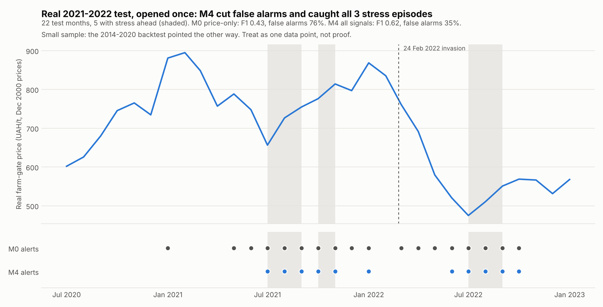

# Real 2021–2022 test results (opened once)

**Opened:** once, in Week 5 (time recorded in `data/processed/final_test/OPENED.json`), by `scripts/run_final_test_once.py --confirm-open-test`
**Protocol:** `configs/week5_frozen_protocol.json` (SHA-256 `c6fc95aa…0af58`). It was committed with decisions D10, D11 and D8 in `a1822a6` before the run.
**Marker:** `data/processed/final_test/OPENED.json`; the script refuses to run again.
**Full output:** `data/processed/final_test/final_test_report.json` (every month's score and alert, every stage, both lags, all three variants).

The test was run exactly as pre-registered. Every stage was fit on 2011–2017, with its alert cutoff taken from 2018–2020, and scored once on 2021-01 to 2022-10. Nothing was tuned after seeing these results.

## 1. Primary result (corrected features, 2-year lag)

22 test months, 5 with stress ahead, 3 episodes: Jul–Aug 2021, Oct 2021, Jul–Aug 2022.

| Stage | Alerts | Precision | Recall | F1 | False-alarm rate | AUC | Episodes caught (lead, months) | F1 − M0, 90% interval |
|---|---:|---:|---:|---:|---:|---:|---|---|
| **M0** price | 18 | 0.28 | 1.00 | 0.43 | 0.76 | 0.75 | 3/3 (1, 3, 2) | — |
| M0 + season (control) | 0 | — | 0.00 | 0.00 | 0.00 | 0.53 | 0/3 | −0.62 to −0.19 |
| M1 + weather | 12 | 0.33 | 0.80 | 0.47 | 0.47 | 0.84 | 3/3 (0, 3, 2) | −0.14 to +0.18 |
| M2 + production | 12 | 0.33 | 0.80 | 0.47 | 0.47 | 0.79 | 3/3 (0, 3, 2) | −0.14 to +0.19 |
| M3 + trade | 12 | 0.33 | 0.80 | 0.47 | 0.47 | 0.85 | 3/3 (0, 3, 2) | −0.12 to +0.18 |
| **M4** + interaction | 11 | 0.45 | 1.00 | **0.62** | **0.35** | **0.88** | 3/3 (1, 3, 2) | **+0.08 to +0.31** |
| Always alert | 22 | 0.23 | 1.00 | 0.37 | 1.00 | | | |
| Momentum rule | | | | 0.37 | | | | |

The interval method is a bootstrap over the 22 test months (2,000 resamples) with the same months for both models. An interval entirely above 0 means the stage beat M0 beyond noise.

**In plain terms**

1. **Every model caught all 3 episodes**, so the difference is in false alarms. Price-only M0 alerted in 18 of 22 months. M4 alerted in 11 and was right 5 times, with warnings 1–3 months ahead.
2. **M4 is the only stage that beats M0 beyond noise** (F1 0.62 vs 0.43). M1–M3 rank months better than M0 (AUC 0.79–0.85 vs 0.75), but their F1 gains are within noise.
3. **The calendar pattern broke.** The season control raised no alerts at all in 2021–2022. The harvest-season pattern learned from 2011–2017 did not hold through the war period.

## 2. Robustness (pre-registered)

| Check | Result |
|---|---|
| 3-year annual lag (D6) | M0 and M1 unchanged. M2 F1 0.50, M3 0.62, M4 0.46 (AUC 0.84–0.87). Multi-signal stages still rank better than M0 (0.75), but which stage is best changes with the lag, so no single stage is robustly best. |
| Season in every stage (D11) | All stages weaker: price + season raised no alerts; M3/M4 F1 0.43, AUC 0.65. Adding the calendar hurt in 2021–2022. |
| Week 3 features as built (D10 check) | M1–M4 AUC 0.28–0.35, worse than chance; M3/M4 alerted in every month. This confirms that the old features were unreliable. |

## 3. How this fits with the 2014–2020 backtest

The two pieces of evidence point in **different directions**:

| Evidence | Months / stress months / episodes | Does adding weather, production and trade help? |
|---|---|---|
| 2014–2020 rolling-origin backtest | 81 / 24 / 8 | No. M1–M4 were worse than M0 beyond noise. |
| 2021–2022 real test (once) | 22 / 5 / 3 | Partly. M4 beat M0 beyond noise; M1–M3 ranked better. |

The backtest has about four times more data, so it should carry at least as much weight as the test. The honest overall reading for the report is:

> On this one-country pilot, multi-signal models did not consistently beat price-only monitoring. They underperformed on 2014–2020 and outperformed on 2021–2022, a period of war-driven disruption when the usual seasonal price pattern broke down. The evidence is too thin (8 + 3 episodes) to decide between the two. More events, from more countries (D9-D) or more years, are needed.

On D9-D: FAOSTAT has at least 120 monthly wheat producer prices for 2010–2022 for 31 countries (`D9_SCALE.md`), so a multi-country panel is feasible on the price side. The team has scheduled it as extension work after the core single-country project (D13).

## 4. Caveats to state in the report

- **Tiny test:** 5 stress months and 3 episodes. One alert more or less moves F1 by about 0.1.
- **What the 2022 "stress" was.** After the February 2022 invasion, Ukraine's real farm-gate price *fell* 43% (835 in February to 475 in July), as exports were blocked. The 2022 stress months (July–August) are a rebound from that low, not the invasion shock. The ≥10% rise rule counts rebounds as stress. That fits a farm-gate price-risk reading, but should be stated plainly.
- **Coverage:** occupied territories are excluded from SSSU-based weather weights from March 2022, and FAOSTAT 2021–2022 figures may be revised.
- **The annual lag is not fully verified.** For data year 2020, FAO's release may have come in about April 2022, so the 2-year rule could be up to 3 months early for January–March 2022 forecasts. The 3-year-lag run shows a similar overall picture.
- **Weather points are approximate:** one grid cell per oblast. *Post-test check (D9-B):* the full 232-cell grid gives almost the same national series (correlation ≥ 0.9986 after removing the season), so this does not affect the reading. See `D9_SCALE.md`.
- **No re-runs.** Because the test is opened, any further model change must be reported as post-test exploration, not as test evidence.
