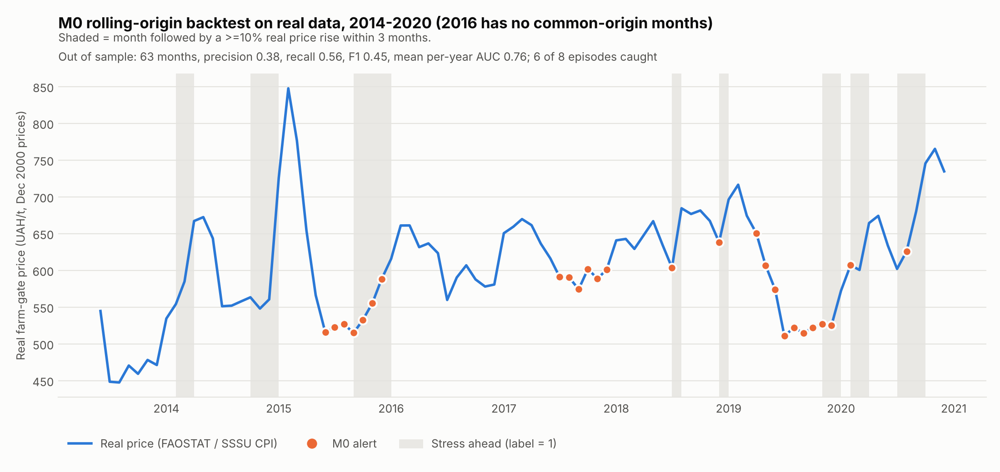
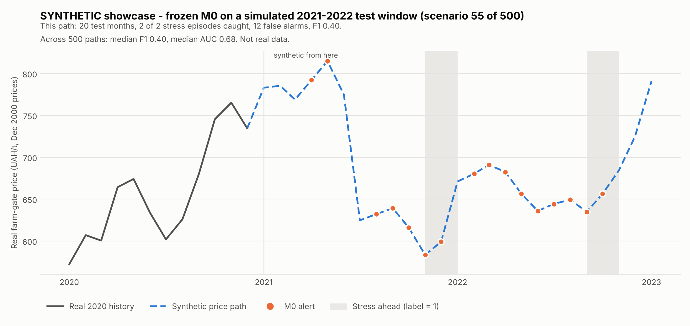

# Week 4 review package (V2): evidence and decisions to confirm

**Branch:** `feature/workinprogress_v2` (created from `feature/workinprogress_v1` at commit `3a6d5fd`)
**Prepared:** Week 4
**Status:** D1–D9 confirmed by Abhijith C R at the Week 4 review (recommended options; see `DECISIONS.md`). The real 2021–2022 test was then opened once, in Week 5, after D10 and D11 (`FINAL_TEST_RESULTS.md`). Items that would change the test protocol can no longer be reopened as test evidence. The tables below show the state at review time.

## 1. What V2 adds

| Area | V1 state | V2 addition | Evidence file |
|---|---|---|---|
| Reproducibility | M0 run on the maintainer's Windows host | Re-ran labels and M0 on a clean Linux/PySpark 4.3.0 environment: label file hash identical, M0 coefficients and validation counts identical | `data/processed/week4_ukraine_m0_candidate/m0_profile.json` |
| Weather (M1 input) | One NASA POWER point at 49°N 32°E, screening only | Wheat-area-weighted national series: 24 oblast points weighted by official SSSU wheat harvested area | `data/processed/week4_ukraine_weather_wheat_area_weighted_monthly.csv` |
| Regional wheat area | Not available | SSSU harvested wheat area by oblast, 2015–2021 (SDMX API) | `data/raw/sssu_ukraine_wheat_harvested_area_by_oblast_2026-11.csv` |
| Annual availability lag | 2-year proxy, no release-date evidence | FAO release dates found for recent data years; earlier years still open (Section 3.3) | this document |
| Small test sample | 9 M4 origins in 2022 | Rolling-origin backtest on real 2014–2020 data: 63 out-of-sample months, 8 stress episodes | `data/processed/week4_rolling_origin/` |
| Model showcase | None | Synthetic 2021–2022 test window (500 scenarios), scored by the frozen M0 model; synthetic only | `data/synthetic/week4_showcase/` |
| Code | — | `evaluation/week4.py`, weighted-weather reader in `features/week4.py`, four new scripts, `configs/week4_v2.local.json` | Section 6 |

## 2. Headline findings

1. **M0 ranks risk reasonably but alerts noisily.** On real, never-trained-on years (2014–2020), the price-only model ranks months well within a year (mean per-year AUC 0.76) and caught 6 of 8 stress episodes, 1–3 months ahead. As an alarm it is weak: precision 0.38 and a false alarm in 36% of calm months. On the M0–M4 common origins its F1 (0.45) barely beats "always alert" (0.44) or a naive momentum rule (0.44). This is the bar M1–M4 must clear, which is what the research question needs.
2. **V1's validation F1 of 0.57 was optimistic.** That figure came from the same 30 months used to choose the cutoff. The cutoff learned on each training window varies from 0.17 to 0.29, and with it the alert rate.
3. **Weighted weather changes rainfall, not temperature.** Correlation with the old single point is 0.999 for temperatures but 0.88 for precipitation. The single point overstated rainfall variability (standard deviation 26.7 vs 21.2 mm/month). Feature coverage is unchanged (M0 145, M1 144, M2 132, M3/M4 121 origins), and so is the M0 result.
4. **The 2-year annual lag matches recent FAO practice, but not every year.** See 3.3. This needs a team decision.



## 3. Evidence

### 3.1 Rolling-origin backtest (real data, pre-test only)

Design: expanding window. For each test year Y, M0 (same Spark MLlib logistic regression and settings) is refit on every common-origin month whose 3-month outcome window ends by December of Y−1. The alert cutoff is picked by F1 on those training months, then year Y is scored once. No outcome after December 2020 is used (code guard). 2016 has no common-origin months because trade anomalies are undefined.

| Test year | Train months (stress) | Cutoff | Test months | Stress months | Alerts | Hits | False alarms | AUC |
|---|---:|---:|---:|---:|---:|---:|---:|---:|
| 2014 | 30 (4) | 0.174 | 11 | 5 | 0 | 0 | 0 | 0.80 |
| 2015 | 41 (9) | 0.227 | 11 | 4 | 7 | 4 | 3 | 0.75 |
| 2017 | 55 (16) | 0.287 | 11 | 0 | 6 | 0 | 6 | — |
| 2018 | 63 (16) | 0.247 | 11 | 2 | 2 | 2 | 0 | 1.00 |
| 2019 | 74 (17) | 0.227 | 11 | 2 | 9 | 2 | 7 | 0.33 |
| 2020 | 85 (18) | 0.204 | 8 | 5 | 2 | 2 | 0 | 0.93 |

| Pooled out of sample (63 months, 18 stress) | Precision | Recall | F1 | False-alarm rate |
|---|---:|---:|---:|---:|
| **M0** | 0.38 | 0.56 | 0.45 | 0.36 |
| Always alert | 0.29 | 1.00 | 0.44 | 1.00 |
| Momentum rule (alert if real price rose last month) | 0.34 | 0.61 | 0.44 | 0.47 |

Episodes: 8 in total. Missed: both in 2014, when the model had only 4 stress months to learn from. Caught: 2015-09 (lead 3 months), 2018-07 (1), 2018-12 (2), 2019-11 (3), 2020-02 (2), 2020-07 (1). Pooling raw scores across folds gives AUC 0.49, but that mixes six different models' scales, so mean per-fold AUC is the correct summary.

Supplementary, M0-eligible origins (not the common set, so not an ablation comparison): 81 months, F1 0.57 vs always-alert 0.46, mean per-year AUC 0.77.

### 3.2 Wheat-area-weighted weather

- **Points:** one per oblast (24, excluding Crimea and Kyiv city, which SSSU does not report). Each point is the polygon centroid from geoBoundaries ADM1; Odesa uses an interior point because its centroid falls outside the oblast.
- **Weights:** mean final-season SSSU wheat harvested area for 2015–2020, so no test-year information is used. The largest weights are Zaporizhzhia 9.6%, Odesa 9.0%, Kharkiv 7.9%, Dnipropetrovsk 7.8% and Kherson 7.1%. Oblast areas add up exactly to the national total in every year.
- **Aggregation:** identical to Week 2. The browser-side aggregation reproduced all 264 months of the committed single-point snapshot byte for byte. `scripts/fetch_week4_weighted_weather.py` regenerates everything.
- **Limits:**
  - one grid cell per oblast;
  - weights fixed at 2015–2020 shares (the SSSU API has no 2010–2014 regional data);
  - pre-2022 SSSU areas exclude occupied territories.

### 3.3 When annual FAOSTAT data actually became available

| Data year | Domain | Public evidence | Fits "available 1 Jan of data year + 2"? |
|---|---|---|---|
| 2023 | Production (QCL) | FAO release event, 19 Dec 2024 | Yes (released about 2 weeks before the rule's date) |
| 2022 | Production (QCL) | FAO highlight dated 27 Dec 2023 | Yes (released 5 days before the rule's date) |
| 2022 | Trade (TCL) | FAOSTAT Analytical Brief 80, December 2023 | Yes |
| 2020 | Production (QCL) | FAO highlight dated 01/04/2022 (FAO dd/mm format, so 1 April 2022) | **Possibly not.** If that was the release date, Jan–Mar 2022 forecasts would use 2020 data up to 3 months early. This affects only the test window. |
| 2020 | Trade (TCL) | FAOSTAT brief published 2022 (month not shown) | Unclear |
| ≤2016/17 | QCL / TCL | Internet Archive copy of the FAOSTAT bulk catalogue (28 Dec 2018): Production updated 20 Dec 2018, Trade updated 27 Jun 2018. Data years in those releases are not shown. | Unclear. A mid-year trade release would make the rule up to 6 months early for trade. |
| 2009–2015 | QCL / TCL | No release dates found | Unknown |

FAOSTAT keeps no historical vintages, and each further archive page needs a manual approval in the browser, so this search stopped here. **A way forward is requested in D6.**

### 3.4 Synthetic showcase (demonstration only)

The showcase mirrors the real test window's structure, using the same:

- 20 eligible origins (2021-02 to 2022-10);
- features and ≥10% / 3-month label rule;
- frozen M0 model;
- alert cutoff of 0.2377.

Prices come from a calendar-aligned half-year block bootstrap of 2011–2020 real-price returns, starting from the real December 2020 price. No real price after December 2020 is read. Every synthetic row is marked `is_synthetic=true`.

Across 500 scenarios (10th / median / 90th percentile):

| Metric | p10 | Median | p90 |
|---|---:|---:|---:|
| F1 | 0.13 | 0.40 | 0.62 |
| AUC | 0.41 | 0.68 | 0.84 |
| Recall | 0.25 | 0.75 | 1.00 |
| Precision | 0.07 | 0.29 | 0.47 |
| False-alarm rate | 0.31 | 0.47 | 0.70 |
| Momentum-rule F1 | 0.14 | 0.32 | 0.50 |

Overall, 755 of 1,098 synthetic stress episodes (69%) were caught.

The plotted scenario (55) is chosen as *typical, not best*: median stress count, F1 nearest the median. It catches both episodes 2–3 months ahead, with 12 false alarms. The bootstrap reuses 2011–2020 behaviour and contains no war shock like 2022, so **these numbers must never be reported as FoodShield performance**.



## 4. Decisions to confirm

Reply per item with **Confirm**, **Change (how)** or **Discuss**.

| # | Decision | Current working choice | Evidence | Recommendation |
|---|---|---|---|---|
| D1 | Stress label | Positive if max real price in t+1..t+3 is ≥10% above the price at t | 12/42 training and 9/30 validation positives with 4–5 episodes each; 18 stress months and 8 episodes in the 2014–2020 backtest | **Confirm.** Keep 5% and 15% as sensitivity checks. |
| D2 | Forecast horizon | 3 months | Balances label count (1 month: 3/44 positives) against long, clustered episodes (6 months) | **Confirm.** Keep 1 and 6 months as sensitivity checks. |
| D3 | Chronological split | Train 2011–2017, validate 2018–2020, test 2021–2022, horizon purge at each boundary | Unchanged | **Confirm**, and make the 2014–2020 rolling-origin backtest the standard second evaluation for every model stage. |
| D4 | M0 model and alert cutoff | Logistic regression on 2 price features, L2 0.1; cutoff = best F1 on validation | Cutoff varies 0.17–0.29 across training windows; F1 barely beats naive rules on common origins | **Confirm M0 as the reference baseline unchanged** (it is the bar, not something to tune). Report threshold-free AUC alongside F1, and always show the always-alert and momentum baselines. |
| D5 | Weather input for M1–M4 | Single screening point | Weighted 24-oblast series ready; coverage and M0 unchanged | **Adopt the weighted series** (`configs/week4_v2.local.json`). Keep the single point only as a sensitivity check. |
| D6 | Annual data availability lag | Available from 1 Jan of data year + 2 | Section 3.3: fits 2022–2023 releases; the 2020 production release may be about 3 months later; earlier years unknown | **Way forward needed.** Options: (a) keep the 2-year rule and add a 3-year-lag sensitivity run for M2/M3 (recommended: cheap and conservative); (b) a teammate spends 1–2 hours in the Internet Archive collecting FAOSTAT update dates for 2012–2019; (c) email FAO Statistics (faostat@fao.org) for historical release dates. |
| D7 | Synthetic test data | — | Section 3.4 | **Confirm as demo and pipeline-test material only.** Never use it in results, labels or coverage claims. |
| D8 | Opening the real 2021–2022 test | Unopened | — | **Open once, for M0–M4 together**, after D1–D6 are settled and the M1–M4 configs are frozen in Week 5. |

## 5. After confirmation: Week 5 starts

M1 (weather), M2 (production), M3 (trade) and M4 (lags and interactions) are built with the same estimator, on the same 121 common origins and the same split. Each stage is evaluated by:

- the rolling-origin backtest;
- validation calibration;
- a single opening of the real test set at the end.

Owners follow `TEAM_RESPONSIBILITIES.md`: Jyoti (M1), Abhijith (M2 plus lag sensitivity), Naman (M3/M4 and ablation), Bharath (M0 reference and score interface).

## 6. Reproduce V2

From the repository root (Windows users set `HADOOP_HOME` first, as in `WEEK2_ETL.md`):

```powershell
python scripts\fetch_week4_weighted_weather.py                     # needs internet; rebuilds the weighted weather
python scripts\run_week4_m0.py --config configs\week4_v2.local.json  # features with weighted weather + M0
python scripts\run_week4_rolling_origin.py --config configs\week4_v2.local.json
python scripts\generate_week4_synthetic_showcase.py                 # synthetic, demo only
python scripts\plot_week4_review_figures.py
```

V1 commands and outputs (`configs/week4.local.json`) still work and give the same M0 result.

## Sources

- FAO, *Agricultural production statistics 2010–2023, December 2024 update*: https://www.fao.org/statistics/events/events-detail/agricultural-production-statistics-2010-2023/
- FAO, *Agricultural production statistics (2000–2022)* highlight: https://www.fao.org/statistics/highlights-archive/highlights-detail/agricultural-production-statistics-(2000-2022)
- FAO, *New FAOSTAT data release: Agricultural production statistics (2000–2020)*: https://www.fao.org/statistics/highlights-archive/highlights-detail/New-FAOSTAT-data-release-Agricultural-production-statistics-(2000-2020)/
- FAO, *Trade of agricultural commodities 2005–2022*, FAOSTAT Analytical Brief 80: https://www.fao.org/3/cc9206en/cc9206en.pdf
- FAO, *Trade of agricultural commodities 2000–2020*: https://openknowledge.fao.org/items/92e85c13-6e9d-476c-a000-b925825b1fa8
- Internet Archive copy of the FAOSTAT bulk catalogue, 28 Dec 2018: https://web.archive.org/web/20181228021557id_/http://fenixservices.fao.org/faostat/static/bulkdownloads/datasets_E.xml
- SSSU, *Areas, gross harvests and crop yield (monthly)*: https://stat.gov.ua/en/datasets/areas-gross-harvests-and-crop-yield-monthly
- NASA POWER Daily API: https://power.larc.nasa.gov/docs/services/api/temporal/daily/
- geoBoundaries (Runfola et al. 2020), gbOpen UKR ADM1: https://www.geoboundaries.org/
