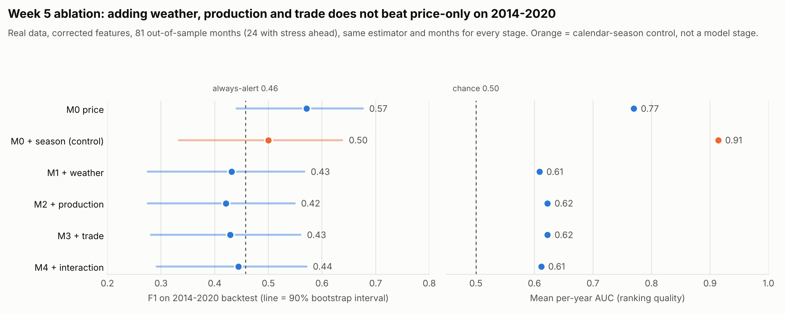

# Week 5: M0–M4 ablation (pre-test evidence)

**Branch:** `feature/workinprogress_v2`
**Prepared:** Week 5
**Status:** M1–M4 implemented and evaluated on real pre-test data (2011–2020). The protocol is frozen in `configs/week5_frozen_protocol.json`. D10, D11 and the D8 go-ahead were confirmed in Week 5 (see `DECISIONS.md`); test results are in `FINAL_TEST_RESULTS.md`.

Decisions applied: D1–D9 as recorded in `DECISIONS.md`:

- ≥10% / 3-month label;
- 2011–2017 / 2018–2020 / 2021–2022 split with purge;
- unchanged M0 estimator;
- weighted 24-oblast weather;
- 2-year annual lag with a 3-year sensitivity run.

## 1. Two feature problems found and fixed (proposed decision D10)

While building M1–M3, two Week 3 feature definitions turned out not to measure what their names say.

| Feature group | Problem (evidence) | Fix used here |
|---|---|---|
| Annual production and trade (M2, M3) | The "12-month anomaly" of an annual value repeated monthly keeps only the **sign** of the year-on-year change. Its size follows a fixed calendar pattern: 3.175 every February down to 0.289 every December, whatever the change was. Production +41% (2013) and +8% (2014) both score 3.175 in February. The feature is also undefined every January, and for trade in all of 2016, because import value was identical in 2013 and 2014. | Bounded year-on-year change of the latest available annual value: `(v_Y − v_Y−1) / ((\|v_Y\| + \|v_Y−1\|)/2)`, range −2 to 2. Same availability lag (D6). Code: `src/foodshield/features/week5.py`. |
| Weather (M1) | The "12-month anomaly" compares a month with the previous 12 months, so for temperature it mostly measures the **season**. Calendar month explains 96% of its variance for maximum temperature, 95% for minimum and 6% for precipitation. | Compare each month with the **same calendar month** in the previous 10 years (at least 5), past-only, from the 2001–2022 weighted series. |

Because the fixed features have no January or 2016 gaps, the common origin set grows from 96 to 117 months (backtest 63 → 81 months). M0's definition is unchanged; it is scored on the larger set.

The fix is recommended because the old features are wrong, not because of the scores. Both versions are reported below.

## 2. Main result (corrected features, 2-year lag)

Rolling-origin backtest on 2014–2020: 81 out-of-sample months, 24 with stress ahead, 8 episodes. Every stage uses the same Spark MLlib logistic regression and the same months. "F1 − M0" is a 90% bootstrap interval; an interval entirely below 0 means the stage is worse than M0 beyond noise.

| Stage | Features | Precision | Recall | F1 (90% interval) | F1 − M0 | False-alarm rate | Mean per-year AUC | Episodes caught |
|---|---:|---:|---:|---|---|---:|---:|---:|
| **M0** price | 2 | 0.43 | 0.83 | **0.57** (0.44–0.68) | — | 0.46 | 0.77 | 6/8 |
| M0 + season (control) | 4 | 0.50 | 0.50 | 0.50 (0.33–0.64) | −0.22 to +0.07 | **0.21** | **0.91** | 6/8 |
| M1 + weather | 5 | 0.41 | 0.46 | 0.43 (0.28–0.57) | −0.27 to −0.02 | 0.28 | 0.61 | 5/8 |
| M2 + production | 8 | 0.36 | 0.50 | 0.42 (0.28–0.55) | −0.26 to −0.05 | 0.37 | 0.62 | 4/8 |
| M3 + trade | 12 | 0.38 | 0.50 | 0.43 (0.28–0.56) | −0.26 to −0.04 | 0.35 | 0.62 | 4/8 |
| M4 + interaction | 13 | 0.40 | 0.50 | 0.44 (0.29–0.57) | −0.25 to −0.02 | 0.32 | 0.61 | 4/8 |
| Always alert | — | 0.30 | 1.00 | 0.46 | | 1.00 | | |
| Momentum rule | — | | | 0.44 | | | | |



**What this says, in plain terms**

1. **The extra signals do not help on 2014–2020.** M1–M4 are worse than price-only M0 on F1 beyond noise, and rank months less well (AUC about 0.61 vs 0.77).
2. **The calendar is the strongest single addition.** Price plus month-of-year ranks risky months best (AUC 0.91) and halves false alarms (21% vs 46%). Its F1 is not clearly different from M0, because it trades recall for precision.
3. **Weather's earlier apparent gain was the season.** With the Week 3 weather feature, M1 reached AUC 0.88; with a true weather anomaly it falls to 0.61.
4. **Too many features for the data.** Adding stages adds 3–4 features each against about 80 training months. Ranking does not improve, which is the expected pattern when signal is weak relative to sample size.

## 3. Robustness checks

**Season in every stage:** does anything beat price + season?

| Stage | F1 | F1 − (price + season) | False-alarm rate | AUC |
|---|---:|---|---:|---:|
| Price + season | 0.50 | — | 0.21 | 0.91 |
| + weather | 0.45 | −0.22 to +0.10 | 0.12 | 0.84 |
| + production | 0.57 | −0.06 to +0.20 | 0.19 | 0.84 |
| + trade | 0.49 | −0.14 to +0.11 | 0.18 | 0.82 |
| + interaction | 0.48 | −0.15 to +0.10 | 0.19 | 0.81 |

No stage beats price + season beyond noise, and ranking (AUC) drops as signals are added.

**3-year annual lag (D6 sensitivity).** M0, the season control and M1 are unchanged, since they use no annual data. With the stricter lag, M2–M4 get worse:

- corrected features: M2 F1 0.38, M3 and M4 0.26;
- season version: M2 0.48, M3 0.40, M4 0.36.

The conclusion does not change: annual signals do not add warning value here.

**Week 3 features as built (for traceability):** on 63 months, M0 0.45, season control 0.36, M1 0.38, M2 0.47, M3 0.30, M4 0.41. Every F1 − M0 interval includes 0. The AUCs of 0.86–0.88 for M1–M4 are inflated by the seasonal weather feature.

Full numbers: `data/processed/week5_ablation_lag2/` and `week5_ablation_lag3/` (`ablation_table.csv`, `ablation_report.json` with per-fold results and intervals, `backtest_predictions.csv`).

## 4. Limits

- **One country.** About 80 backtest months, 24 stress months and 8 episodes.
- **Small changes move F1 a lot.** One or two alerts shift it by about 0.05, hence the bootstrap intervals.
- **No tuning per stage.** The same L2 strength (0.1) is used for every stage, as D4 requires.
- **Same source for features and outcome.** The outcome uses the same FAOSTAT price series as the M0 inputs, strictly after each origin.
- **Approximate weather.** One NASA grid cell per oblast; area weights fixed at 2015–2020 shares. *Post-test check (D9-B):* the full 232-cell grid gives almost the same national series (correlation ≥ 0.9986 after removing the season), so this approximation is not material. See `D9_SCALE.md`.
- **Validation results are flat.** The single 2018–2020 validation split (33 months) gives F1 of 0.53–0.60 for every stage. It cannot separate the stages; the backtest is the more informative evidence.

## 5. What is frozen

`configs/week5_frozen_protocol.json` fixes:

- target, split, estimator, weather source, lags (2, plus 3 as sensitivity) and stages;
- the primary variant (`corrected`) and two robustness variants (`corrected_plus_season`, `contract_anomaly`);
- the exact feature list of every stage.

`scripts/run_final_test_once.py` will:

- stop unless `--confirm-open-test` is given;
- stop if any feature list in the code differs from the frozen file;
- write `data/processed/final_test/OPENED.json` before computing any test label, so it cannot be run twice.

Each stage is fit on 2011–2017. Its alert cutoff is chosen on 2018–2020. It then scores the real test window once: 2021-01 to 2022-10 (the last origin with a complete 3-month outcome). `--dry-run` runs the same code on pre-test stand-in windows and was checked before the test was opened; no 2021+ outcome was read.

## 6. Decisions needed before the real test

All three were confirmed as recommended in Week 5 (`DECISIONS.md`), and the test was opened once (`FINAL_TEST_RESULTS.md`).

| # | Decision | Recommendation |
|---|---|---|
| D10 | Adopt the corrected weather and annual features (Section 1) as the primary M1–M4 definition | **Adopt.** The Week 3 versions measure season and sign only. They stay as a reported robustness variant. |
| D11 | How to treat calendar season | **Keep M0 price-only as the primary baseline (D4)** and pre-register "season in every stage" as a robustness analysis. Report the season result prominently, because it is the strongest signal found. |
| D8 go | Open the real 2021–2022 test once, with the frozen protocol | Go, after D10 and D11 are confirmed. |

## 7. Data-engineering scale (D9) status

Updated status and run instructions: [`D9_SCALE.md`](D9_SCALE.md).

| Item | Status | Needed to proceed |
|---|---|---|
| A. Full FAOSTAT bulk archives in Spark | **Done.** 22.7 million rows from 3.2 GB of CSV; Ukraine values match exactly. | — (the optional detailed trade matrix is not downloaded) |
| B. Gridded NASA POWER weather over the wheat area | **Done.** 232 cells, 1.86 million daily rows. The national series correlates with the 24-point series at ≥ 0.9986, even after removing the season. | — |
| C. Daily-granularity Kafka replay | Week 6 | Choose the local Kafka runtime on Windows (Docker Desktop or native Kafka with KRaft) |
| E. Labelled synthetic scaling runs | Week 7 | Fixed pipeline slice from A/B |
| D. Multi-country wheat panel | Extension work after the core project (D13, revised at the start of Week 6) | Main route to more stress events |

## 8. Reproduce

```powershell
python scripts\run_week5_ablation.py                                                          # 2-year lag (primary)
python scripts\run_week5_ablation.py --annual-lag 3 --output data\processed\week5_ablation_lag3  # D6 sensitivity
python scripts\plot_week4_review_figures.py                                                   # figures incl. week5_ablation.png
python scripts\run_final_test_once.py --dry-run                                               # pre-test check only
```
