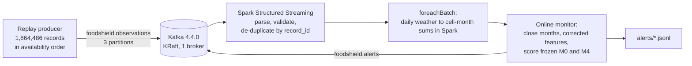

# Week 6: local Kafka replay with Spark Structured Streaming

**Branch:** `feature/workinprogress_v2`
**Decision:** D12 (confirmed at the start of Week 6): native Kafka on the project laptop; replay of the daily grid weather plus monthly price and annual records; the proposed targets; at-least-once delivery with de-duplication.
**Status:** Built and checked in the Claude workspace. Four development runs passed every check and met both targets. The laptop run, which gives the reported numbers and the demo, needs Java 17+ and the Hadoop native files installed first (Section 5).

This is the TA's required demonstration. Historical records are replayed into a local Kafka topic, Spark Structured Streaming consumes them, and stress alerts come out. It is an engineering demonstration only: it uses the already-frozen M0 and M4 models and adds no test evidence.

## 1. What runs



**Records.** Each record has the time it would have become known (`available_at`):

| Record type | Count | Source | Available at |
|---|---:|---|---|
| Daily weather (232 grid cells × 8,035 days) | 1,864,120 | NASA POWER, D9-B grid | next day, 00:00 UTC |
| Monthly real farm-gate price | 156 | FAOSTAT PP ÷ SSSU CPI | first day of the next month |
| Annual production and trade (7 measures) | 210 | FAOSTAT QCL and TCL | 1 January of data year + 2 (D6) |

**Ordering and keys.** The producer sends records in `available_at` order, with `record_id` as the tie-breaker. Weather is keyed by grid cell. Price and annual records share the key `UKR:wheat`, so each series stays in order within one partition.

**Fast-forward, then a paced window.** Before `--measure-from`, records go as fast as possible so the stream builds its history: 12 months of prices and 10 years of weather climatology. From `--measure-from` on they go at `--rate` events per second, and only that window is used for the throughput and latency measurements.

**Consumer.** A month closes when all 232 cells have every day of the month and its price has arrived. The online monitor then:

- builds the national wheat-weighted weather for the month;
- computes the 13 corrected features with the batch definitions (D10);
- scores the frozen M0 and M4 models, using the coefficients, intercepts and validation cutoffs saved by the one-time test run, with no refitting;
- writes one alert per month and stage, to a JSON-lines file and to the alert topic.

Each alert carries its score, cutoff, top three feature contributions and latency. Latency is measured from the Kafka timestamp of the month's last input to the moment the alert is written.

**Delivery (D12d).** At-least-once:

- Spark checkpoints the Kafka offsets and the de-duplication state;
- `dropDuplicatesWithinWatermark(record_id)` removes repeated records within a 45-day event-time watermark;
- the monitor state is saved with each micro-batch id, so a batch Spark re-delivers after a restart is skipped;
- an alert message can repeat after a crash; readers de-duplicate it by its `record_id`.

## 2. Checks on every run

`scripts/run_week6_replay.py` writes `week6_report.json` with these checks:

| Check | What it shows |
|---|---|
| Every unique record processed once | Processed counts by type equal the producer's unique counts |
| Duplicates removed | Kafka input rows minus processed rows equal the duplicates the producer sent |
| Streamed weather equals the D9-B batch series | The national monthly weather built in the stream matches the Spark batch job (within the 4-decimal CSV rounding) |
| Streamed alerts equal the offline reference | Feeding the same records straight into the monitor (no Kafka, no Spark) gives the same alerts and scores |
| M0 scores equal the frozen test | Streamed M0 scores for 2021-01 to 2022-10 equal the one-time test run's scores |
| Alert topic complete | Every alert reached the Kafka alert topic |
| Rate achieved, p95 latency within target | Paced runs only |

## 3. Runs

| Run | Command options | What it tests |
|---|---|---|
| `full_max` | `--duplicate-fraction 0.01` | All 1,864,486 records as fast as possible, with 1% re-sent: capacity, completeness, de-duplication, correctness |
| `restart` | `--kill-consumer-after-batches 60` | Hard-kills the Spark consumer process mid-run and restarts it on the same checkpoint |
| `paced_250` | `--replay-from 2011-01-01 --measure-from 2022-01-01 --rate 250` | Burst target: all of 2022 at 250 events/s |
| `paced_100` | `--replay-from 2011-01-01 --measure-from 2022-01-01 --rate 100` | Sustained target: all of 2022 at 100 events/s |

The paced runs start in 2011, so the 2022 window still has more than 10 years of weather history and 12 months of prices. Before 2016 they produce fewer M4 alerts than a full replay, because weather climatology needs 5 years. The offline reference uses the same records, so the comparison stays like for like.

## 4. Laptop results (reported)

The reported runs (D12) ran on the team laptop: Windows 11, 16 cores, Java 21, Python 3.12, PySpark 4.3.0. Every check passed in all four runs. Full tables, with the workspace runs beside them: `WEEK6_LAPTOP_RESULTS.md`.

| Run | Laptop result |
|---|---|
| Full speed, 1% re-sent | 6,610 events/s sent, 6,442/s processed; 18,582 of 18,582 duplicates removed; alert p95 3.7 s |
| 100 events/s | 100.0/s for 849 s; alert p50 2.4 s, p95 2.9 s; target met |
| 250 events/s | 250.0/s for 340 s; alert p50 2.1 s, p95 3.1 s; target met |
| Hard restart (consumer killed after batch 60) | 239,011-record backlog cleared from the checkpoint; nothing lost or double-counted; alert p95 21.4 s, from the alerts due while the consumer restarted |
| Demo rehearsal (2022 at 1,000/s, replay from 2016) | All checks passed; 3.0 minutes end to end; M4 agrees with the frozen test on 20 of 22 months, as expected for a replay from 2016 |

Alert latency at the target rates was about one second higher than on the 2-core workspace, because each micro-batch took longer (626 against 968 micro-batches in the 849 s window at 100/s). Streamed M0 equalled the one-time test on all 22 months in every run.

**Windows fixes found by the laptop run** (all in the code now): the Python launcher arguments in `week6_laptop.ps1`; atomic writes that retry while another process briefly holds the file (`src/foodshield/streaming/winsafe.py`); one Kafka data folder per run; consumer and broker stopped as process trees; leftover Java processes of this project stopped before the runs.

## 4a. Results (development runs)

**Machine:** Claude cloud workspace, Linux, 2 CPU cores, 7 GB RAM. Java 21, Python 3.13, PySpark 4.3.0, Kafka 4.4.0 (one broker, 512 MB heap), Spark `local[2]` with a 1 GB driver, a 1-second trigger and at most 200,000 offsets per trigger.

Under D12a, the numbers to report are the laptop runs. These development runs show that the pipeline works and give a first measurement.

**Correctness: every check passed in every run.**

| Run | Messages | Unique records | Duplicates removed | Micro-batches | Alerts | Checks |
|---|---:|---:|---:|---:|---:|---|
| `full_max` | 1,883,068 | 1,864,486 | 18,582 of 18,582 | 278 | 288 (144 months × M0, M4) | all passed |
| `restart` | 1,864,486 | 1,864,486 | — | 207, one hard restart | 288 | all passed |
| `paced_250` | 1,017,324 | 1,017,324 | — | 456 | 217 | all passed |
| `paced_100` | 1,017,324 | 1,017,324 | — | 968 | 217 | all passed |

In every run:

- the processed counts by record type equal what was sent, and no day was counted twice;
- the streamed national weather equals the D9-B Spark batch series to within its 4-decimal rounding (largest difference 0.00005);
- streamed alerts equal the offline reference (largest score difference 1×10⁻¹⁶);
- streamed M0 scores for 2021-01 to 2022-10 equal the frozen one-time test scores (difference 3×10⁻¹⁶, 22 of 22 alerts the same).

Streamed M4 agrees with the frozen test on 21 of 22 months (largest score difference 0.013). The stream uses the 232-cell grid weather, while the frozen model was scored on the 24-point series. D9-B showed the two series are almost identical, so one borderline month flips.

**Throughput and latency against the D12c targets:**

| Run | Offered rate | Achieved (producer) | Consumer processed | Largest backlog | Alert latency p50 / p95 / max | Target |
|---|---:|---:|---:|---|---|---|
| `full_max` | max | 5,003 events/s | 4,914 events/s | 72,301 records | 1.9 / 2.6 / 3.0 s (144 months) | capacity, no target |
| `restart` | max | 5,024 events/s | 4,983 events/s | 219,489 records while the consumer was down; cleared after restart | 2.2 / 3.3 / 3.9 s | — |
| `paced_250` | 250 events/s | 250.0 events/s for 340 s | kept up | 2,669 records, left over from the fast-forward | 1.2 / 1.9 / 2.3 s (13 months) | ≥ 250/s burst, p95 ≤ 10 s: **met** |
| `paced_100` | 100 events/s | 100.0 events/s for 849 s | kept up | 6,354 records, left over from the fast-forward | 1.4 / 1.7 / 2.1 s (13 months) | ≥ 100/s sustained, p95 ≤ 10 s: **met** |

What this means:

- The burst and sustained targets were met with a wide margin. Even at full speed the 2-core machine moved about 5,000 events per second, 20 times the burst target, and kept alert latency under 3 seconds.
- The producer limits full-speed throughput. kafka-python is pure Python and sends with one request in flight to keep order. Spark processed each micro-batch of about 8,000 records in about 1 second (median 1.0 s, largest 7.3 s).
- Latency is mostly the 1-second trigger plus one micro-batch. A month's alert follows its last input by about 1–3 s.
- After a hard kill, Spark resumed from its checkpoint. The backlog built while the consumer was down (about 220,000 records) cleared, and no record was lost or counted twice.

**Limits:**

- One machine and one broker, with no repeats yet; the Week 7 scaling series repeats runs and varies settings.
- Kafka message timestamps come from the same machine's clock, so latency is end-to-end on one host.
- Alerts for 2011–2020 are in-sample for the frozen models.
- The paced runs fast-forward through history first. Only the 2022 window is measured.

## 5. Run it on the laptop

**One-time setup:**

1. **Java 17 or later.** None is installed on the project laptop. Install Eclipse Temurin 21 (LTS) from [adoptium.net](https://adoptium.net/temurin/releases/?version=21&os=windows&arch=x64) with the MSI installer, or run `winget install EclipseAdoptium.Temurin.21.JDK`. Both Kafka 4.x and Spark 4.3 need it.
2. **Hadoop 3.5.0 Windows native files.** Spark needs `winutils.exe` and `hadoop.dll` to write streaming checkpoints on Windows. Copy Bharath's build (see `PREREQUISITES.md`) to a short path, for example `C:\hadoop\bin\`, then run `setx HADOOP_HOME C:\hadoop` and open a new PowerShell window.
3. **Kafka and the connector.** Already in the `Kafka` folder: `kafka_2.13-4.4.0.tgz` (SHA-512 checked against Apache) and the four connector jars (SHA-1 checked against Maven Central). Nothing to install; the script unpacks Kafka itself.

**Run.** From the repository folder in PowerShell:

```powershell
powershell -ExecutionPolicy Bypass -File scripts\week6_laptop.ps1
```

The script:

- checks Java, `HADOOP_HOME` and the input files;
- installs `requirements.txt` with Python 3.12 (`pyspark==4.3.0`, `kafka-python==3.0.13`);
- runs the four runs described in Section 3, with Kafka data and Spark checkpoints in `C:\fs6`, a short path without spaces.

It takes about 45–60 minutes in total (about 40 minutes of replay on this 2-core workspace, plus setup). Each report lands in `data\processed\week6_streaming\laptop_<run>\week6_report.json`.

**After the runs:** `python scripts\apply_laptop_results.py`. It writes `laptop_summary.csv`/`.json`, `docs/WEEK6_LAPTOP_RESULTS.md` (laptop next to workspace runs, plus the text for the report's and the slides' laptop cells) and rebuilds the dashboard. It exits with 1 if a run is missing and 2 if a run failed a check.

**Single run:**

```powershell
py -3.12 scripts\run_week6_replay.py --name demo --work-root C:\fs6 --replay-from 2011-01-01 --measure-from 2022-01-01 --rate 250
```

**Windows specifics handled by the code:**

- Kafka is started with `java` directly, not through the `.bat` scripts. Those scripts break on paths with spaces, and their stop script needs `wmic`, which recent Windows 11 versions no longer include.
- Retention is unlimited, so Kafka never deletes log files during a run. File deletion is the fragile part of Kafka on Windows.
- Every run starts from a fresh data folder.
- The broker listens on 127.0.0.1 only.

## 6. Files

| Path | Purpose |
|---|---|
| `configs/week6_streaming.local.json` | Topics, Kafka, Spark, streaming, inputs, frozen-model source, targets |
| `src/foodshield/streaming/records.py` | Replay records and envelope |
| `src/foodshield/streaming/producer.py` | Paced producer, duplicate injection |
| `src/foodshield/streaming/spark_job.py` | Structured Streaming query and `foreachBatch` |
| `src/foodshield/streaming/monitor.py` | Online monitor (month closing, features, scoring, state) and offline reference |
| `src/foodshield/streaming/kafka_local.py` | Local KRaft broker start/stop, topics |
| `scripts/run_week6_replay.py` | One-command run, checks and report |
| `scripts/run_week6_consumer.py` | Consumer process (started by the run script) |
| `scripts/week6_laptop.ps1` | Laptop setup check and the four runs |
| `data/processed/week6_streaming/<run>/` | `week6_report.json`, `alerts.csv` (shared) |
| `data/interim/week6/` or `--work-root` | Kafka data, checkpoints, state, logs (local only) |
