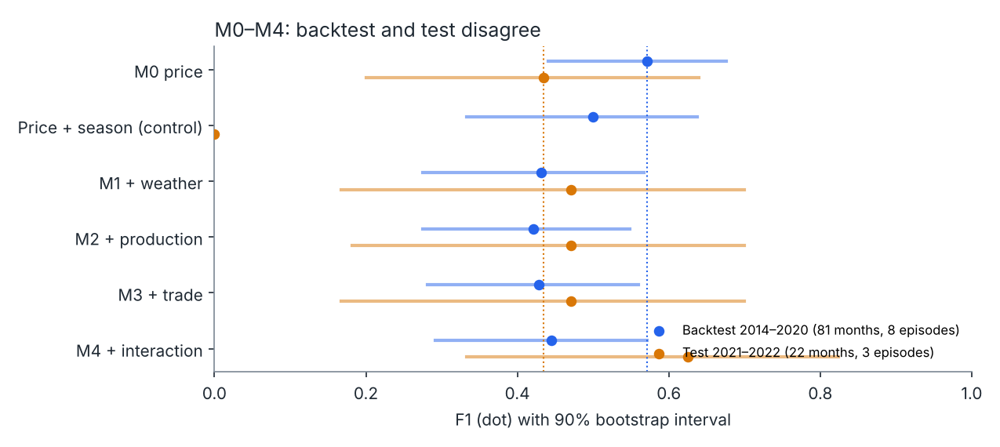
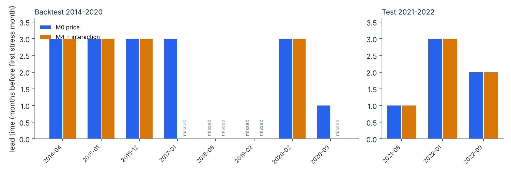
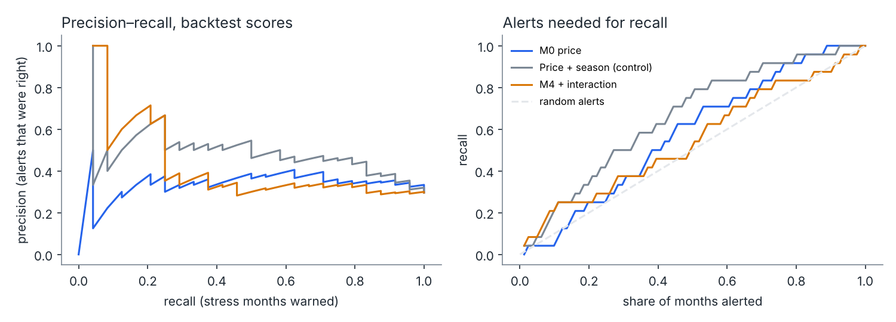
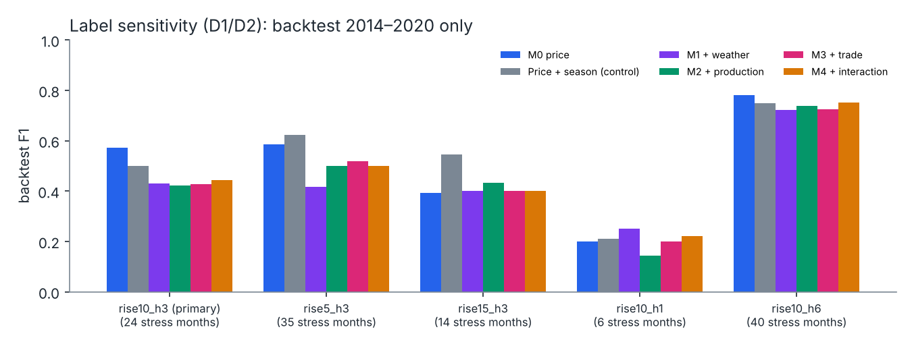

# Week 7: model evaluation (M0–M4, Ukraine)

**Branch:** `feature/workinprogress_v2` · **Prepared:** Week 7
**Script:** `scripts/run_week7_model_evaluation.py` → `data/processed/week7_model_evaluation/` and `docs/figures/week7_model_*.png`

This brings together the Week 5 backtest and the one-time 2021–2022 test. It also adds analyses that use only pre-test data: lead times, the threshold trade-off, probability quality and label sensitivity. No test-period label was computed for this report; the test numbers come from the one-time run.

## 1. Headline

**Setup:** label ≥10% real price rise within 3 months; corrected features; 2-year annual lag; one Spark MLlib logistic regression for every stage.

**Data:**

| Window | Months | Months with stress ahead | Episodes |
|---|---:|---:|---:|
| Backtest 2014–2020 | 81 | 24 (30%) | 8 |
| Test 2021–2022 | 22 | 5 (23%) | 3 |

| Stage | Backtest F1 (90% interval) | F1 − M0, backtest | Backtest false alarms | Backtest episodes | Test F1 (90% interval) | F1 − M0, test | Test false alarms | Test episodes |
|---|---|---|---:|---:|---|---|---:|---:|
| **M0** price | **0.57** (0.44–0.68) | — | 0.46 | 6/8 | 0.43 (0.20–0.64) | — | 0.76 | 3/3 |
| Price + season (control) | 0.50 (0.33–0.64) | −0.22 to +0.07 | **0.21** | 6/8 | 0.00 | −0.64 to −0.20 | 0.00 | 0/3 |
| M1 + weather | 0.43 (0.28–0.57) | −0.27 to −0.02 | 0.28 | 5/8 | 0.47 | −0.14 to +0.18 | 0.47 | 3/3 |
| M2 + production | 0.42 (0.28–0.55) | −0.26 to −0.05 | 0.37 | 4/8 | 0.47 | −0.15 to +0.19 | 0.47 | 3/3 |
| M3 + trade | 0.43 (0.28–0.56) | −0.26 to −0.04 | 0.35 | 4/8 | 0.47 | −0.14 to +0.18 | 0.47 | 3/3 |
| **M4** + interaction | 0.44 (0.29–0.57) | −0.25 to −0.02 | 0.32 | 4/8 | **0.62** (0.33–0.82) | **+0.08 to +0.32** | **0.35** | 3/3 |
| Always alert | 0.46 | | 1.00 | | 0.37 | | 1.00 | |
| Momentum rule (price rose last month) | 0.43 | | | | 0.37 | | | |

**Note on the test intervals.** They are now recomputed by the script with the published method (2,000 bootstrap resamples, seed 20261107). The earlier values in `FINAL_TEST_RESULTS.md` were computed outside a script, with a different resampling order. The two differ by at most 0.023 and no conclusion changes; the scripted values are the reproducible ones.

**What it says:**

1. **The two evaluations point in opposite directions.**
   - On 2014–2020, every added signal made F1 worse than price-only M0 beyond noise.
   - On 2021–2022, M4 beat M0 beyond noise.
   - With 11 episodes in total, neither result is strong enough to overrule the other. The defensible statement is that multi-signal models did not *consistently* beat price-only monitoring for Ukraine.
2. **Price-only M0 is only modestly better than trivial rules.** On the backtest, F1 0.57 against 0.46 for alerting every month and 0.43 for "the price rose last month".
3. **Calendar season is the strongest single signal on the backtest, and it broke in the test.** It halved false alarms on 2014–2020 but raised no alerts at all in 2021–2022.

## 2. Episodes and lead time

| Episode (stress ahead) | First stress month | M0 | M4 |
|---|---|---|---|
| 2014-01 to 2014-03 | 2014-04 | 3 months ahead | 3 months ahead |
| 2014-10 to 2015-01 | 2015-01 | 3 | 3 |
| 2015-09 to 2015-12 | 2015-12 | 3 | 3 |
| 2016-10 to 2016-12 | 2017-01 | 3 | missed |
| 2018-07 | 2018-08 | missed | missed |
| 2018-12 | 2019-02 | missed | missed |
| 2019-11 to 2020-03 | 2020-02 | 3 | 3 |
| 2020-07 to 2020-09 | 2020-09 | 1 | missed |
| **Test** 2021-07 to 2021-08 | 2021-08 | 1 | 1 |
| **Test** 2021-10 | 2022-01 | 3 | 3 |
| **Test** 2022-07 to 2022-08 | 2022-09 | 2 | 2 |

- **Lead time.** When an episode is caught, the warning is usually 3 months ahead, the most a 3-month label allows. Lead time is capped by the horizon (D2), so the useful comparison is caught versus missed.
- **Missed by both models:** the two one-month episodes of 2018, which are short and isolated.
- **Missed by M4 but caught by M0:** two backtest episodes (2017-01 and 2020-09). That is why M4 catches fewer backtest episodes than M0.

## 3. Threshold trade-off (backtest only)

Alert cutoffs are chosen by best F1 (D4). To see what other cutoffs would give, precision and recall were traced over every cutoff on the pooled out-of-sample backtest scores (2014–2020; no test data):

| Model | Best precision while catching ≥80% of stress months | Stress months caught when alerting in ≤30% of months | … in ≤50% of months |
|---|---:|---:|---:|
| M0 price | 0.35 | 33% | 62% |
| Price + season | 0.44 | 50% | 75% |
| M4 | 0.33 | 38% | 50% |

No cutoff gives both high recall and high precision. Catching 80% of stress months means about two false alarms for every correct alert. That is the practical cost of an early-warning rule built on this data.

## 4. Probability quality (backtest)

The Brier score is the mean squared error of the predicted probability; lower is better. Always predicting the backtest base rate (30%) scores **0.209**.

| Stage | Brier |
|---|---:|
| M0 | 0.204 |
| Price + season | **0.183** |
| M1 | 0.210 |
| M2 | 0.205 |
| M3 | 0.209 |
| M4 | 0.210 |

The M0–M4 probabilities score about the same as the base rate on 2014–2020. Only price + season clearly improves on it. The models rank months a little (per-year AUC 0.61–0.77), but their probabilities should not be read as calibrated risks.

## 5. Robustness (pre-registered)

| Check | Backtest | Test |
|---|---|---|
| 3-year annual lag (D6) | M2–M4 worse (M2 0.38, M3 and M4 0.26) | Best stage changes: M3 0.62, M4 0.46 |
| Season in every stage (D11) | No stage beats price + season beyond noise | All stages weaker; price + season raises no alerts |
| Week 3 features as built | Every F1 − M0 interval includes 0; AUC inflated by seasonal weather | On 20 months (these features have gaps): M0 0.47, M1–M4 0.20–0.42 |

Details: `WEEK5_ABLATION.md` §3 and `FINAL_TEST_RESULTS.md` §2; numbers are in `data/processed/week7_model_evaluation/robustness.csv`.

## 6. Label sensitivity (D1, D2)

D1 and D2 kept 5% and 15% rises and 1- and 6-month horizons as sensitivity checks. Here they are run at model level on the 2014–2020 backtest only: the same estimator, folds and cutoff rule, with no test data. Command: `run_week5_ablation.py --rise-pct … --horizon … --variants corrected`; outputs are in `data/processed/week7_label_sensitivity/`.

| Label | Stress months / episodes | M0 F1 | M1 | M2 | M3 | M4 | Price + season | Always alert |
|---|---|---:|---:|---:|---:|---:|---:|---:|
| **≥10% in 3 months (primary)** | 24 / 8 | **0.57** | 0.43* | 0.42* | 0.43* | 0.44* | 0.50 | 0.46 |
| ≥5% in 3 months | 35 / 11 | 0.58 | 0.42* | 0.50* | 0.52 | 0.50 | **0.62** | 0.60 |
| ≥15% in 3 months | 14 / 6 | 0.39 | 0.40 | 0.43 | 0.40 | 0.40 | **0.55** | 0.29 |
| ≥10% in 1 month | 6 / 5 | 0.20 | 0.25 | 0.14 | 0.20 | 0.22 | 0.21 | 0.13 |
| ≥10% in 6 months | 40 / 9 | **0.78** | 0.72 | 0.74 | 0.73 | 0.75 | 0.75 | 0.68 |

\* worse than M0 beyond noise (the 90% interval of F1 − M0 is entirely below 0). No stage is better than M0 beyond noise under any label.

**What it says:**

- **The main backtest finding does not depend on the label choice.** Under every definition, adding weather, production or trade does not beat price-only monitoring on 2014–2020.
- **A 1-month horizon is too short to warn.** Every stage catches 1–2 of 5 episodes.
- **A 6-month horizon makes everything look better,** but only because stress becomes common (40 of 78 months): alerting every month already scores 0.68.
- **Season helps most at the rarer, larger 15% threshold.** Its interval, −0.002 to +0.305, just touches 0.

These checks support keeping D1 and D2 unchanged.

## 7. Limits

- **One country and few events:** 8 backtest and 3 test episodes. One alert more or less moves F1 by up to 0.03 (backtest) or 0.1 (test).
- **Short histories:** the backtest's early folds train on 3–4 years.
- **Same source for features and outcome:** the outcome uses the same FAOSTAT price series as the M0 inputs, strictly after each origin.
- **2022 is unusual:** the stress months follow a 43% fall in the real price after the February 2022 invasion.
- **The planned extension:** a multi-country panel (D13) is the way to more events.
