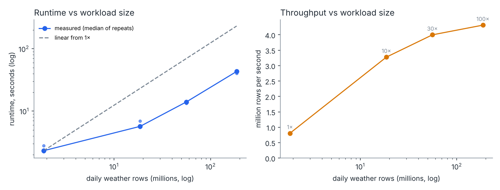
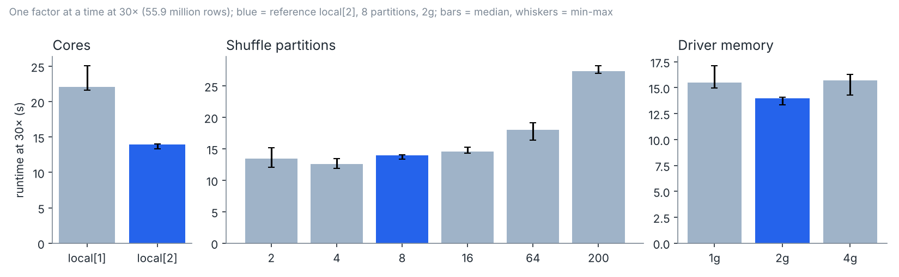
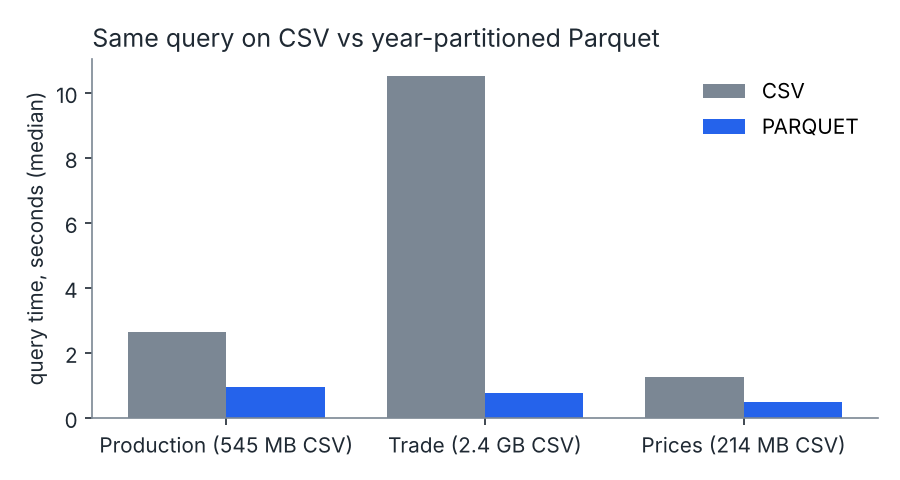
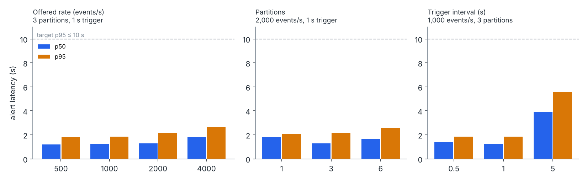

# Week 7: scalability (batch and streaming)

**Branch:** `feature/workinprogress_v2` · **Run:** Week 7 · **Protocol:** `SCALABILITY_EXPERIMENT.md`
**Batch script:** `scripts/run_week7_batch_scaling.py` → `data/processed/week7_batch_scaling/` (`runs.jsonl` holds every run, `summary.json`/`.csv` the medians)
**Streaming script:** `scripts/run_week6_replay.py` → `data/processed/week6_streaming/s7_*/`

**Machine:**

| Item | Value |
|---|---|
| Hardware | Claude cloud workspace, Linux, 2 CPU cores, 8.4 GB RAM |
| Software | Python 3.13, Java 21, PySpark 4.3.0 in local mode |
| Spark settings | Adaptive query execution off, so the configured shuffle partition count is what runs |
| Mode | Single-machine scaling only; no cluster was used |

## 1. Batch

**Pipeline slice (fixed).** The D9-B weather aggregation, in two timed stages:

1. read daily cell weather from Parquet → aggregate to monthly per cell → write Parquet;
2. read the cell-months → join the wheat-area weights → national monthly → write Parquet.

**Workloads.** Labelled, benchmark-only synthetic expansions of the real 1,864,120-row daily grid file:

- factor k makes k copies with a `benchmark_series` id;
- series 0 is the real data unchanged, so every run is checked against the D9-B batch output;
- the other copies add seeded noise (seed 20261107);
- they are never used for modelling or food-market conclusions.

| Factor | Rows | Parquet on disk | Generation |
|---:|---:|---:|---:|
| 1× | 1,864,120 | 12 MB | 4 s |
| 10× | 18,641,200 | 431 MB | 13 s |
| 30× | 55,923,600 | 1.29 GB | 26 s |
| 100× | 186,412,000 | 4.29 GB | 83 s |

**Method.** Each configuration runs in a fresh Spark process: one warm-up run, then 3 timed runs, reporting the median with min–max. Shuffle and spill bytes come from Spark's own metrics API.

**Checks, in all 12 configurations:**

- output row counts are exact (61,248 × k cell-months, 264 × k national months);
- series 0 matches the D9-B result to within its 4-decimal CSV rounding.

### 1.1 Workload size (reference: `local[2]`, 8 shuffle partitions, 2 GB driver)

| Factor | Rows | Median runtime (min–max) | Throughput | Shuffle written | Spill |
|---:|---:|---|---:|---:|---:|
| 1× | 1.9 M | 2.32 s (2.23–2.79) | 0.80 M rows/s | 1.9 MB | 0 |
| 10× | 18.6 M | 5.69 s (5.51–6.97) | 3.28 M rows/s | 23 MB | 0 |
| 30× | 55.9 M | 13.98 s (13.34–14.06) | 4.00 M rows/s | 66 MB | 0 |
| 100× | 186.4 M | 43.21 s (40.45–44.37) | 4.31 M rows/s | 216 MB | 0 |

- **Small workloads are dominated by fixed cost.** At 1× most of the 2.3 s is job start-up and file handling, so 100 times the data takes only 19 times as long.
- **From 30× up, runtime grows almost in proportion to data.** 3.3× more data took 3.1× longer, and throughput levels off at about 4.3 million rows per second on 2 cores.
- **Warm-up matters.** The first run in each fresh process was 1.3–4× slower (for example 9.4 s vs 2.3 s at 1×) while the JVM warms up. That is why warm-up runs are excluded.
- **No configuration spilled to disk.** The aggregation shrinks the data early (186 million daily rows become 6.1 million cell-months).

### 1.2 One factor at a time (30×, 55.9 million rows)

| Factor | Setting | Median runtime | vs reference |
|---|---|---:|---:|
| Cores | `local[1]` | 22.12 s | 0.63× |
| | **`local[2]` (reference)** | **13.98 s** | 1.00× |
| Shuffle partitions | 2 | 13.47 s | 1.04× |
| | 4 | **12.56 s** | **1.11×** |
| | **8 (reference)** | 13.98 s | 1.00× |
| | 16 | 14.59 s | 0.96× |
| | 64 | 18.03 s | 0.78× |
| | 200 (Spark default) | 27.35 s | 0.51× |
| Driver memory | 1 GB | 15.52 s | 0.90× |
| | **2 GB (reference)** | 13.98 s | 1.00× |
| | 4 GB | 15.71 s | 0.89× |

- **Cores.** Two cores are 1.58× faster than one: a parallel efficiency of 79%. The machine has only 2 cores, so this is the only core comparison possible here. The laptop can extend it.
- **Shuffle partitions matter most.** Spark's default of 200 partitions is 2.2 times slower than the best setting (4). Each partition is a task with fixed overhead, and here only about 66 MB is shuffled. For this workload, partitions should be about 2–4 per core, or adaptive query execution should be left on so Spark merges small partitions itself.
- **Memory is not the constraint.** Nothing spilled at 1, 2 or 4 GB. Both 1 GB and 4 GB ran 11–12% slower than 2 GB, outside the 2 GB min–max range, so more memory did not help; the small difference is not caused by memory pressure.

### 1.3 CSV vs Parquet on the real FAOSTAT archives (no synthetic data)

Same query as D9-A (all-country wheat rows, 2010–2022). The time includes opening the dataset each time. Median of 3 after a warm-up:

| Domain | CSV | Parquet (year-partitioned) | Speed-up |
|---|---:|---:|---:|
| Production (QCL, 4.2 M rows, 545 MB CSV) | 2.64 s | 0.95 s | 2.8× |
| Trade (TCL, 17.1 M rows, 2.4 GB CSV) | 10.51 s | 0.75 s | **14×** |
| Prices (PP, 1.3 M rows, 214 MB CSV) | 1.27 s | 0.49 s | 2.6× |

The single D9-A run reported 7–44× because it timed only the query on an already-opened dataset. Including the open, which costs about half a second for Parquet, is the fairer comparison. The gain grows with file size: Parquet reads only the needed year folders and columns.

## 2. Streaming

**Setup.** The Week 6 replay (Kafka 4.4.0, one KRaft broker; Spark Structured Streaming `local[2]`):

- records from 2016-01 are sent fast to build the 5+ years of history the features need;
- all of 2022 (84,939 records, 13 alert months) is then sent at a fixed rate and measured;
- one factor is changed at a time; every run is a fresh broker and checkpoint;
- the run checks from Week 6 (exact-once processing of unique records, alerts equal the offline reference, M0 equals the frozen test, alert topic complete, rate achieved) are applied to every run.

Summary table: `data/processed/week6_streaming/week7_series_summary.csv`.

| Varied | Setting | Achieved rate | Micro-batches | Alert latency p50 / p95 / max | Checks |
|---|---|---:|---:|---|---|
| Offered rate (3 partitions, 1 s trigger) | 500/s | 500.0/s | 227 | 1.20 / 1.81 / 1.99 s | all passed |
| | 1,000/s | 1,000.0/s | 141 | 1.26 / 1.87 / 2.26 s | all passed |
| | 2,000/s | 1,999.8/s | 98 | 1.30 / 2.19 / 2.51 s | all passed |
| | 4,000/s | 3,996.3/s | 79 | 1.83 / 2.68 / 2.92 s | all passed |
| Partitions (2,000/s, 1 s trigger) | 1 | 1,999.7/s | 85 | 1.82 / 2.07 / 2.14 s | all passed |
| | 3 | 1,999.8/s | 98 | 1.30 / 2.19 / 2.51 s | all passed |
| | 6 | 1,999.9/s | 104 | 1.65 / 2.56 / 3.14 s | all passed |
| Trigger (1,000/s, 3 partitions) | 0.5 s | 1,000.0/s | 161 | 1.40 / 1.86 / 1.86 s | all passed |
| | 1 s | 1,000.0/s | 141 | 1.26 / 1.87 / 2.26 s | all passed |
| | 5 s | 1,000.0/s | 39 | 3.89 / 5.59 / 5.68 s | all passed |

**What it says:**

- **Targets met with a wide margin.** The targets were ≥100 events/s sustained, ≥250 burst and p95 ≤10 s. Spark kept up with every offered rate up to 4,000 events/s, 16 times the burst target, and the alert p95 stayed under 2.7 s.
- **The limit on this machine is the producer, not Spark.** The pure-Python Kafka producer peaks at about 5,000 events/s while sharing 2 cores with the broker and Spark; at full speed the consumer processed 4,914/s (Week 6). Spark was not saturated at any tested rate. A faster client, or more cores, would be needed to find Spark's ceiling.
- **Latency is set by the trigger interval and one micro-batch.**
  - With a 1 s trigger, a month's alert follows its last input by about 1.2–1.8 s (median).
  - A 5 s trigger cuts micro-batches by 72% but raises latency to the trigger length.
  - 0.5 s gives no gain, because each micro-batch already takes about 1 s to process.
- **M4 agreement depends on the replay start.** These runs replay from 2016, so the weather comparison has fewer earlier years than the frozen model's features: streamed M4 matches the frozen test on 20 of 22 months (largest score difference 0.064), against 21 of 22 for the Week 6 runs that replay from 2011. M0 matches exactly in every run.
- **Partitions make little difference on 2 cores.** More than about one partition per core adds tasks without adding parallelism. With 6 partitions, p95 was slightly higher.

The development numbers above come from the Claude workspace. The reported laptop runs (D12; Windows 11, 16 cores) met both targets with alert p95 of 2.9 s at 100/s and 3.1 s at 250/s, and sent 6,610 events/s at full speed (`WEEK6_LAPTOP_RESULTS.md`).

## 3. Limits

- **One machine, 2 cores.** These results show single-machine scaling, not cluster scale-out.
- **Disk caching.** Repeated runs may read input from the operating system's file cache. This is likely for the smaller workloads; the 4.3 GB workload is half the RAM.
- **Synthetic copies.** The larger workloads are noisy copies of real data. They have the real schema and key structure, but they are not new information.
- **The laptop repeat.** Tried: 1×, 10× and 30× ran (median 3.5 s, 6.9 s and 14.6 s), then the 100× run stopped with a Java direct-memory error at the 2 GB setting. It needs a memory fix before it can be reported. Repeating the series on the project laptop would add a second machine: `run_week7_batch_scaling.py --phase all --output-suffix _laptop` writes to `data/processed/week7_batch_scaling_laptop/` and `docs/figures/*_laptop.png`, so the workspace series is kept. `apply_laptop_results.py` then puts the two side by side.
